# 实验报告

## 实验基本信息

| 项目 | 内容 |
|------|------|
| **实验名称** | Lab 1: 比麻雀更小的麻雀（最小可执行内核） |
| **小组成员** | 2512163-李思翰、2512436-郭睿彤、2512130-刘婕 |
| **完成日期** | 2026-10-09 |

### 小组分工

| 成员 | 负责的练习/模块 |
|------|----------------|
| 2512163-李思翰 | 练习1（内核启动中的程序入口操作分析）；撰写实验目的与实验整体逻辑分析 |
| 2512436-郭睿彤 | 练习2（GDB 验证启动流程）；第五部分测试与验证及全部截图取证 |
| 2512130-刘婕 | 报告整合与交付：实验环境、实验内容与实现总装、总结收获、prompt 汇总、Git 提交推送 |

### 交付与仓库结构

- 分支：`lab1`
- `code/`：最小可执行内核完整源码快照
- `report/`：`report.md`、`prompt.md`、`images/`

---

## 一、实验目的

<!-- 由 2512163-李思翰 撰写 -->

本实验的主要目的是：

1. 理解最小可执行内核的组成与边界，明确内核、bootloader 与固件三者的职责划分。
2. 掌握 RISC-V 从加电复位到进入内核第一条指令的完整启动流程，能解释每一段跳转的地址依据与功能。
3. 理解链接脚本对内核内存布局的作用，掌握 ELF 与裸二进制镜像的区别及转换方法。
4. 学习从裸 `ecall` 出发，自底向上构建 `cprintf` 格式化输出函数的分层封装思路。
5. 掌握使用 GDB 远程调试 QEMU 内核的方法，将"观察到的证据"与"推断的结论"严格区分。
6. 学习使用 AI 工具辅助理解与验证操作系统底层机制，并按规范记录提示词与迭代过程。

---

## 二、实验环境

### AI 编程工具

| 成员 | AI 编程工具 | 底层模型 | 备注 |
|------|------------|---------|------|
| 2512163-李思翰 | Codex CLI | gpt-6.1-sol | 用于练习1 的入口汇编分析与知识点梳理 |
| 2512436-郭睿彤 | Codex CLI | gpt-6.1-sol | 用于练习2 的调试脚本组织与报告段落整理 |
| 2512130-刘婕 | Codex CLI | gpt-6.1-sol | 用于报告整合、prompt 规范整理与交付核对 |

**说明：**
- **AI 编程工具**：本组统一使用终端形态的 Codex CLI 作为 AI 协作工具。
- **底层模型**：本组统一使用 `gpt-6.1-sol` 模型。
- **实际使用情况**：Lab1 的基础代码已由实验指导书提供，因此 AI 工具的协作重点不是从零生成内核，而是**代码理解、调试过程组织、证据核对与报告规范化**。所有提交到本报告的运行结果、寄存器数值与截图均来自实际执行，未使用 AI 生成或推测的运行数据。

### 硬件与软件环境

| 项目 | 配置 |
|------|------|
| 开发平台 | VMware Workstation Pro 虚拟机中的 Ubuntu |
| 交叉工具链 | `riscv64-unknown-elf-gcc` (GCC 16.1.0) |
| 模拟器 | `qemu-system-riscv64` (QEMU 4.1.1) |
| 调试器 | `riscv64-unknown-elf-gdb`（随交叉工具链安装） |
| 固件 | QEMU 内置 OpenSBI v0.4（Runtime SBI Version 0.1） |
| 目标机器 | QEMU virt 机型，RV64 单 hart |

---

## 三、实验整体逻辑分析

<!-- 由 2512163-李思翰 撰写 -->

### 3.1 本章节的逻辑主线

本章围绕"**一个程序如何在没有任何操作系统的情况下获得控制权**"这一核心问题展开。Lab1 不实现任何高级功能，只完成两件事：

1. **实现一个能在 QEMU 上跑起来的最小可执行内核**——它在屏幕上输出一行启动信息。
2. **完整解释这个内核从加电到输出的每一步为什么是这样**。

因此本章的逻辑主线是**自底向上的启动链**：从硬件复位开始，逐级向上移交控制权，直到内核用最底层的系统调用接口输出第一条信息。

### 3.2 功能的逐步实现

整个启动链按"控制权逐级移交"的顺序组织，顺序不可交换，因为每一段都依赖上一段提供的前提：

1. **硬件复位（`0x1000`）——提供起点**
   CPU 上电后硬件强制把 PC 置为复位地址，首先执行 QEMU 内置的 MROM 代码，将各部件置初始状态并启动 bootloader。没有这一步，CPU 不知道从哪里开始。

2. **固件引导（`0x80000000`）——提供加载能力**
   操作系统无法自己把自己从磁盘装进内存（不能拽着头发把自己拽离地面），必须有一个已在内存中运行的程序来完成。OpenSBI 运行在 M 模式，直接操作硬件，把内核镜像加载到物理内存 `0x80200000`。

3. **控制权移交（`0x80200000`）——提供内核入口**
   OpenSBI 跳转时同时把特权级从 M 模式降为 S 模式。从此 CPU 开始执行内核的第一条指令 `kern_entry`，证明控制权已移交给内核。这一步的地址由 QEMU 的内存布局决定，必须与链接脚本中的 `BASE_ADDRESS` 一致。

4. **建立最小运行环境（`entry.S`）——提供 C 语言执行条件**
   汇编不能直接调用 C 函数，且 C 函数的局部变量、调用栈都依赖栈。所以入口汇编先做两件事：设置内核栈指针 `sp`，然后 `tail` 跳转到 C 入口 `kern_init`。

5. **内核初始化（`kern_init`）——提供可见输出**
   清除 `.bss` 段（因其只记录大小和位置、不记录内容），然后调用 `cprintf` 输出启动信息，最后进入无限循环。

6. **自底向上构建输出能力（`cprintf`）——提供可用工具**
   从 QEMU 内置固件提供的"输出单个字符"接口（`SBI_CONSOLE_PUTCHAR`）出发，逐层封装：裸 `ecall` → `sbi_console_putchar` → `cons_putc` → `cputs` → `printfmt` 格式化 → `cprintf`。每一层只增加一层抽象，最终得到功能等同标准库 `printf` 的输出函数。

这个顺序体现了一条重要原则：**下层是上层的地基**。链接地址必须先与 QEMU 约定一致，内核才能被正确加载；栈必须先建立，C 函数才能被调用；最底层的字符输出接口必须先可用，上层的格式化封装才有意义。

---

## 四、实验内容与实现

### 练习2：使用 GDB 验证启动流程

**负责人：** [成员二学号-姓名]

#### 任务与接口范围

使用 GDB 观察 QEMU 模拟的 RISC-V 从复位到内核入口的关键阶段，回答最初指令的地址与功能。该练习是分析与调试任务，不要求新增内核函数。涉及既有汇编符号 kern_entry，以及声明为 noreturn 的 `int kern_init(void)`；临时 BSS 测试只修改 init.c，最终已恢复原版。

#### 调试过程与观察结果

在两个 WSL 终端分别执行 make debug、make gdb。GDB 读取 bin/kernel 并连接 localhost:1234。初始 PC 为 0x1000；反汇编观察五条启动指令。读取 0x1018 得到下一阶段入口 0x80000000，五次单步后 PC 到达该处。在 0x80200000 设置硬件断点并继续，命中 kern_entry。此时 SP 尚为固件使用的值；执行栈初始化后 SP 等于 bootstacktop，随后进入 kern_init。具体命令、寄存器和截图见第五部分。

#### 问题回答：最初执行的指令位于哪里，完成什么功能？

本次 QEMU 4.1.1 virt 的最初指令位于复位 ROM 的 0x1000，而不是内核入口。auipc 获取当前地址；addi 准备下一阶段参数；csrr 读取 mhartid；ld 读取固件入口；jr 转移控制权。之后进入 0x80000000 的 OpenSBI，再将控制权交给 0x80200000 的内核。

本项目的 QEMU 命令通过 loader 将内核镜像预置到 0x80200000。因此本次断点证据证明启动控制权的转移，没有证明 OpenSBI 在调试期间才写入内核镜像。0x1000 处为复位 ROM 代码，不能将其直接当作 OpenSBI 主体代码。

#### 最终标准化提示词

以下为事后整理的标准格式，原始输入及反馈见 prompt.md；并非历史原话。

```text
[PROMPT]
任务：验证 Lab1 从复位到内核入口的启动流程，记录真实证据并回答练习2。
操作要求：读取实际 Makefile、链接脚本和 ELF；两个 WSL 终端调试，不改启动代码。
输出要求：报告初始 PC、指令作用、固件和内核入口以及启动栈变化；区分观察与推断。
[RELY]
make debug 启动暂停的 QEMU；make gdb 加载 bin/kernel 并连接 localhost:1234。
QEMU 4.1.1；kern_entry、bootstacktop、kern_init 符号以实际 ELF 为准。
[GUARANTEE]
不新增函数。交付初始指令、跳转目标、内核入口及栈变化截图和练习答案。
[SPECIFICATION]
Pre-Condition：ELF 与镜像一致，GDB 已连接启动暂停的 QEMU。
Post-Condition：观察 0x1000 的初始指令，验证进入固件并命中 0x80200000；确认栈初始化及 C 入口。
Requirements：不伪造运行结果；缺少固件符号时按地址分析；不将 loader 预加载表述为已观察到固件加载。
```

#### 迭代说明

核心练习2已通过原版启动调试。之后进行了三轮额外测试：第一轮建立非空 BSS 探针并检查启动；第二轮人为写入非零数据，验证 memset 清零；第三轮移除探针并回归验证。改进是补充可验证证据，不声称性能优化。详细结果如下。
## 五、测试与验证

**负责人：** [填写学号-姓名]

本实验采用编译运行测试与 GDB 单步调试，验证最小内核从复位入口、OpenSBI 到内核初始化和输出的完整启动流程。下列结果来自实际运行截图。

### 5.1 编译与运行测试

在 WSL 的 lab1 项目目录执行 `make`，编译和链接正常结束，生成 ELF 文件 `bin/kernel`，随后通过 objcopy 生成原始二进制镜像 `bin/ucore.img`。终端返回提示符，截图未出现编译错误。

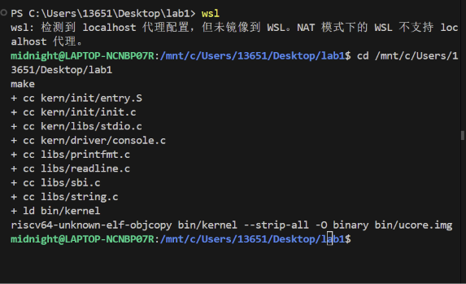

此前 `make qemu` 已成功显示内核启动信息；本次为进一步验证执行过程，使用 `make debug` 启动暂停的 QEMU，再由 GDB 控制运行。该目标使用相同的内核镜像和加载地址，并增加 `-s -S` 调试选项。继续执行后，QEMU 输出 `(THU.CST) os is loading ...`，证明程序已进入内核并执行打印。打印后停留在无限循环，与 init.c 的预期行为一致。

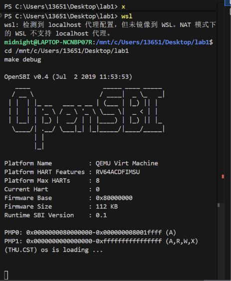

### 5.2 复位入口与初始指令验证

分别在两个 WSL 终端运行 `make debug` 和 `make gdb`，连接后执行：

```gdb
set pagination off
info registers pc
x/5i $pc
```

实测 PC 为 `0x1000`，观察到五条启动指令：

| 地址 | 指令 | 功能 |
|---|---|---|
| 0x1000 | auipc t0,0x0 | 取得当前复位代码地址 |
| 0x1004 | addi a1,t0,32 | 将 0x1020 写入 a1，准备传递给下一阶段的参数 |
| 0x1008 | csrr a0,mhartid | 获取硬件线程编号 |
| 0x100c | ld t0,24(t0) | 读取 0x1018 中的下一阶段入口 |
| 0x1010 | jr t0 | 跳转到该入口 |

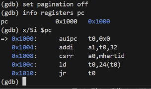

### 5.3 跳转至 OpenSBI 的验证

执行 `x/gx 0x1018`，读得入口地址 `0x80000000`；连续执行五次 `si` 后，再查看 PC，结果为 `0x80000000`。这验证了 MROM 复位代码到 OpenSBI 的跳转。固件地址显示 `??` 是因为没有加载相应固件符号，不表示执行失败。

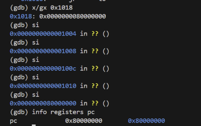

### 5.4 内核入口与栈初始化验证

执行：

```gdb
hbreak *0x80200000
continue
info registers pc sp
x/3i $pc
p/x &bootstacktop
```

断点命中 `kern_entry`，PC 为 `0x80200000`，与链接脚本中的基地址及 QEMU 镜像加载地址一致。此时 SP 为 `0x8001bd80`，内核设置栈的指令尚未执行；符号 bootstacktop 的地址为 `0x80203000`。

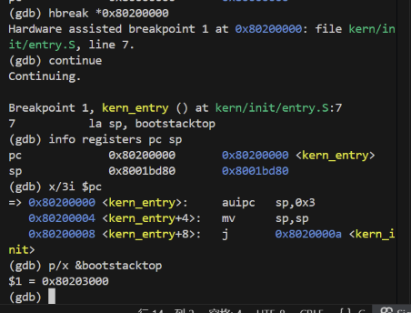

两次 `si` 执行 `la sp, bootstacktop` 对应的两条机器指令后，PC 为 `0x80200008`，SP 为 `0x80203000`，与 bootstacktop 相等，验证启动栈初始化成功。GDB 在该地址旁标注其他同地址符号，不影响数值验证。

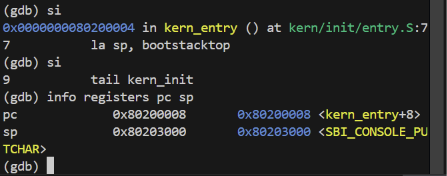

### 5.5 C 初始化入口及清零区间验证

再次执行 `si`，PC 变为 `0x8020000a`，GDB 显示 `kern_init`，验证 `tail kern_init` 成功进入 C 入口。

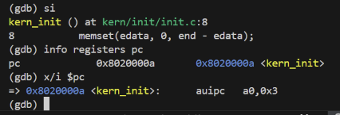

执行以下命令检查清零范围：

```gdb
p/x &edata
p/x &end
p/d (long)end - (long)edata
```

实测 edata 与 end 均为 `0x80203008`，区间长度为 0，说明当前构建的清零区间为空。不能据此宣称已经验证非空 BSS 的清零效果；本次仅验证其边界和长度。执行 `continue` 后出现前述内核启动文字。

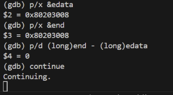

### 5.6 原版启动验证结果汇总

| 检查项 | 实际结果 | 结论 |
|---|---|---|
| 编译与镜像生成 | 生成 bin/kernel 和 bin/ucore.img | 通过 |
| 复位入口 | PC=0x1000 | 通过 |
| MROM 跳转 | 五次单步后 PC=0x80000000 | 通过 |
| 内核入口 | 断点命中 kern_entry，PC=0x80200000 | 通过 |
| 启动栈 | SP=bootstacktop=0x80203000 | 通过 |
| C 入口 | PC=0x8020000a，进入 kern_init | 通过 |
| 清零范围检查 | edata=end=0x80203008，长度为 0 | 边界核对通过；未测试非空区间 |
| 内核输出 | 显示 (THU.CST) os is loading ... | 通过 |
| make grade 自动评测 | 缺少 tools/grade.sh，未执行 | 未验证 |

因此，本次实测确认了 `0x1000 → 0x80000000 → 0x80200000 → kern_init → 内核打印` 的启动链，达到了最小可执行内核的运行目标。模板要求的 make grade 截图暂时无法提供：当前项目虽定义该目标，但缺少对应脚本，需向课程确认适用的评测方式，不能记为已通过。上述验证不覆盖后续实验中的进程调度、虚拟内存和文件系统等功能。


### 5.7 三轮额外验证与最终回归

原版 edata=end，清零长度为0，故新增临时16字节 volatile 全局探针，以验证非空区间。第一轮重新编译后输出 `[BSS test] PASS`，但单独的 PASS 不能证明 memset 清除了人为写入的非零数据。

第二轮在 memset 前暂停，实测 edata=0x80203008、end=0x80203018，长度16。用 GDB 将探针设为非零，读回确认16字节都是0xa5。设置 memset 临时断点并继续，观察到参数起址0x80203008、填充值0、长度16。finish 返回后，16字节全部为0x00，证明清零操作有效。

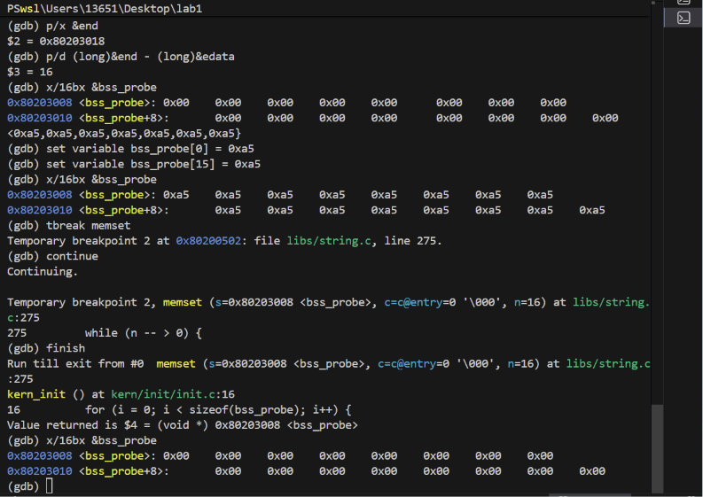

继续运行后，临时测试版输出 PASS 及原启动文字。

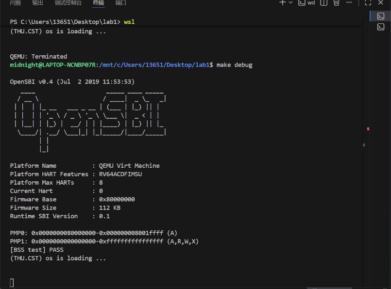

第三轮删除探针、测试循环及测试输出，保留原 memset、启动文字和无限循环。重新编译 init.c、链接并生成镜像成功；make qemu 输出原启动文字，不再输出 BSS 测试信息。最终源码已恢复最小内核。

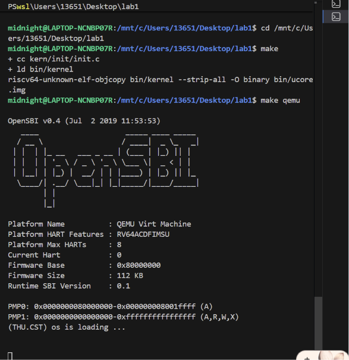

三轮结果均来自实际截图；探针结果属于临时测试版，不属于最终提交版。最终截图证明编译和启动输出；此前 Ctrl+C 暂停在 while (1) 的观察与源码相符。

### 5.8 验证范围与未完成事项

核心启动链、栈初始化、非空 BSS 清零测试及最终编译启动均已取得证据。尚无 make grade 通过结果，因为当前工程缺少 tools/grade.sh；该限制应保留在正式报告中，若课程另行提供脚本再补测。本材料不包含完整固件逐指令执行日志，也不声称已推送 Git 仓库。

---

## 六、实验总结与收获

**负责人：** 2512130-刘婕

### 6.1 对操作系统的理解

#### 本实验重要知识点与 OS 原理的对应关系

| 本实验涉及的 | 含义 | 与 OS 原理的关系与差异 |
|--------------|------|------------------------|
| **复位地址 `0x1000`** | CPU 上电时 PC 被硬件强制赋的初始值 | 对应 OS 原理中"启动第一步"。**差异**：真实硬件的复位地址由芯片厂商决定，OS 原理只讲抽象流程；本实验能具体到 `0x1000` 是因为 QEMU 模拟器将其固定 |
| **bootloader / OpenSBI** | 开机引导程序，负责把 OS 从磁盘装进内存并移交控制权 | 对应 OS 原理中"引导加载程序"概念的实体。x86 平台上通常是 GRUB/UEFI，RISC-V 平台上是 OpenSBI。**差异**：本实验中的 OpenSBI 只做"加载内核 + 跳转"，没有多操作系统选择、交互式命令行等完整 bootloader 功能 |
| **M / S / U 特权级** | RISC-V 的四级权限环：机器态、监督态、用户态 | 对应 OS 原理中"特权级保护机制"的具体硬件实现。**差异**：本实验只用到 M 模式和 S 模式，U 模式要到 Lab5 才登场；且本实验只做特权级降级，没有做页表级的内存隔离 |
| **`ecall` 指令** | 从低特权级陷入高特权级的指令 | 这正是 OS 原理中**系统调用的底层机制**。**差异**：Lab1 调用的是 S→M 的固件服务，Lab5 的系统调用是 U→S；两者机制相同（都是触发异常陷入），但调用目标和调用约定不同 |
| **链接脚本 `kernel.ld`** | 规定各段在内存中的布局和加载地址 | 对应 OS 原理中"内核内存布局"的实现手段。**差异**：真实内核还需考虑 KASLR、地址无关代码等复杂机制；本实验全部使用地址相关代码，因此锁死 `0x80200000`，实现简单直接 |
| **`.text` / `.data` / `.bss` 段** | 分别存放代码、已初始化数据、初始化为零的未初始化数据 | 对应 OS 原理中"内存布局"的静态部分。**差异**：本实验的内存全部为静态预留，Lab2 才会引入堆和运行期动态分配 |
| **地址相关 vs 地址无关代码** | 指令中是否在编译期编入绝对地址 | 链接技术的核心概念。**本实验全部使用地址相关代码**，所以内核必须被加载到链接时指定的 `0x80200000` 才能正确运行 |
| **栈（stack）** | 从高地址向低地址增长，存放局部变量与函数调用帧 | 对应 OS 原理中"进程内存布局"的一部分。**差异**：本实验只有一个全局静态预留的内核栈，没有用户栈、没有运行期栈管理，Lab4 才会引入每进程独立内核栈 |
| **`cprintf` 五层封装** | 从裸 `ecall` 到 `printf` 的逐层抽象 | 对应 OS 原理中"系统调用接口 + 设备抽象"的自底向上构建过程。**差异**：这是最简版本，没有中断驱动、没有输出缓冲区、没有线程安全机制 |
| **SBI 调用约定** | `a7` 放功能号、`a0`-`a2` 传参、`ecall` 触发 | 与 OS 原理中的系统调用调用约定**同构**，是理解后续 Lab5/Lab6 的关键。**差异**：SBI 是 RISC-V 平台厂商自定义的规范，并非 RISC-V 官方标准 |
| **特权级降级** | OpenSBI 跳转时将 CPU 从 M 模式降为 S 模式 | 对应 OS 原理中"内核启动时建立保护机制"的第一步。**差异**：本实验是单级裸机，没有页表保护机制 |
| **`edata` / `end` 符号** | 由链接脚本提供的 `.data` 段末尾与 `.bss` 段末尾地址 | 对应 OS 原理中"内核启动时初始化未初始化数据段"。**差异**：本次实测 `edata == end`，清零区间为空，该机制的实际效果在 Lab2 引入非零 `.data` 后才会显现 |

#### OS 原理中重要但本实验未涉及的知识点

| 未涉及的知识点 | 为什么重要 | 本实验为什么不做 |
|----------------|-----------|----------------|
| **虚拟内存与页表** | 现代操作系统最核心的内存管理机制 | 本实验为裸机单特权级运行，物理地址即虚拟地址，Lab2 与 Lab4 主题 |
| **中断与异常处理** | 操作系统最核心的事件驱动机制 | `kern/trap/` 目录虽已存在但本实验不触碰，Lab3 主题 |
| **进程与线程** | 操作系统的核心抽象单位 | 本实验只有一个内核在运行，没有任何并发，Lab4 主题 |
| **系统调用（U→S）** | 用户程序请求内核服务的正式通道 | 本实验只有 S→M 的 `ecall`，不存在用户态和系统调用，Lab5 主题 |
| **进程调度** | 多道程序系统的核心机制 | 只有一个程序在运行，无从设计调度，Lab6 主题 |
| **同步互斥与并发控制** | 多线程正确性的保障机制 | 本实验全程单线程，不存在竞态条件，Lab7 主题 |
| **文件系统** | 持久化存储的管理机制 | 内核镜像由 QEMU 通过 `-device loader` 直接装载进内存，不涉及磁盘 I/O，Lab8 主题 |
| **动态内存分配（堆、页分配器）** | 支持运行期按需分配内存 | 本实验全部内存为静态预留（链接脚本 + `.space`），运行期没有任何分配代码，Lab2 主题 |
| **设备驱动模型** | 统一管理各类硬件设备 | 本实验仅有最简的控制台字符输出，没有中断驱动的键盘、时钟等设备 |
| **每进程独立内核栈** | 防止内核态调用相互破坏栈空间 | 本实验全局只有一个内核栈，定义在 `entry.S` 中静态预留 |
| **内核与用户地址空间分离** | 现代操作系统最核心的安全基石 | 本实验为单一特权级裸机，采用平坦内存布局 |
| **C 语言运行时完整初始化** | 编译产物正确落地的前提条件 | 本实验只做了清零 `.bss`；`.data` 段的装载由 QEMU 的 loader 完成，且实测该区间为空 |
| **多核与 SMP** | 提升系统并行吞吐能力 | QEMU virt 机型在本次测试中为单 hart（`Current Hart : 0`），完全是单核环境 |

#### 一句话总结本实验的定位

Lab1 是整门课程的地基。它不实现任何高级功能，只证明一件事：**你能让一个程序从 QEMU 上电开始跑起来，并说清楚每一步为什么是这样**。后续 8 个实验的所有复杂机制，都建立在这三段跳转（`0x1000` → `0x80000000` → `0x80200000`）和"自底向上逐层搭建输出能力"这个思路之上。

### 6.2 AI 协作开发的经验

**一、AI 工具在已有框架型实验中的定位需要重新认识。**

Lab1 的基础代码已由实验指导书提供，AI 工具无法"从零生成"一个内核。这意味着 AI 的价值不在写代码，而在**理解、验证与表达**。本组实际的使用方式是：让 AI 辅助梳理启动链的因果关系、核对寄存器数值与链接脚本是否自洽、组织调试步骤、以及按四段式框架规范化提示词本身。

**二、AI 生成的"看似合理的解释"必须用实际证据核对。**

本组在验证过程中遇到过典型例子：AI 会自然地把"QEMU 通过 `-device loader` 预先把内核镜像放入内存"与"OpenSBI 在运行期间把内核写入内存"混为一谈。如果不加辨别，会写出"我们观察到了 OpenSBI 加载内核"这样的错误结论。实际操作中，成员二在 `b *0x80200000` 命中后，明确区分了这两件事——断点证据只能证明**控制权已移交**，不能证明**固件在调试期间才写入镜像**。这类核对是 AI 无法替代的，必须回到实际运行结果。

**三、实验证据的价值在于真实，而不在于漂亮。**

本组在验证 `.bss` 清零时，实测发现 `edata == end`、清零区间长度为 0。如果到此为止，"清零功能已验证通过"是一个不完整的结论——因为长度为 0 的区间清零不构成有效证据。于是成员二额外构造了非空探针，进行了三轮测试：建立探针、人为写入 `0xa5` 后验证被清零、移除探针回归原版。最终报告中明确标注"探针结果属于临时测试版，不属于最终提交版"。**这种不回避实验中发现的反直觉结果、不把无结果的步骤写成已通过的态度，比任何漂亮的报告都更有价值。**

**四、提示词本身也需要被版本管理。**

本组把提示词当作实验产物的一部分对待，而非临时输入。`prompt.md` 中记录的不只是最终使用的提示词，还包括原始提问、三轮反馈的修正过程，以及"事后整理的标准格式"与"历史原话"的明确区分。这种做法让提示词从一次性消耗品变成可复盘的实验记录。

**五、诚实标注未完成项比掩盖它更安全。**

本次实验中 `tools/grade.sh` 脚本缺失，`make grade` 无法执行。成员二在报告中如实写明"缺少 tools/grade.sh，未执行""需要向课程确认适用的评测方式，不能记为已通过"。实验报告的读者能够据此判断哪些结论有证据支撑、哪些没有。如果伪造一张通过截图，反而会在答辩或复查时暴露，且性质更严重。

**六、工具故障不应成为停滞的理由。**

实验初期在虚拟机中的 AI 工具出现连接故障，而此时核心的编译与调试环境已经就绪。判断后发现**实验本身的推进完全不依赖 AI 工具**——编译、GDB 调试、截图取证都可以独立完成，而报告整合与 git 交付在主机侧完成效率更高。因此把 AI 工具的可用性与实验进度解耦，避免了在非核心环节上消耗时间。

### 6.3 全组结论

三名成员分工协作完成了 Lab1。成员一负责练习1 的入口汇编分析与实验目的、逻辑分析的撰写；成员二负责练习2 的 GDB 验证与全部截图取证，产出了覆盖复位入口、固件跳转、内核入口、栈初始化、C 入口、BSS 边界的 11 张实测截图；成员三负责报告整合、提示词规范汇总与 Git 提交推送。

通过本实验，全组掌握了 RISC-V 最小可执行内核的完整启动链路，理解了链接地址约束、特权级切换、系统调用底层机制和分层封装等核心概念，并建立了"每个结论都必须有实际运行证据支撑"的实验态度。
