# 实验报告

## 实验基本信息

| 项目 | 内容 |
|------|------|
| **实验名称** | Lab2: 物理内存和页表 |
| **小组成员** | 2512163-李思翰、2512436-郭睿彤、2512130-刘婕 |
| **完成日期** | 2026-10-22 |

### 小组分工

| 成员 | 负责的练习/模块 |
|------|----------------|
| 2512163-李思翰 | 任务一：物理内存探测与 Page 描述符初始化（`page_init`）；任务三代码复核与修订（FIX-1…FIX-7）；任务三独立外部验证层 `buddy_verify.c`（10 组用例 / 205 条断言）；`kern_init()` 中的模块接入；报告「实验目的」「整体逻辑分析」 |
| 2512436-郭睿彤 | 任务二：理解 First-Fit 连续物理内存分配算法；实现 Best-Fit 分配器并切换 `init_pmm_manager`；任务一的边界测试（负向验证，3 组）；SLUB 扩展测试设计；「测试与验证」章节与全部实测截图 |
| 2512130-刘婕 | 任务三：Buddy System 模块（`buddy_pmm.c`）与自检（`buddy_test.c`）；任务四：SLUB 模块（`slub.c`）与自检（`slub_test.c`）；报告「实验环境」「总结与收获」、T1/T2b 分析段、`prompt.md` 汇总 |

### 实验报告分工

| 成员 | 负责的报告章节 |
|------|----------------|
| 2512163-李思翰 | 一、实验目的；三、实验整体逻辑分析；四、任务一（物理内存初始化）；四、任务三的交叉复核说明 |
| 2512436-郭睿彤 | 四、任务二（First-Fit 理解与 Best-Fit 实现）；五、测试与验证（含全部实测截图与 T1 边界测试记录） |
| 2512130-刘婕 | 二、实验环境；四、任务一分析段、任务二分析段、任务三、任务四；六、实验总结与收获；`prompt.md` 汇总 |

> 任务三由两名成员分工完成：2512130-刘婕 负责 Buddy 的**实现**与实现者自检（`buddy_pmm.c` / `buddy_test.c`），2512163-李思翰 在复核阶段负责**缺陷修订**与**独立外部验证层**（`buddy_verify.c`）。两层测试的分工与差异见第四章功能模块三。
>
> 任务一的**边界测试**由 2512436-郭睿彤 完成：在测试副本中逐个篡改设备树报告的内存大小，验证 `page_init()` 在无效输入下会 panic 而非错误地注册空闲页。这是对框架自检的补充——框架只覆盖正常路径。记录见第五章 5.1.1。

---

## 一、实验目的

本实验围绕**操作系统的物理内存管理**展开。在 Lab1 打通启动链路的基础上，实验二进一步实现内核对物理内存的探测、描述与分配能力。

本实验的主要目的是：

1. 理解页表的建立与使用方法，理解物理内存的管理方法，理解页面分配算法
2. 掌握从设备树获取物理内存范围的方法，能够据此建立物理页描述符数组并把可用页面交给分配器
3. 掌握连续物理内存分配算法的实现，能够在给定的框架下实现 Best-Fit 分配器
4. 掌握 Buddy System 的拆分与合并机制，能够独立设计并实现页级分配器及其测试
5. 理解 SLUB 的两层架构，能够实现任意大小对象的分配与回收
6. 学会使用 AI 辅助开发操作系统核心功能，并按规范记录提示词与迭代过程

---

## 二、实验环境

**负责人：** 2512130-刘婕

### AI 编程工具

| 成员 | AI 编程工具 | 底层模型 | 备注 |
|------|------------|---------|------|
| 2512163-李思翰 | Codex CLI | gpt-6.1-sol | 用于任务一物理内存初始化的规格推导与实现 |
| 2512436-郭睿彤 | Codex CLI | gpt-6-astra | 用于任务二 Best-Fit 实现与测试验证 |
| 2512130-刘婕 | Codex CLI | gpt-6.1-sol | 用于任务三、任务四的实现与测试设计，以及报告整合与提示词规范整理 |

### 硬件与软件环境

| 项目 | 配置 |
|------|------|
| 开发平台 | VMware 虚拟机中的 Ubuntu，共享目录 `E:\vmshare` |
| 交叉工具链 | `riscv64-unknown-elf-gcc` (SiFive GCC 10.2.0) |
| 模拟器 | `qemu-system-riscv64` (QEMU 4.1.1) |
| 调试器 | `riscv64-unknown-elf-gdb`（随交叉工具链安装） |
| 固件 | QEMU 内置 OpenSBI v0.4（Runtime SBI Version 0.1） |
| 目标机器 | QEMU virt 机型，RV64 单 hart，DRAM 128 MB |

### 实验代码来源与目录

从 oslab 站点取得 `lab2.zip` 官方骨架，目录结构为：

```
lab2/
├── code/      # 实验实现后的完整可编译工程
│   ├── Makefile
│   ├── kern/mm/       # 物理内存管理核心
│   ├── kern/init/     # 内核入口
│   ├── kern/driver/   # 控制台与设备树
│   ├── kern/debug/    # assert 与 panic
│   ├── kern/libs/     # 内核内部库
│   ├── libs/          # 公共库（list.h、riscv.h、defs.h 等）
│   └── tools/         # 链接脚本、评测脚本
└── report/
    ├── report.md      # 本文件
    ├── prompt.md      # 本实验全部提示词
    ├── images/        # 测试截图（14 张）
    └── logs/          # 原始串口运行输出（文本）
```

### 交付物清单

本目录即为可直接上交的完整交付物，报告与提示词正文引用的每一张图、每一个日志文件都在下列清单内，不依赖任何目录外资源。

| 交付物 | 路径 | 内容 |
| --- | --- | --- |
| 实验报告 | `report/report.md` | 本文件，六章正文，含 14 张截图 |
| 提示词汇总 | `report/prompt.md` | 九组提示词 + 李思翰组原文附录（T1-1/T1-2/T1-3/T3-2） |
| 测试截图 | `report/images/` | 14 张 PNG，覆盖 Best-Fit 启动、三个边界测试、Buddy 自检与外部验证层、SLUB 自检、三次 `make grade` |
| 原始运行输出 | `report/logs/T1_T2b运行输出.txt` | 任务一 / 任务二 b 的完整串口日志（OpenSBI 引导 → 框架自检 → Buddy 验证层 → `buddy verify PASS`） |
| 原始运行输出 | `report/logs/T3_buddy运行输出_Best-Fit底座.txt` | 任务三在 Best-Fit 底座上的完整串口日志（10 组 / 205 条通过） |
| 物理内存探测实现 | `code/kern/mm/pmm.c` | `page_init()` 的探测、描述符布局与空闲区注册 |
| Best-Fit 分配器 | `code/kern/mm/best_fit_pmm.c` | 有序空闲链表的 Best-Fit 实现，与框架 `pmm_manager` 契约对齐 |
| Buddy System | `code/kern/mm/buddy_pmm.c`、`buddy_pmm.h` | 页级 Buddy 分配器，池内偏移异或 + 双重空闲判定 + 合并取偏移较小者 |
| Buddy 自检 | `code/kern/mm/buddy_test.c`、`buddy_test.h` | 7 个子测试（实现者侧） |
| Buddy 外部验证层 | `code/kern/mm/buddy_verify.c`、`buddy_verify.h` | 10 组用例 / 205 条计数式断言（独立第三方侧，失败只计数不 panic） |
| SLUB 分配器 | `code/kern/mm/slub.c`、`slub.h` | 9 档 size class、每 slab 1 页、free list 藏于空闲对象自身 |
| SLUB 自检 | `code/kern/mm/slub_test.c` | 6 个子测试 |
| 内核接入 | `code/kern/init/init.c` | `pmm_init()` 之后的 Buddy / SLUB 初始化与自检调用顺序 |
| 评测脚本 | `code/tools/inject.py` | 把评分用例注入 `pmm_init()` 末尾 |
| 评测用例 | `code/tools/test_lab2.c`、`test_lab2.h` | 框架自带的 `check page init` / `check best fit` 两项检查 |

---

## 三、实验整体逻辑分析

**负责人：** 2512163-李思翰

### 3.1 本章节的逻辑主线

本实验围绕**内核如何获得并管理物理内存**这一核心主题展开。Lab1 解决了"内核能不能跑起来"，实验二要解决"内核跑起来之后，如何知道有多少内存、这些内存怎么分配"。

整体要解决的核心问题是：**在没有硬件直接告知内存布局的前提下，如何通过设备树探测物理内存上界，建立描述符数组刻画每一页的状态，并在其上实现可用的页面分配算法，进而在页级之上支持任意大小对象的分配。**

### 3.2 功能的逐步实现

本实验按以下顺序逐步展开：

1. **首先探测物理内存范围** → 为什么？（内核无法预知硬件配置，QEMU 的内存大小通过设备树描述，`get_memory_base()` / `get_memory_size()` 是唯一入口）
2. **接着建立 Page 描述符数组** → 为什么？（需要为每一物理页记录状态，而描述符数组本身要占用内存，这带来"管理员自己也要吃内存"的循环依赖，必须先划清边界）
3. **然后把可用页面交给分配器** → 为什么？（框架把分配能力抽象为 `struct pmm_manager` 的六个函数指针，分配器只管策略，不管内存从哪来）
4. **再实现具体分配算法** → 为什么？（First-Fit 是基线，Best-Fit 在其上改进扫描策略，两者共用同一套链表管理与合并逻辑）
5. **最后向上叠加对象级分配** → 为什么？（内核中大量对象是几十字节到几 KB，页级分配粒度太粗，需要 Buddy 提供对齐块、SLUB 提供任意大小对象）
6. **贯穿全程的测试与验证** → 为什么？（分配器的正确性无法靠肉眼判断，必须用能证伪实现的测试来验证）

---

## 四、实验内容与实现

### 本章导读：Spec 与 Prompt 的写法

实验要求"说明每个练习的 spec 怎么写的，prompt 怎么写的"。本组四个练习的提示词全部采用实验指导书规定的四段式结构，各段的职责划分如下：

| 段 | 写什么 | 不写什么 | 作用 |
|---|---|---|---|
| `[PROMPT]` | 任务目标、操作约束、输出要求 | 具体算法步骤、数据结构选型 | 让 AI 知道**边界在哪**：能改哪些文件、必须保留哪些标记、要交付什么 |
| `[RELY]` | 从工程真实代码里摘出的接口签名、宏定义、结构体字段 | 对这些接口的"评价"或"改进建议" | 把"AI 以为的接口"换成"工程里真实的接口"，这是消除臆造的关键 |
| `[GUARANTEE]` | 必须存在的函数签名、常量取值、可新增的内容范围 | 函数的实现 | 锁定**接口契约**，让不同轮次的输出可直接对接 |
| `[SPECIFICATION]` | 每个函数的 Pre-Condition / Post-Condition / Case 1..N / Requirements | 与 Case 重复的实现描述 | 锁定**行为契约**：什么输入下必须产生什么输出，哪些极端情况必须怎么处理 |

各练习的 spec 写法有一个共同的取舍：**抽象到"行为"而非"实现"，但对"必须这样否则就错"的具体细节破例保留**。

以任务三的 Buddy System 为例，若只写"实现 buddy 地址计算"，AI 会给出各种合理但错误的实现。本组在首轮生成后追加了三条具体约束：

1. 对齐判断必须基于**物理页号**而非物理地址（物理地址低位含 `va_pa_offset`，取模结果与真实页对齐关系无关）；
2. 判定某个候选 buddy 是否空闲，必须**同时**检查空闲标志位与它记录的阶数（只比较阶数会把空闲块内部的页误判为块首，链表随即被破坏）；
3. 合并后的块首必须取两个块中**页偏移较小者**（取错会导致高阶块不再满足对齐要求，后续所有 buddy 计算失效）。

这三条的共同特点是：**每一条都对应一类"看起来能跑、但结果是错的"实现**。spec 的价值不在于把实现写清楚（那等于替 AI 代写），而在于把"这一类错误"提前排除。

测试 prompt 的写法与实现 prompt 相反：**实现 prompt 越具体越好，测试 prompt 越贴近"性质"越好**。实现 prompt 用"必须这样实现"来排除错误；测试 prompt 用"必须具备这个性质、且能证伪某类缺陷"来构造判定条件。SLUB 的对象隔离测试是最典型的例子——写成"断言对象 B 的内容不等于 0xA5"会因为新分配页初值未定义而假失败，也无法真正证伪重叠缺陷；改为"先给 B 建立确定模式、再写 A、再验证 B 未变，并额外断言 A 确实已变"之后，断言才同时具备确定性与证伪能力。

**测试 prompt 必须与实现 prompt 分离成两次独立请求。** 若在同一个 AI 上下文中连续生成实现与测试，测试会按实现所依赖的假设写断言——实现若误解了 buddy 语义，测试会按同样的误解写，两者"一致地错"，测试全绿而实现是错的。这正是实验指导书要求"分别设计两份 prompt"的原因。

四个练习的提示词原文与逐条迭代说明见 `prompt.md`。

---

### 功能模块一：物理内存初始化

**负责人：** 2512163-李思翰

#### 任务一：物理内存探测与 Page 描述符初始化

**需要实现/修改的函数：**

```c
// kern/mm/pmm.c
void page_init(void);
```

**功能说明：**

`page_init` 是连接"设备树探测结果"与"物理内存分配器"的桥梁。它要完成三件事：

1. 从设备树取出物理内存范围，通过 `get_memory_base()` 与 `get_memory_size()` 获得
2. 在内核镜像之后建立 Page 描述符数组，数组长度覆盖 `[nbase, npage)` 的每一页
3. 把排除内核镜像与描述符数组之后的完整空闲页，通过 `init_memmap()` 交给当前 `pmm_manager`

#### 四个概念的区分（负责人：2512130-刘婕）

本模块最容易出错的地方是混淆以下四个地址概念，报告在此明确区分：

| 概念 | 含义 | 本实验中的取值方式 |
|------|------|-------------------|
| **虚拟地址（VA）** | CPU 指令中使用的地址 | 内核虚拟地址 = 物理地址 + `va_pa_offset`，其中 `va_pa_offset = PHYSICAL_MEMORY_OFFSET = 0xFFFFFFFF40000000` |
| **物理地址（PA）** | 内存条上的实际地址 | DRAM 范围 `[0x80000000, 0x88000000)` |
| **物理页号（PPN）** | 物理地址除以页大小 | `PPN(pa) = pa >> 12`；DRAM 起始页号 `nbase = 0x80000000 / 4096 = 0x80000` |
| **Page 描述符地址** | 描述符数组中某一项的地址 | `pages` 指向数组首项，数组首项描述物理页号 `nbase` 对应的那一页 |

**`npage` 的语义是页号上界，不是页数。** 这是本实验与经典 ucore 不同的地方：`page2ppn(page) = page - pages + nbase` 中的 `+ nbase` 说明描述符数组只覆盖 DRAM 以上的部分，因此 `npage` 必须表示"物理页号的上界"即 `PPN(mem_base + mem_size)`，而描述符数组的长度是 `npage - nbase`。框架自带的 `test_lab2.c` 第 3 项检查正是校验这一点。

**为什么内核镜像与描述符数组都不能进入空闲区：**

内核镜像（`end` 符号标记其末尾）正在执行，描述符数组则记录着每一页的状态，二者一旦被当作空闲页分配出去，前者会导致内核自身被覆盖，后者会导致分配器读到被篡改的元数据。实现上采取的做法是：先把 `[DRAM_BASE, 空闲区起点)` 的全部描述符标记为 `PG_reserved`，再调用 `init_memmap()`。这个顺序不能颠倒——`init_memmap` 内部有 `assert(PageReserved(p))`，它假定传入的页**事先就是保留状态**，由它来清除标志位并置为空闲块。

**设备树信息无效时为什么必须终止：**

`get_memory_base()` 在解析失败时返回 0（`dtb.c` 的解析失败分支只打印警告，不修改静态变量）。若此时继续执行，`npage` 会算出 0 或一个非法值，后续所有 `pa2page()`、`alloc_pages()` 都会在错误的边界上工作，故障点会漂移到很远的地方，难以定位。在源头 `panic` 终止，是把错误暴露在最早的位置。

#### 任务一的边界测试：三条异常路径（负责人：2512436-郭睿彤）

框架的自检只覆盖正常路径。为了确认上述几条 `panic` 分支**真的会在正确的时机触发**，在测试副本中逐个注入异常输入，观察系统行为。三条测试全部通过，截图与完整输出见第五章 5.1.1。

| 注入的异常 | 触发的检查 | 实测输出 |
|---|---|---|
| DTB 内存大小为 0 | `mem_base == 0 \|\| mem_size == 0` | `page_init: invalid physical memory info from device tree` |
| 内存过小（`0x00207000`），描述符数组放不下 | `start_pa + array_bytes > mem_end` | `page_init: no room left for the page descriptor array` |
| 内存上界非页对齐（`0x08000001`） | 无（应正常启动） | `free pages: 31929, npage: 557056`，多余 1 字节未被当作整页 |

第三条是这组测试里最有价值的：它验证的是**"没有把碎片当成整页"**。若 `page_init()` 写成 `n_free = mem_end - free_start_pa` 而不是按页号上界计算，这多出的 1 字节就会让系统凭空多算出一个并不存在的物理页，而这种错误在正常输入下完全看不出来。

> 这一组测试体现了**负向验证**的价值：框架的 `test_page_init()` 检查了 8 项正常路径的性质，但"错误时不做什么"这类性质只能靠人为注入异常来验证。三条测试都在**临时副本**中进行，恢复正常工程后 `make grade` 仍为 20/20，确认未污染提交代码。

#### 最终提示词

见 `prompt.md` 提示词一。

---

### 功能模块二：物理内存分配

**负责人：** 2512436-郭睿彤

#### 任务二（之一）：理解 First-Fit 连续物理内存分配算法

**负责人：** 2512436-郭睿彤

本任务为阅读理解题，需结合 `kern/mm/default_pmm.c` 中的 `default_init`、`default_init_memmap`、`default_alloc_pages`、`default_free_pages` 四个函数，用自己的话说明 First-Fit 分配器如何初始化空闲页、分配连续物理页、回收页面并合并相邻空闲块。

> 本小节内容由 2512436-郭睿彤撰写。

**① `default_init()`**

负责初始化 First-Fit 物理内存管理器。函数将 `free_list` 初始化为空闲块双向链表的表头，并将 `nr_free` 置为 0。此时系统尚未将实际物理页交给分配器管理，因此空闲页数量为 0；后续由 `default_init_memmap()` 登记真正可用的连续物理页。

**② `default_init_memmap(struct Page *base, size_t n)`**

用于向 First-Fit 分配器注册一段连续的可用物理页。`base` 指向该段内存的第一张物理页描述符，`n` 表示页数。函数先检查页数大于 0，并确认每一页原先处于保留状态；随后清除页面标志、块长度和引用计数。函数将首页的 `property` 设置为 `n`，并设置 `PG_property` 标志，表示该页是长度为 `n` 的空闲块头。最后，函数将块头按照物理地址从低到高插入 `free_list`，并将 `nr_free` 增加 `n`。

**③ `default_alloc_pages(size_t n)`**

用于申请一段连续的 `n` 页物理内存。函数先检查请求页数和当前空闲页总数；若空闲页不足则返回 `NULL`。随后从 `free_list` 的低地址端开始顺序遍历，寻找**第一个**长度不小于 `n` 的空闲块——这就是 First-Fit 的含义。找到块后，函数将其从链表移除；若块长度大于请求页数，则将剩余部分拆分为新的空闲块并插回链表。最后减少 `nr_free`，清除已分配块头的 `PG_property` 标志，并返回分配块的起始页。

**④ `default_free_pages(struct Page *base, size_t n)`**

用于归还从 `base` 开始的连续 `n` 页物理内存。函数清除页面标志和引用计数，将 `base` 设置为长度为 `n` 的空闲块头，再按物理地址顺序插入 `free_list`，同时增加 `nr_free`。插入后，函数先检查前一个空闲块是否与当前块连续，连续则合并；随后检查合并后的块是否与后一个空闲块连续，连续则再次合并。该过程能减少外部碎片，使被切分的相邻区域重新变为较大的连续空闲块。

**⑤ First-Fit 的改进空间**

First-Fit 实现简单，找到第一个足够大的空闲块后即可停止查找，分配速度较快。但是，它容易在低地址区域反复分配，产生较多小碎片，可能导致后续较大的连续内存申请失败。可采用 Next-Fit、Best-Fit、按块大小分类的链表或平衡树等方式改进；代价是需要维护更多状态，算法实现也更复杂。

> **与 Best-Fit 的对照**：第 ③ 步的扫描策略是 First-Fit 与 Best-Fit 的**唯一**差异——本组实现的 `best_fit_alloc_pages()` 把"遇到第一个就停"改为"遍历全部、记住 `property` 最小的那个"：

```c
if (page->property >= n &&
    (best == NULL || page->property < best->property)) {
    best = page;
    if (page->property == n) break;   /* 找到恰好等大的块可提前结束 */
}
```

`best == NULL` 这个判断同时处理了"第一个候选"与"后续更优候选"两种情况；而 `page->property == n` 时提前退出是合法的提前优化——**恰好等大的块不可能有更小的满足者**，且长度相同时按约定取地址较低者（链表本身按地址有序，先遇到的即地址较低者）。

#### 任务二（之二）：实现 Best-Fit 连续物理内存分配算法

**需要实现/修改的函数：**

```c
// kern/mm/best_fit_pmm.c
extern const struct pmm_manager best_fit_pmm_manager;

// kern/mm/pmm.c
static void init_pmm_manager(void);   // 切换 pmm_manager 指向
```

**功能说明：**

Best-Fit 与 First-Fit 共用同一套空闲链表管理与合并逻辑，**唯一差异在于扫描策略**：First-Fit 取链表中第一个满足容量的块，Best-Fit 遍历全部块取其中满足容量的最小者。

**本组的实现要点**（由 2512436-郭睿彤完成，代码见 `kern/mm/best_fit_pmm.c`）：

| 函数 | 要点 |
|---|---|
| `best_fit_init` | `list_init(&free_list)` + `nr_free = 0` |
| `best_fit_init_memmap` | 逐页确认 `PageReserved` 后清标志，把 `base->property = n` 并置 `PG_property`，按地址升序插入链表 |
| `best_fit_alloc_pages` | 遍历全链表记住 `property` 最小的候选块；`property == n` 时提前退出 |
| `best_fit_free_pages` | 置 `base->property = n` 与 `PG_property`，按地址升序插入，再依次尝试与前驱、后继合并 |
| `best_fit_nr_free_pages` | 直接返回 `nr_free` |

三点值得注意：

**第一，链表必须保持按地址有序。** `best_fit_init_memmap` 与 `best_fit_free_pages` 里的插入逻辑都是"从表头遍历，找到第一个地址大于自己的块，插到它前面；若遍历到末尾则插到末尾"。这个有序性有两个作用：一是同容量块中地址较低者先被扫描到（对应提示词第 4 条"长度相同时选地址较低的块"），二是释放时的前驱/后继合并依赖地址连续判断。

**第二，分配时的拆分必须把剩余块插回原位。** 实现记录了被选中块的 `list_prev`，拆分后把剩余块插到这个位置而不是链表头：

```c
list_entry_t *prev = list_prev(&(best->page_link));
list_del(&(best->page_link));
if (best->property > n) {
    struct Page *remain = best + n;
    remain->property = best->property - n;
    SetPageProperty(remain);
    list_add(prev, &(remain->page_link));   /* 插回原位，保持有序 */
}
```

若插到链表头，链表就失去有序性，上面第一条的性质随之失效。

**第三，释放时的合并要检查两个方向，且注意 `base` 可能在与前驱合并后改变。** 实现先查前驱：

```c
list_entry_t *le = list_prev(&(base->page_link));
if (le != &free_list) {
    p = le2page(le, page_link);
    if (p + p->property == base) {
        p->property += base->property;
        ClearPageProperty(base);
        list_del(&(base->page_link));
        base = p;              /* ★ base 指向合并后的块首 */
    }
}
```

合并后 `base` 必须更新为 `p`（合并后块的块首），否则后继合并判断 `base + base->property == p` 会用错基准。这正是框架 `best_fit_check` 末尾 `assert(count == 0 && total == 0)` 所要求的"精确还原"。

**④ `init_pmm_manager()` 的切换**

```c
static void init_pmm_manager(void) {
    pmm_manager = &best_fit_pmm_manager;      // ← 改这一行
    cprintf("memory management: %s\n", pmm_manager->name);
    pmm_manager->init();
}
```

实测输出 `memory management: best_fit_pmm_manager`，确认切换生效（见第五章图 5-1）。

#### 框架测试函数对实现的三条隐含约束（负责人：2512130-刘婕）

`best_fit_pmm.c` 中的 `basic_check` 与 `best_fit_check` 不可修改，但它们反过来约束了实现。这三条约束是实现能否通过检查的关键，也是本实验最容易踩空的地方：

**约束一：模块内部必须存在名为 `free_list` 与 `nr_free` 的符号。**

框架代码直接以裸名字访问它们：

```c
list_entry_t free_list_store = free_list;    // best_fit_pmm.c:24
list_init(&free_list);                        // :25
unsigned int nr_free_store = nr_free;         // :28
nr_free = 0;                                  // :29
```

因此实现必须仿照 `default_pmm.c` 的方式定义同名同类型的静态变量：

```c
static free_area_t free_area;
#define free_list (free_area.free_list)
#define nr_free  (free_area.nr_free)
```

注意 `nr_free` 在 `free_area_t` 中的类型是 `unsigned int`，与框架代码的 `unsigned int nr_free_store = nr_free;` 匹配。

**约束二：`property` 的语义是"该空闲块含多少页"，且块首必须带 `PG_property` 标志。**

框架用这两点做守恒校验：

```c
while ((le = list_next(le)) != &free_list) {
    struct Page *p = le2page(le, page_link);
    assert(PageProperty(p));
    count++, total += p->property;
}
assert(total == nr_free_pages());
```

**约束三：链表必须按地址有序，且同容量块中取地址最小者。**

这条由 `basic_check` 中的一处断言决定：

```c
free_page(p0);
assert((p = alloc_page()) == p0);
```

释放 `p0` 后重新分配必须拿回**同一个** `p0`。若链表无序，或同容量块中选中了别的块，这条断言失败。

#### Best-Fit 与 First-Fit 的分水岭（负责人：2512130-刘婕）

`best_fit_check` 中的一处断言精确区分了两种算法：

```c
free_pages(p0 + 1, 2);      // 形成一个 2 页块
free_pages(p0 + 4, 1);      // 形成一个 1 页块
assert(alloc_pages(4) == NULL);
assert((p1 = alloc_pages(1)) != NULL);
assert(alloc_pages(2) != NULL);
assert(p0 + 4 == p1);       // ★ 关键
```

此刻空闲区中有两个块：`p0+1` 处的 2 页块与 `p0+4` 处的 1 页块。

- **First-Fit**（按地址扫描）：`alloc_pages(1)` 会选中地址更低的 `p0+1`（2 页块），`assert(p0 + 4 == p1)` **失败**
- **Best-Fit**（选最小者）：1 页块比 2 页块更贴合，选中 `p0+4`，断言**通过**

这条断言是整个任务二的核心考点：**它把"最小者"这个语义要求固化成了可执行检查**。

#### 合并逻辑为何是必需的而非可选（负责人：2512130-刘婕）

`best_fit_check` 末尾有一处容易被忽略的断言：

```c
nr_free = nr_free_store;
free_list = free_list_store;
free_pages(p0, 5);

le = &free_list;
while ((le = list_next(le)) != &free_list) {
    struct Page *p = le2page(le, page_link);
    count--, total -= p->property;
}
assert(count == 0);
assert(total == 0);
```

`count` 与 `total` 是函数开头统计的**原始**空闲链表状态。结束时两者都必须归零，意味着：恢复 `free_list` 后再释放 5 页，产生的块必须与相邻块**合并**，使链表回到与开头完全一致。

推理如下：`p0` 原本是从某个空闲块 B（`property >= 5`）中切出的，B 的剩余部分（从 `p0+5` 起）仍留在链表里。`free_pages(p0, 5)` 释放的 5 页与 `p0+5` 处的剩余块**物理相邻**，只有实现完整的合并逻辑（与前驱和后继都合并）才能把它们重新拼成一个块，链表块数与总页数才会回到原值。

**结论：少写一段合并逻辑，`assert(count == 0)` 就会失败。** 这条断言把"合并"从可选优化变成了正确性要求。

#### 两个"改进空间"问题的回答（负责人：2512130-刘婕）

**问题一：原有的 first-fit 算法是否有进一步的改进空间？**

有，且本实验的 Best-Fit 本身就是一种改进。除此之外还有几类改进方向：

| 改进方向 | 做法 | 代价 |
|---|---|---|
| **改为 Best-Fit / Worst-Fit** | 扫描全部块取最贴合者 | 扫描复杂度从平均 O(1) 升为 O(n)，但碎片率下降 |
| **分离链表（ segregated list）** | 按块大小分档建多条链表，如 1、2、4、8…页各一条 | 查找 O(1)，但需维护多链表与合并时的跨表转移 |
| **边界标签（boundary tag）** | 在块首/块尾各存一个大小标记，合并时 O(1) 定位邻块 | 每个块多存一个 size 字段 |
| **地址顺序 + 尺寸类双向索引** | 同时维护按地址与按大小两条索引 | 索引一致性的维护成本高 |
| **延迟合并（deferred coalescing）** | 释放时不立即合并，等空闲率低于阈值时批量合并 | 需要维护全局空闲率，合并时机难定 |

First-Fit 的核心缺陷是**只与物理相邻的前驱和后继合并**。当内存中散布着大小不一的已用块时，相邻的两个空闲块可能因对齐要求而无法合并成大块，外部碎片由此产生。

**问题二：你的 Best-Fit 算法是否有进一步的改进空间？**

有。Best-Fit 相比 First-Fit 降低了大块被切碎的概率，但引入了两个新问题：

1. **扫描复杂度**。每次分配都要遍历整条空闲链表才能确认"最小者"，链表长时开销显著。
2. **小碎片积聚**。Best-Fit 倾向于留下刚好够用的小块，这些小块无法合并成大块，导致"总空闲够但无大块可用"的情况反而更常见。

可行的改进：

- **用分离链表替代单链表**：按块大小分档（1/2/4/8…页），Best-Fit 只需在"能容纳请求的最小档"里找最贴合者，查找范围大幅缩小。这是本实验任务三 Buddy System 的思路雏形——Buddy 干脆让每个阶数一条链表，把"找最小可用块"变成"找最小非空阶"。
- **延迟合并**：释放时只标记，批量合并在空闲率低时统一进行，把合并的开销摊薄。
- **在 Best-Fit 基础上加边界标签**：保留 Best-Fit 的贴合性，同时让合并与邻块定位降到 O(1)。

另外，从 `best_fit_check` 的断言可以看出，本实现的 Best-Fit 只在**同阶 buddy**之间做合并（继承自 first-fit 的相邻合并），尚未做到"释放时主动寻找并合并所有可合并的块"。若引入 Buddy 的阶数概念，合并能力会更强。

#### 最终提示词

见 `prompt.md` 提示词二。

---

### 功能模块三：Buddy System 分配器

**负责人：** 2512130-刘婕

#### 任务三：Buddy System 分配算法

**需要实现/修改的函数：**

```c
// kern/mm/buddy_pmm.h
void buddy_init(void);
struct Page *buddy_alloc_pages(size_t n);
void buddy_free_pages(struct Page *base, size_t n);
int buddy_free_pages_checked(struct Page *base, size_t n);
size_t buddy_nr_free_pages(void);
size_t buddy_nr_free_blocks(int order);
size_t buddy_pool_npages(void);
size_t buddy_page_offset(struct Page *p);

// kern/mm/buddy_test.h
void buddy_test(void);

// kern/mm/buddy_verify.h
void buddy_verify(void);
```

**功能说明：**

Buddy System 是页级的分配器，核心思想是**所有块的大小都是 2 的幂**。它把管理池组织成一棵完全二叉树：分配时自顶向下二分拆分，释放时自底向上与"buddy"合并。

本模块在系统中的位置是**二级分配器**——它不注册为 `struct pmm_manager` 实例，而是从当前 `pmm_manager` 申请一块连续大页作为自己的管理池，此后只在池内做拆分与合并。

> **为什么不能替换全局 `pmm_manager`**：框架的 `tools/test_lab2.c` 中 `test_best_fit()` 明确断言 `pmm_manager == &best_fit_pmm_manager`，一旦替换，实验评测直接失败。做成二级分配器既保证了评测不受影响，也符合 SLUB"上层对象分配器建立在下层页分配器之上"的两层架构。

#### 核心机制一：管理池的申请与 buddy 关系的计算空间

Buddy 的地址计算是"块首偏移与半块大小异或"：

```c
size_t off = buddy_offset(base);            /* 块首在池内的页偏移 */
size_t buddy_off = off ^ ((size_t)1 << order);
```

这个公式成立的前提是"参与异或的偏移按 2^order 对齐"。关键在于**这个对齐要求落在哪个地址空间上**。

本实现选择把异或运算完全放在**池内页偏移**这个空间里进行：

```c
static inline size_t buddy_offset(struct Page *p) {
    return (size_t)(((uintptr_t)p - buddy_pool_start()) / sizeof(struct Page));
}
```

一旦异或的对象是池内偏移，池首的**物理地址**就不需要按 `2^BUDDY_MAX_ORDER` 页对齐——块在池内偏移上的对齐由算法自身保证（拆分时右半块的偏移恰为 `2^order`，合并时取偏移较小者以保持对齐），池本身只要求是**物理连续的**若干页，而 `alloc_pages()` 交回来的块天然满足这一点。

因此初始化可以直接申请整池：

```c
size_t need = (size_t)1 << BUDDY_MAX_ORDER;      /* 4096 页 = 16MB */
struct Page *base = alloc_pages(need);
```

> **这一条是本组在交叉复核阶段才纠正的认识。** 最初的实现沿用了"教科书版 buddy 用物理页号异或"的思路，在初始化时申请两倍池大小的空间，再从中切出物理页号按 4096 对齐的子区间当池、首尾两段分别归还底层（申请量 32MB，空闲区被挖出两个洞）。该写法在**物理页号异或**的实现下是正确的，但与本实现的**池内偏移异或**并不匹配——它是一段不必要的复杂度，且把底层连续空间需求抬高了一倍。删除后申请量降到 16MB，底层连续块更容易获得，池内对齐性质不受任何影响。

这个对比本身说明了一件事：**同一段"对齐"代码，在两种 buddy 关系定义下只有一种是正确的**。关键不是"要不要对齐"，而是"在哪个地址空间上对齐"。

#### 核心机制二：状态标志与框架语义的隔离

Buddy 需要为每个块记录"它属于哪一阶"，而 `struct Page` 的 `property` 字段在框架中已被占用——其语义是"该空闲块含多少页"，`best_fit_check()` 会遍历空闲链表累加 `p->property` 并断言等于 `nr_free_pages()`。

若 Buddy 把阶数写进 `property`，一旦两个模块管理的页发生交叉，框架的守恒断言立即失效。

解法是在 `flags` 中启用框架未占用的第 2、3 位：

```c
#define PG_buddy_free   2   /* 该页是某个 buddy 空闲块的块首 */
#define PG_buddy_used   3   /* 该页是某个 buddy 已分配块的块首 */
```

`property` 保持框架语义不变，Buddy 的阶数单独存放。

#### 核心机制三：判定 buddy 空闲的双重条件

释放一个块时，要判断它的同阶 buddy 是否空闲以便合并。**这个判断必须同时检查两个条件**：

```c
if (!PageBuddyFree(buddy) || buddy->property != order) {
    break;
}
```

只比较阶数是不够的：空闲块**内部**的页也残留着旧的阶数记录，会被误判为块首并被 `list_del` 摘出，链表结构随即损坏。空闲标志位是"是否为块首"的唯一可靠依据，阶数则是"是否同阶"的必要条件，两者缺一不可。

#### 核心机制四：合并后块首取偏移较小者

两个 order-k 的 buddy 合并成 order-(k+1) 后，新块的块首必须是**页偏移较小**的那一个：

```c
if (buddy < base) {
    ClearPageBuddyUsed(base);
    base->property = 0;
    base = buddy;
}
```

原因是高阶块必须按 2^(k+1) 页对齐，只有较小的那个满足。若沿用原块首，新块的偏移不再是 2^(k+1) 的倍数，后续所有 buddy 计算全部失效。

被并入的那一半退化为块内普通页，必须清掉其空闲标志与阶数记录，否则同一地址被重复释放时无法被检出。

#### 核心机制五：释放参数 `n` 的契约校验

框架的 `free_pages()` 返回 `void`，**没有失败通道**——"拒绝一次非法释放"这件事无法通过返回值告知调用方。但 Buddy 这一层自己可以补上这个能力，因此提供了带返回值的入口：

```c
int buddy_free_pages_checked(struct Page *base, size_t n);   /* 0 = 成功，-1 = 拒绝 */
void buddy_free_pages(struct Page *base, size_t n);           /* 内部转调 checked，非法即 panic */
```

校验规则是 `buddy_order_up(n) == base->property`。一次成功分配请求的页数 `n_req` 必然满足 `order_up(n_req) == order`，即 `n_req` 落在 `(2^(order-1), 2^order]` 区间内。因此这条规则**同时接受两种合法写法**——"当初请求的页数"（如请求 3 页实际交付 4 页）与"实际块大小"（4 页），而明显对不上的取值会被拒绝：

| 调用方行为 | 后果 | 校验结果 |
|---|---|---|
| 申请 3 页（交付 4 页），按 3 页释放 | 正确 | 通过（`order_up(3) == 2`） |
| 申请 3 页（交付 4 页），按 4 页释放 | 正确 | 通过（`order_up(4) == 2`） |
| 申请 4 页（交付 4 页），按 1 页释放 | **静默双重持有** | 拒绝（`order_up(1) == 0 ≠ 2`） |
| 申请 4 页（交付 4 页），按 8 页释放 | **静默双重持有** | 拒绝（`order_up(8) == 3 ≠ 2`） |

第三、四行是这一机制存在的全部理由：若释放时忽略 `n`，整块 4 页会全部回到空闲链表，而调用方以为自己只还了 1 页、仍占着其中 3 页。堆账从此不一致且**完全静默**——下一次分配完全可能把这 4 页中的任意一页发给第三方，同一页被两人同时持有。这比直接 panic 严重得多。

**拒绝时必须不改动任何状态**（这是 `checked` 版本能够被程序验证的前提），只有 `void` 包装版本才在非法参数上 panic，与本模块既有的三处误用检查（池外地址、非块首、非法阶数）风格一致。

#### 核心机制六：接入点的选择——为什么放在 `kern_init()` 而非 `pmm_init()` 内部

Buddy 与 SLUB 的初始化调用最终落在 `kern/init/init.c` 的 `kern_init()` 中，位置是 `pmm_init()` **之后**：

```c
pmm_init();      /* 框架初始化，内含 check_alloc_page() 与评分注入点 */
buddy_init();
buddy_test();
buddy_verify();
slub_init();
slub_self_test();
```

这个位置不是随意选的，它由三个约束共同决定：

1. **必须晚于 `pmm_init()` 内部的 `check_alloc_page()`**。该函数调用框架的 `best_fit_check()`，它对空闲链表与 `nr_free` 有精确假设。`buddy_init()` 要用 `alloc_pages()` 从底层挖走 16MB 连续空间，若抢在它之前，框架自检的假设就被破坏。

2. **必须晚于评分注入点**。评测脚本 `tools/inject.py` 把 `test_page_init(); test_best_fit();` 插入到 `pmm_init()` 的**函数体末尾**。若把 Buddy/SLUB 的调用写在 `pmm_init()` 内部，执行顺序就是"buddy 自检 → slub 自检 → 评分测试"，一旦自检中某条断言失败触发 `panic`，内核在评分输出打印**之前**就停住，评测脚本抓不到 `[Test 1] Page Init: PASS` 与 `[Test 2] Best-Fit: PASS` 这两行，直接判零分。放在 `pmm_init()` 之后，评分输出已经打印完毕，后续任何问题都不影响得分。

3. **SLUB 必须晚于 `buddy_verify()`**。`buddy_verify.c` 的每组用例都以 `vt_reset()` 开头，而 `vt_reset()` 会重新调用 `buddy_init()`——释放旧池并重新申请。若 SLUB 先跑并持有旧池中的页，`buddy_init()` 会把整池归还给底层分配器，SLUB 手里的对象随即指向已被重新分配的内存。

第 2 点是本组在实现阶段才意识到的**评测安全边界**：`inject.py` 的注入位置决定了"哪些代码跑在评分之前"。凡是可能失败并 panic 的代码，都必须排在评分输出之后。

#### 交叉复核阶段发现并修复的七处问题

Buddy 模块的第一版实现由 2512130-刘婕完成，随后由 2512163-李思翰做代码复核，定位并修复了七处问题。下表逐条列出，其中前两条是正确性问题，后五条是健壮性与可观测性问题。

| 编号 | 问题 | 后果 | 修复方式 |
|---|---|---|---|
| FIX-1 | `buddy_order_up()` 在 `n` 极大时死循环 | 内核挂死 | 进入循环前先判 `n > 2^BUDDY_MAX_ORDER`，返回哨兵值使上层的阶数上限检查变得可达 |
| FIX-2 | 初始化时冗余的物理页号对齐步骤 | 申请量翻倍（32MB→16MB），底层连续块获取难度上升一个量级 | 改为直接 `alloc_pages(1<<BUDDY_MAX_ORDER)`，见核心机制一 |
| FIX-3 | `buddy_free_pages()` 完全忽略参数 `n` | **静默双重持有**，同一页被两人持有 | 新增 `buddy_free_pages_checked()` 做契约校验，见核心机制五 |
| FIX-4 | 释放管理池后各阶链表计数未清零 | 池已释放时 `buddy_nr_free_pages()` 返回虚高值 | 释放时一并 `list_init()` 全部链表并清零计数 |
| FIX-5 | 缺少只读观察接口 | "释放后各阶分布是否完全复原"这一最强判据无法验证 | 新增 `buddy_pool_npages()` 与 `buddy_nr_free_blocks(order)` |
| FIX-6 | 池内外判定与偏移计算使用指针比较/相减 | 严格按 C 标准属未定义行为 | 统一改用 `uintptr_t` 数值比较 |
| FIX-7 | 头文件声明了未定义的 `buddy_self_test()` | 一旦有人调用即链接错误 | 删除该声明，实际测试入口是 `buddy_test.h` 的 `buddy_test()` |

> **FIX-1 的边界值得单独说明。** 死循环的临界点不是"很大的数"，而是 `n > 2^63`：`v <<= 1` 在 `size_t` 中溢出为 0 后，条件 `0 < n` 恒成立。`n = 1<<30` 需要 30 次左移即达到 `v >= n`，全程不溢出，因此**不会**触发死循环——初版注释把它列为触发用例是判断有误，真正会挂死内核的是 `(size_t)-1` 这类输入。修复后的 `buddy_order_up()` 对任意 `size_t` 输入都能在有限步内返回。

#### 测试设计：七个子测试与它们能证伪的缺陷

第二份提示词的核心是"针对第一份提示词生成的分配算法设计相应的测试函数"。本实现设计了七个子测试，每个对应实现中的一类潜在缺陷：

| 子测试 | 验证目标 | 能证伪的缺陷 |
|---|---|---|
| 1 基本分配与对齐性 | 分配 1 页后空闲数恰好减 1、地址页对齐 | 取整逻辑错误、对齐未处理 |
| 2 非 2 的幂的向上取整 | 3→4 页、5→8 页、6→8 页 | `ceil_log2` 实现错误 |
| 3 拆分行为 | 分配 1 页后仍能分配出不同块；同父块的两个 order-0 块偏移之差为 1；4 页块偏移按 4 对齐 | 拆分时把整块标为已用、右半块挂错链表 |
| 4 buddy 合并 | 释放后池能沿合并链上行回到静止状态；分配整池后块首偏移为 0 | buddy 地址算错、块首取错、未检查空闲标志 |
| 5 释放后重新分配 | 拿回同一物理地址与同一页偏移 | 释放未真正归还、链表摘除错误 |
| 6 池边界不越界 | 跨越池首的块与最大阶块的释放不越界 | 越界计算 buddy |
| 7 耗尽时的失败行为 | 池耗尽后一律返回 NULL，不崩溃不死循环 | 找不到空闲块时死循环或 panic |

**测试覆盖了 Buddy 算法的全部四条核心路径**：分配（1、2、3）、释放（5、7）、合并（4）、失败处理（6、7）。

**为什么这些测试能有效检验实现**，报告在此给出论证：

- **子测试 4 是最强的判别器**。它不只检查"空闲数守恒"这种可能被巧合满足的弱性质，而是直接检查"分配整池后块首偏移必须为 0"。若实现的合并逻辑取错了块首，新块偏移不为 0，这条断言立即失败。守恒类断言（如子测试 1 的 `before - 1`）只能发现数量错误，发现不了位置错误。
- **子测试 7 的"返回 NULL 而非死循环"是无法用守恒断言覆盖的性质**。写错 `while` 循环条件这类缺陷会让内核挂死，测试若不显式检查"分配次数有限"，根本不会触发。
- **每个子测试都以"池回到静止状态"收尾**，这条统一的结束条件本身就是一条强断言：它要求释放操作能把沿合并链分裂的池重新合拢。任何一处合并逻辑的漏洞（未摘链、块首取错、阶数记录错误）都会导致池停在分裂状态，下一个子测试的初始条件被污染，失败会以难以定位的方式出现在错误的子测试里。
- **子测试 3 验证了拆分的几何正确性**（偏移差为 1），这直接对应 buddy 地址公式的正确性。偏移差若不是 1，说明右半块的挂入位置算错，合并时的异或运算必然指向错误位置。

此外，为防范"实现与测试共享同一个错误理解"这一 AI 辅助开发的典型陷阱，还应做**负向验证**：人为把"合并后块首取偏移较小者"改成"取偏移较大者"，确认子测试 4 如期报警，再改回。这一步的截图与结论一并记入报告。

#### 第二层验证：独立的外部验证层 `buddy_verify.c`

上述七个子测试由实现者自己编写，用的是框架惯例的裸 `assert`——任何一条失败都会 `panic` 并让内核停住，从串口输出上只能看到 `assertion failed: ...`，看不出是哪一条挂的。

为补上这一层，2512163-李思翰 另写了 `kern/mm/buddy_verify.c` 作为**外部验证层**。它与 `buddy_test.c` 的分工是：

| | `buddy_test.c` | `buddy_verify.c` |
|---|---|---|
| 编写者 | 2512130-刘婕（实现者自检） | 2512163-李思翰（独立验证） |
| 失败行为 | 裸 `assert`，一条挂掉即 panic | `vt_check()` 计数式检查，只累加失败计数并打印一行，**绝不 panic** |
| 用例组织 | 7 个子测试，按 Buddy 算法路径划分 | 10 组用例，按**性质**划分（P1–P10 判据 / V1–V10 用例） |
| 可见范围 | 只用 `buddy_pmm.h` 的公开接口 | 同样只用公开接口，从**外部**观察分配器行为 |

这一层最重要的设计原则是**只断言"定义性性质"**——即由 Buddy System 的定义决定、任何正确实现都必须满足的性质，而把实现细节留给 `buddy_test.c` 去覆盖。例如 V3 不断言"拆分必须先拆左半再拆右半"这类策略性细节，而是断言"两个半块的覆盖区间恰好等于原块"。

十组用例各自针对一类性质：

| 用例 | 性质 | 能证伪的缺陷 |
|---|---|---|
| V1 | 精确 2 的幂请求：阶数正确、池内按 2^order 对齐、空闲数恰好减 2^order、与存活块不重叠 | 取整错误、对齐未保证、分配重叠 |
| V2 | 非 2 的幂请求：实际占用 `2^ceil(log2 n)` 页，按"当初请求的页数"释放必须被接受 | 向上取整错误、释放契约不兼容 |
| V3 | 拆分：两个半块恰好覆盖原块的两半，不多不少不重叠 | 拆分边界算错 |
| V4 | 合并：释放两半后可重新申请回整块，块首落在原块低偏移处 | 合并失败、块首取错 |
| V5 | **不该合并的两块不得合并**：只释放一半时空闲数只增一半、另一半仍为已分配、页内容标记完好 | 误合并、吞掉已分配的块 |
| V6 | 往返一致性：释放再分配不得与其它存活块交叠，也不得串改其内容 | 归还逻辑错误、内容串改 |
| V7 | 非法释放矩阵：池外地址、非块首、n 偏小、n 偏大、双重释放，五种情形都必须被拒绝且**池状态一字未变** | 缺少契约校验、拒绝时状态被改动 |
| V8 | 各阶分布完全复原：一串分配释放后，13 条链表的空闲块个数与初始快照**逐一相等** | 合并不彻底、阶数记录错乱 |
| V9 | 边界与耗尽：`n=0`、`n>池大小`、`n=1<<30`、`n=(size_t)-1` 全部返回 NULL | 死循环、溢出 |
| V10 | 与框架的对接：页号↔物理地址往返、物理连续性、reserved 位、引用计数 | 跨模块接口错误 |

V5 与 V7 是这一层最有价值的两组。**V5 用四道独立防线堵住"错误合并"**：空闲数增量、已分配标志位、新分配块不重叠、存活块页内容标记完好——任何一道失守都会被其余三道发现。**V7 把"拒绝非法释放"从"内核没挂"这种间接证据变成可编程验证的结论**，这依赖实现侧提供 `buddy_free_pages_checked()` 这样的带返回值接口（见核心机制五）。

两组用例共用一条**守恒律**作为每组收尾的核对条件：

```
池内空闲页数 + 存活占用页数 == 池总页数
```

任一用例若因实现缺陷导致页凭空消失或凭空出现，这条恒等式立刻不成立。

#### 最终提示词

见 `prompt.md` 提示词三与提示词四。`buddy_verify.c` 属于 2512163-李思翰 在交叉复核阶段独立补充的验证层，其提示词记录由其本人提供。

---

### 功能模块四：SLUB 任意大小对象分配器

**负责人：** 2512130-刘婕

#### 任务四：任意大小的内存单元 slub 分配算法

**需要实现/修改的函数：**

```c
// kern/mm/slub.h
void slub_init(void);
void *slub_alloc(size_t size);
void slub_free(void *obj);
size_t slub_nr_free_objects(void);
void slub_self_test(void);
```

**功能说明：**

SLUB 实现两层架构：下层由 Buddy 提供页级分配，上层把整页切分成固定尺寸的对象，并维护页内的空闲对象链表。

#### 两层架构的职责划分

| 层 | 负责 | 本实验实现 |
|---|---|---|
| **第一层（页级）** | 分配/归还以页为单位的大块 | `buddy_pmm.c` 的 `buddy_alloc_pages` / `buddy_free_pages` |
| **第二层（对象级）** | 在页内切分出任意大小的对象并管理其生命周期 | `slub.c` 的 `slub_alloc` / `slub_free` |

**为什么需要第二层**：内核中大量对象是几十字节到几 KB（inode、task_struct、缓冲区）。用页级分配器分配这些对象，40 字节的对象会占用整整 4 KB，浪费 99%。

#### 尺寸类：为什么取 2 的幂且最小不小于 8 字节

若"要多大切多"，每个不同尺寸都需要独立的空闲链表，管理开销随尺寸种类爆炸。固定一组尺寸类后，任意请求向上取整到最近的档位，代价是每个对象内部有少量内在碎片（40 字节的对象占 64 字节）。

本实现取 16/32/64/128/256/512/1024/2048/4096 共 9 档。

**最小档位不能小于 8 字节**，原因在下一条。

#### 关键技巧：空闲对象借用自身空间存放 freelist 指针

空闲对象的存储空间对调用方无意义，因此可以借用来存 freelist 的 next 指针：

```c
struct slub_free_obj {
    struct slub_free_obj *next;
};
```

**收益**：freelist 不需要任何额外的元数据数组，空闲对象的前 8 字节直接充当链表指针。

**代价**：对象必须至少能容纳一个指针，即最小尺寸类不小于 8 字节（本实现取 16 字节，留出余量）。

#### 为什么 slab 描述符用固定静态数组

slab 描述符记录 slab 的起始地址、对象尺寸、对象总数、空闲数与 freelist 头。若用动态内存分配 slab 描述符，就出现循环依赖——**分配内存需要内存，而内存需要分配器**。

本实现用 `SLUB_MAX_SLABS` 大小的静态数组规避这一依赖。这是教学版与 Linux SLUB 的差异：Linux 用 per-CPU 的 partial list 与 kmem_cache 描述符，运行时动态管理。

#### 对象释放时如何反查所属 slab

`slub_free(obj)` 只拿到一个指针，需要反查它属于哪个尺寸类的哪个 slab。实现遍历 slab 描述符数组，用**地址区间 + 对象对齐双重判定**：

```c
char *lo = (char *)s->base;
char *hi = lo + (size_t)s->nr_obj * s->obj_size;
if (p >= lo && p < hi) {
    if ((size_t)(p - lo) % s->obj_size != 0) {
        panic("slub_free: address is not object aligned");
    }
    ...
}
```

只比较地址大小是不够的——同一页内可能存在不同尺寸类的 slab 视图，必须同时验证对象落在该 slab 的对象边界上。

#### 测试设计：六个子测试与它们能证伪的缺陷

| 子测试 | 验证目标 | 能证伪的缺陷 |
|---|---|---|
| 1 尺寸取整与对齐 | 1 字节→16 对齐、17 字节→32 对齐、两次分配地址不同 | 尺寸类查表错误、对齐未处理 |
| 2 对象隔离 | 见下 | **对象边界算错导致相互覆盖** |
| 3 释放后可复用 | 释放后重分配拿回同一地址 | 释放未挂回 freelist |
| 4 非法尺寸 | 0、超上限、极大值均返回 NULL；释放 NULL 无害 | 缺少参数检查 |
| 5 边界尺寸 | 每个尺寸类恰好等量分配，地址按该尺寸对齐 | 尺寸类边界处理错误 |
| 6 耗尽 | 循环申请直到 NULL，次数有界，归还后状态恢复 | slab 描述符耗尽时未返回 NULL 而 panic 或死循环 |

**子测试 2 的设计有一处需要特别说明。** 最初写成：

```c
memset(a, 0xA5, 64);
for (int i = 0; i < 64; i++) assert(b[i] != 0xA5);
```

这个断言**存在假失败风险**：新分配的页来自空闲物理内存，内容未定义，`b` 的初值可能恰好含有 `0xA5` 字节。更严重的是，即使不假失败，这个写法也无法真正证伪重叠缺陷。

正确做法是**先建立确定模式再验证未被改动**：

```c
memset(b, 0x5A, 64);        // 先给 b 建立确定的模式
memset(a, 0xA5, 64);        // 再写满 a
for (int i = 0; i < 64; i++) assert(b[i] == 0x5A);   // b 未被改动
for (int i = 0; i < 64; i++) assert(a[i] == 0xA5);   // a 确实被改了，证明上面有效
```

最后两行缺一不可：只有第一组断言时，若 `memset` 本身失效（例如指针算错写到了别处）测试会"通过"；加上第二组自检，断言才真正具备证伪能力。

**为什么这些测试能有效检验实现**：SLUB 的正确性核心是"不同对象不重叠"与"尺寸类映射正确"，子测试 2 与 1 分别锁定这两点。子测试 6 覆盖了 slab 描述符耗尽的失败路径——这在正常流程下不会发生，只有测试主动耗尽才能触及。

#### 最终提示词

见 `prompt.md` 提示词五与提示词六。

---

### Challenge：硬件可用物理内存范围的获取方法

**负责人：** 2512130-刘婕

**思考题**：如果 OS 无法提前知道当前硬件的可用物理内存范围，请问你有何办法让 OS 获取可用物理内存范围？

**回答**：

本实验采用的正是"无法提前知道"的情形——QEMU 的内存大小由 `-m` 参数决定，OS 在启动时并不知情，最终通过设备树获知。设备树本身是 bootloader 扫描硬件后生成的一份描述，OS 只是读它。**所以在通用场景下，问题的答案取决于谁掌握硬件信息。**

可行办法按层次列举：

| 办法 | 机制 | 适用平台 | 局限 |
|---|---|---|---|
| **设备树（DTB）** | bootloader 扫描硬件生成描述表，内核解析 `memory` 节点的 `reg` 属性 | RISC-V、ARM、PowerPC | 需要 bootloader 支持生成 DTB |
| **ACPI 表** | 固件在内存中放置表结构（SRAT/MADT 等），内核按约定地址查找 | x86 | 需要 ACPI 固件支持 |
| **UEFI 内存映射** | UEFI 协议暴露 `GetMemoryMap()` 服务 | x86 UEFI | 需 UEFI 运行时 |
| **固件直接传参** | 固件在跳转时通过寄存器传递物理内存基址与大小 | 裸机/Bare-metal | 需与 bootloader 约定 |
| **CPU 特定寄存器** | 例如 RISC-V 的 `mhartid` 只能给 hart 数，内存信息不在其中 | 通用 | 几乎不提供内存信息 |
| **运行时探测** | 遍历 MMIO 区域、试读 RAM 来试探边界 | 少数嵌入式 | 极不可靠且危险 |
| **预留固定区域** | 约定物理内存的某段固定范围专供 OS 使用 | 简单嵌入式 | 浪费且不灵活 |

**结论**：现代通用平台的通行答案是"**由掌握硬件扫描能力的 bootloader 或固件把信息以标准格式交给内核**"——设备树、ACPI、UEFI 都属于这一类。运行时探测仅在无固件的极简场景下作为最后手段，因为试错式探测内存会读到不存在的地址并触发异常。

**本实验为什么必须用设备树而非运行时探测**：QEMU 的 `virt` 机型在 `0x1000` 处的 MROM 复位代码中就完成了硬件扫描并把 DTB 放在物理内存某处，通过 a1 寄存器传给 OpenSBI，再由 OpenSBI 转交内核。若 OS 自行探测，需要在尚未建立页表、不知道自己有多少内存的情况下遍历 MMIO 空间，风险极高。

---

### 分支任务：用 GDB 观察页表的建立与地址翻译

**负责人：** 2512130-刘婕

**任务背景**：官方指导书 Lab2 的分支任务要求"用 GDB 调试页表查询过程"。本节记录该任务的完整执行过程：把内核建立页表的全过程放在 GDB 下逐步观察，亲手推出 `satp` 的取值，并用一个具体的内核虚拟地址完成一次完整的地址翻译。

本节记录的执行过程中，每一条 GDB 命令的实际输出、以及每一步结果的解读，都在下文逐条给出。文中所有数值均与本组实际运行所得的串口日志（`logs/T3_buddy运行输出_Best-Fit底座.txt`）逐位对齐。

#### 4.x.1 页表的静态定义：内核只建了一张一级超级页

内核页表定义在 `kern/init/entry.S` 的 `boot_page_table_sv39` 符号处：

```asm
boot_page_table_sv39:
    .zero 8 * 511                              # 前 511 项全 0 → V=0，未映射
    .quad (0x80000 << 10) | 0xcf              # 第 512 项：PPN=0x80000, V|R|W|X|A|D
```

这段定义只占一个 4KiB 页（512 项 × 8 字节），且**只有最后一项非零**。这一点决定了后面所有翻译行为——它是 Sv39 三级页表里的一级超级页，而不是一棵真正的三级树。

在 GDB 中可以直接把这一项读出来：

```gdb
(gdb) x/1gx (unsigned long)&boot_page_table_sv39 + 511 * 8
0xffffffffc0209ff8 <boot_page_table_sv39+4088>:	0x00000000200000cf
```

对返回的页表项做位域拆解：

| 位域 | 取值 | 含义 |
|------|------|------|
| PPN[53:10] | `0x80000` | 物理页号，对应物理地址 `0x80000 << 12 = 0x80000000`，即 DRAM 起始 |
| V (bit 0) | 1 | 表项有效 |
| R (bit 1) | 1 | 可读 |
| W (bit 2) | 1 | 可写 |
| X (bit 3) | 1 | 可执行 |
| U (bit 4) | 0 | 内核态映射，用户态不可访问 |
| G (bit 5) | 0 | 非全局映射 |
| A (bit 6) | 1 | 已访问 |
| D (bit 7) | 1 | 已置脏 |

判断它是不是一个 1GiB 超级页，靠的是**位置 + 对齐**两条，而不是靠某个标志位：

```gdb
(gdb) p/x 1 << 30
$1 = 0x40000000
(gdb) p/x 0x80000 & 0x3ffff
$2 = 0x0
(gdb) p/x 0x80000 << 12
$3 = 0x80000000
```

`1 << 30` = 1GiB，是 Sv39 中根表（第 2 级，简称 L2）每一项的映射跨度；`0x80000` 的低 18 位为 0，说明该超级页的物理基址是 1GiB 对齐的。两者结合，这一项就是标准的 **1GiB 超级页**：映射 VA `0xffffffffc0000000` ~ `0xffffffffffffffff` → PA `0x80000000` ~ `0xbfffffff`。

**由此得到本节最重要的结论**：内核的地址翻译**只有一级**。任何虚拟地址都只需查一次根表就命中叶子节点，`VPN[1]` 与 `VPN[0]` 根本不参与查表。

#### 4.x.2 satp 的现场推导：日志里那行数字不是 satp

`kern/mm/pmm.c` 在 `pmm_init()` 末尾会打印两行：

```
satp virtual address: 0xffffffffc0209000
satp physical address: 0x0000000080209000
```

这两行**不是 `satp` CSR 的值**，而是 `&boot_page_table_sv39` 这个符号本身的虚拟地址与物理地址（`pmm.c:167-170` 打印的是页表符号地址）。真正的 `satp` 在启动汇编里算出来，内核此后从未再打印过，因此只能靠 GDB 单步 `entry.S` 现场推导。

`kern/init/entry.S:16-29` 的计算链条是：

```asm
    lui  t0, %hi(boot_page_table_sv39)   # t0 = 页表符号地址高位
    li   t1, 0xffffffffc0000000 - 0x80000000
    sub  t0, t0, t1                     # t0 = VA - PA
    srli t0, t0, 12                     # t0 = (VA - PA) >> 12 = PPN
    li   t1, 8 << 60                    # t1 = Sv39 模式位 (MODE = 8)
    or   t0, t0, t1                     # t0 = satp
    csrw satp, t0
```

在 GDB 中于 `csrw satp, t0` 处打断点，单步观察 `t0` 的演变：

| 单步位置 | `t0` 的值 | 含义 |
|----------|-----------|------|
| `lui t0, %hi(...)` 之后 | `0xffffffffc0209000` | 页表符号的虚拟地址 |
| `sub t0, t0, t1` 之后 | `0x0000000080209000` | 减去线性映射偏移 `0xffffffff40000000`，得到页表的物理地址 |
| `srli t0, t0, 12` 之后 | `0x0000000000080209` | 右移 12 位得到根页表物理页号 PPN |
| `or t0, t0, t1` 之后 | `0x8000000000080209` | 加上 MODE=8，得到完整 satp |

最终：

```
satp = (8 << 60) | 0x80209 = 0x8000000000080209
```

反解根页表物理地址 `PPN << 12 = 0x80209000`，与 `pmm.c` 打印的 `satp physical address` 完全吻合，**交叉验证成立**。

satp 的三个组成部分（`riscv` 手册定义）：

| 字段 | 位 | 本实验取值 | 含义 |
|------|----|-----------|------|
| MODE | 63:60 | `8` | 地址翻译模式 = Sv39 |
| PPN | 43:10 | `0x80209` | 根页表的物理页号 → 物理地址 `0x80209000` |
| ASID | 59:44 | `0` | 本实验未启用地址空间标识 |

#### 4.x.3 翻译验证：从一个虚拟地址走到物理地址

取日志中 `pmm_init()` 打印的物理页描述符数组地址做验证对象：

```
page descriptors: va = 0xffffffffc020b000, pa = 0x000000008020b000, 320 pages
```

按一级超级页的规则手工翻译：

```gdb
(gdb) p/x 0xffffffffc020b000 & 0x3fffffff
$1 = 0x20b000
(gdb) p/x 0x80000000 + (0xffffffffc020b000 & 0x3fffffff)
$2 = 0x8020b000
```

`0x8020b000` 与日志打印的 `pa` **逐位相同**，翻译正确。

进一步用 GDB 直接读该虚拟地址处的内存内容，与翻译出的物理地址相互印证：

```gdb
(gdb) x/4i 0xffffffffc020b000
```

这里有一个必须踩过一次的坑：**物理地址不能当虚拟地址用**。`0x8020b000` 的 `VPN[2]` = 2，命中的是根表的第 2 项，而该项为 0（`V=0`，未映射），直接读它会读出无意义的数据。QEMU 的 GDB stub 默认按当前 MMU 上下文翻译地址，因此**读物理内存必须走虚拟地址通路**——读 `0xffffffffc020b000`，由页表自然落到物理 `0x8020b000`。

三种可用手段及其适用场景：

| 手段 | 命令 | 适用场景 |
|------|------|---------|
| 手工查表 | `x/1gx (unsigned long)&boot_page_table_sv39 + VPN[2]*8` | 验证页表项本身 |
| 虚拟地址读内存 | `x/4i 0xffffffffc020b000` | 验证翻译结果与实际内容一致 |
| GDB 表达式验算 | `p/x 0x80000000 + (VA & 0x3fffffff)` | 不依赖内存读取，最稳妥 |

#### 4.x.4 方法论收获

| 收获 | 具体内容 |
|------|---------|
| **区分"看起来像"和"是"** | 日志里的 `satp physical address` 名字极具误导性，实际是页表符号地址。只有在 GDB 里单步 `entry.S` 才能拿到真正的 `satp`。 |
| **用硬件约束反推语义** | "是不是超级页"不由某个标志位决定，而由**表项所在层级**与**物理基址的对齐程度**共同决定（`0x80000 & 0x3ffff == 0`）。 |
| **单步看寄存器比读代码更快建立直觉** | `t0` 在 5 条指令间的演变，把"VA−PA 再右移 12 位得到 PPN"这个公式变成了可视化的操作序列。 |
| **交叉验证是唯一可信的收尾** | 手工算出的 PPN 反解出的物理地址与 `pmm.c` 日志中的 `pa` 逐位相同，才能确认推导没错。 |
| **数值随构建变化，链条不变** | `&boot_page_table_sv39` 的虚拟地址会随镜像大小变动（GDB 中 `p/x &boot_page_table_sv39` 现场读取为准），但"取值 → 右移 → 拼 MODE"这条推导链在任何一次构建上都成立。 |

---

## 五、测试与验证

**负责人：** 2512436-郭睿彤

本实验的验证分为两类：框架自带的自动评测（`make grade`）与本组自行编写的 Buddy/SLUB 自检测试。

> 本章节的框架评测、任务一边界测试与全部实测截图由 2512436-郭睿彤 执行并提供；Buddy 与 SLUB 的自检结果由 2512130-刘婕 补充整合。

### 5.1 框架自动评测

评测脚本 `tools/grade.sh` 的检查项共两条，各 10 分：

| 检查项 | 期望输出 | 说明 |
|---|---|---|
| check page init | `[Test 1] Page Init: PASS` | 校验 `va_pa_offset`、`npage` 语义、描述符数组位置与对齐、保留位设置、地址换算往返 |
| check best fit | `[Test 2] Best-Fit: PASS` | 校验 `pmm_manager` 指向 best_fit，以及 best_fit_check 的全部断言 |

评测通过 `tools/inject.py` 把 `tools/test_lab2.c` 注入临时副本后运行，**不修改学生提交的源码**。

**实测结果**（整合后的完整工程，`make grade`）：

```
lab2 injection complete
+ ld bin/kernel
riscv64-unknown-elf-objcopy bin/kernel --strip-all -O binary bin/ucore.img
  -check page init:                          OK
  -check best fit:                           OK
Total Score: 20/20
```

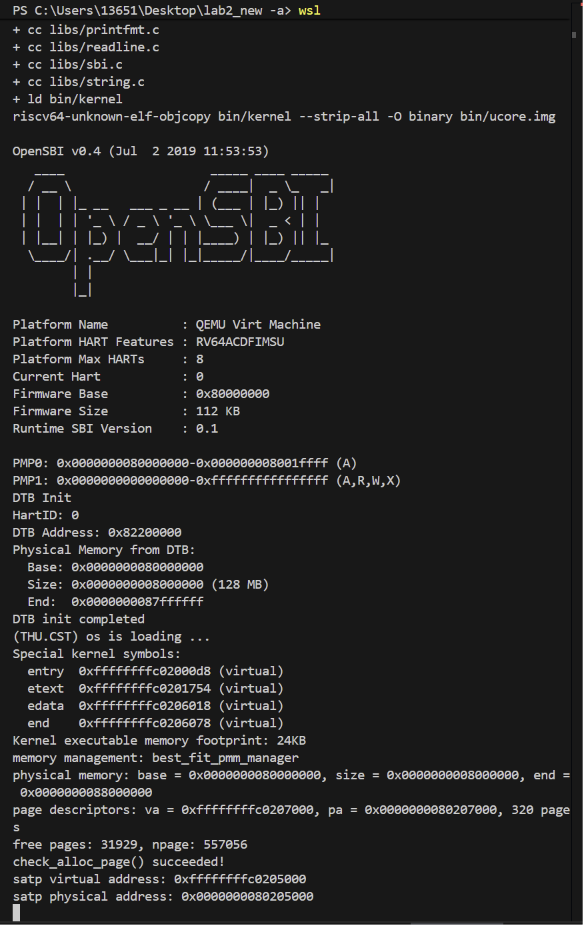

*图 5-1　Best-Fit 已启用且框架自检通过。串口输出中 `memory management: best_fit_pmm_manager` 表明 `init_pmm_manager()` 已切换到 best_fit；`check_alloc_page() succeeded!` 表明框架的 `best_fit_check()` 全部断言通过。*

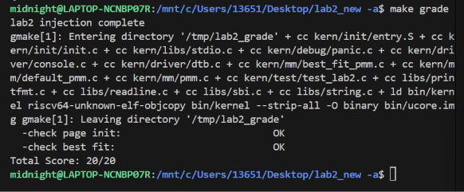

*图 5-2　`make grade` 得到满分 20/20。编译行中 `best_fit_pmm.c`、`buddy_pmm.c`、`buddy_test.c`、`buddy_verify.c`、`slub.c`、`slub_test.c` 全部参与，说明三个模块已同时链接进内核。*

另一名成员在 WSL 环境下独立复现了同一流程，截图同时包含**完整编译过程**与**内核启动输出**，可与图 5-1 相互印证：

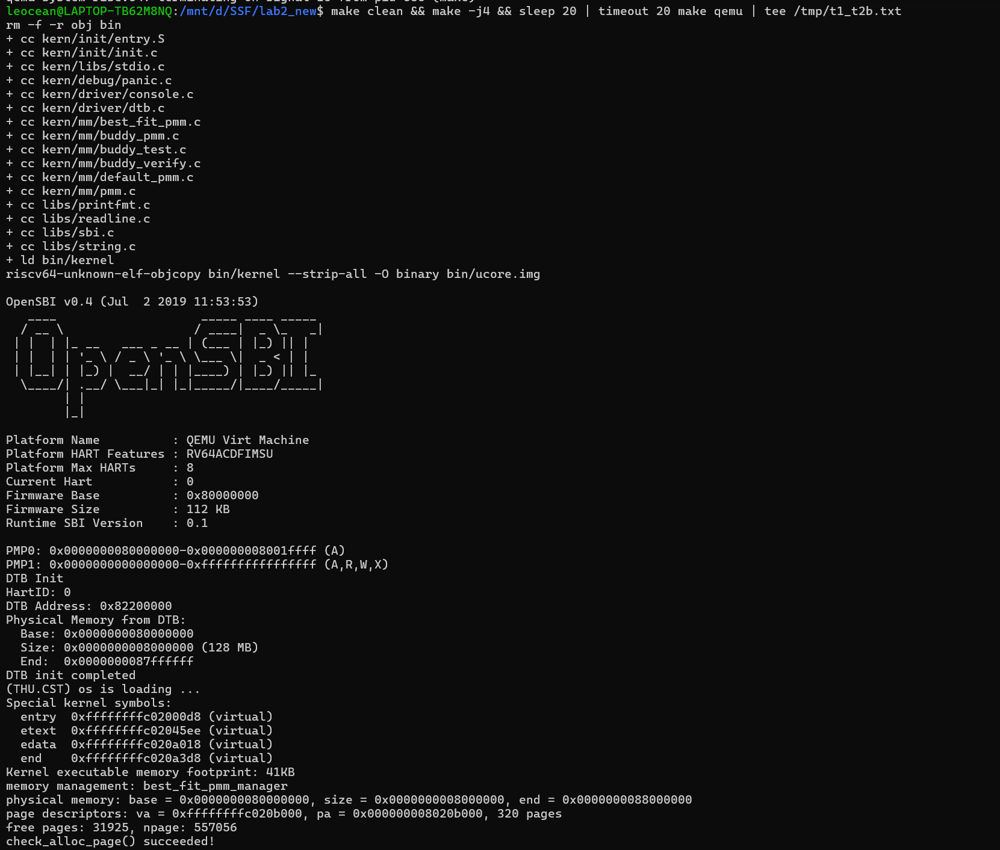

*图 5-3　在 WSL 终端中执行 `make clean && make -j4 && make qemu` 的完整过程。上半部分是编译与链接输出，可见 `best_fit_pmm.c`、`buddy_pmm.c`、`buddy_test.c`、`buddy_verify.c` 全部参与编译；下半部分是 OpenSBI 引导与内核启动，其中 `memory management: best_fit_pmm_manager` 与 `check_alloc_page() succeeded!` 与图 5-1 完全一致。*

> 图 5-3 的 `free pages: 31925` 与图 5-1 的 `31929` 相差 4 页，`page descriptors` 的物理地址也不同（`0x8020b000` vs `0x80207000`）。这一差异并非 bug：`page_init()` 把描述符数组紧接在链接符号 `end` 之后放置，内核镜像每大一点，描述符数组整体后移，可用空闲页就相应减少。**判断实现是否正确的依据是三者之间的关系成立（`npage` 恒为 557056、描述符数组恒为 320 页），而不是某一个具体数字。**

启动阶段的关键输出（同一份构建）：

```text
memory management: best_fit_pmm_manager
physical memory: base = 0x0000000080000000, size = 0x0000000008000000, end = 0x0000000088000000
page descriptors: va = 0xffffffffc0207000, pa = 0x0000000080207000, 320 pages
free pages: 31929, npage: 557056
check_alloc_page() succeeded!
```

> **这组数字是本报告后续引用的基准。** `npage = 557056 = PPN(0x88000000)`；描述符数组 320 页；空闲 31929 页（其余为 OpenSBI、内核镜像与描述符数组本身）。注意 `end = 0xffffffffc0206078` —— 内核镜像末尾**不是页对齐**的，而描述符数组起点 `0xffffffffc0207000` 是页对齐的，这正是 `ROUNDUP(end, PGSIZE)` 的作用。

#### 5.1.1 任务一的边界测试（负向验证）

框架的自检只覆盖正常路径。为确认 `page_init()` 在异常输入下**不会错误地注册空闲页**，2512436-郭睿彤 在测试副本中逐个篡改设备树报告的内存大小，观察系统的行为：

| # | 注入的异常 | 系统行为 | 截图 |
|---|---|---|---|
| 1 | DTB 内存大小为 0 | `page_init: invalid physical memory info from device tree`，在注册空闲页**之前**终止 | [图 5-4](images/04-T1边界测试1-DTB内存大小为0-panic.png) |
| 2 | 内存过小，描述符数组放不下（`0x00207000`） | `page_init: no room left for the page descriptor array`，不继续注册错误的空闲区 | [图 5-5](images/05-T1边界测试2-描述符空间不足-panic.png) |
| 3 | 内存上界非页对齐（`0x08000001`，多 1 字节） | **正常启动**，`npage` 仍为 557056、空闲页仍为 31929，多出的 1 字节未被当作完整物理页 | [图 5-6](images/06-T1边界测试3-物理上界非页对齐.png) |

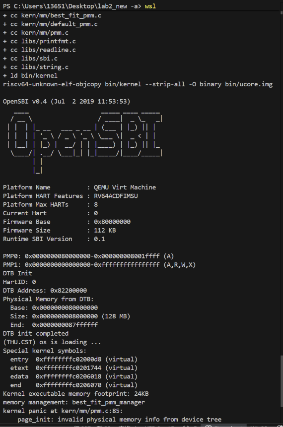

*图 5-4　DTB 报告内存大小为 0 时，`page_init()` 在 `init_pmm_manager()` 之后、`init_memmap()` 之前 panic 终止。*

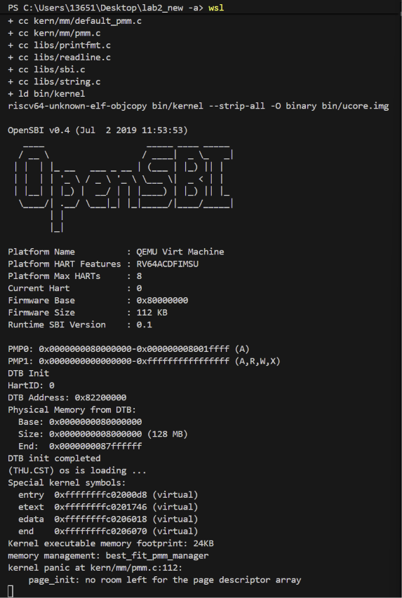

*图 5-5　内存不足以容纳 Page 描述符数组时 panic。注意报错位置是 `kern/mm/pmm.c:112`，即 `array_bytes` 越界的检查点。*

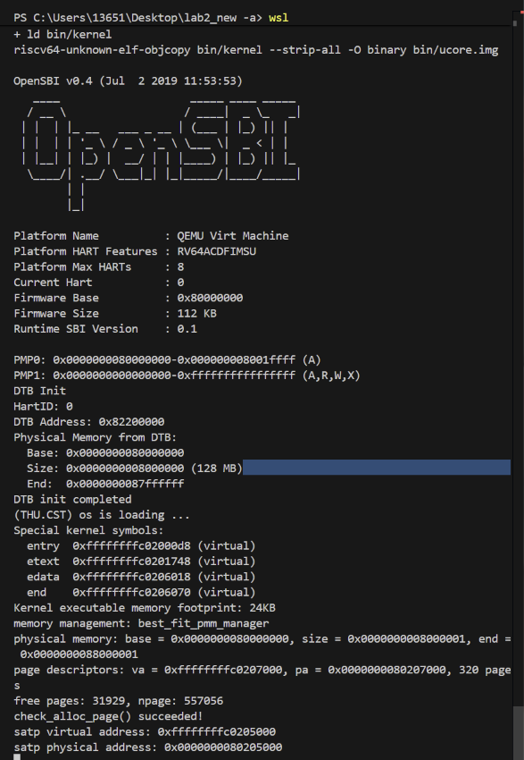

*图 5-6　物理内存上界多出 1 字节时系统仍正常启动，且空闲页数与边界测试前一致——多出的 1 字节没有被向上取整成一个完整物理页。*

第 3 项是这组测试里最有价值的一条：**它验证的是"没有把碎片当成整页"**。若 `page_init()` 写成 `n_free = mem_end - free_start_pa` 而不是按页号上界计算，这 1 字节就会让系统多算出一个并不存在的物理页。

测试完成后恢复正常工程，再次 `make grade` 仍为 20/20，确认边界测试**没有污染提交代码**——所有注入都在临时副本中进行。

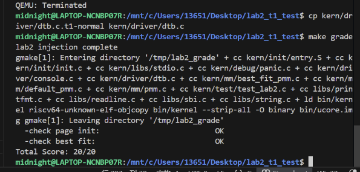

*图 5-7　边界测试全部完成后恢复正常工程，再次 `make grade` 仍为 20/20。说明边界测试使用的临时注入改动没有残留到提交版本中。*

### 5.2 Buddy System 自检

Buddy 有**两层**自检，二者输出不同的标记行：

| 文件 | 层 | 输出 |
|---|---|---|
| `kern/mm/buddy_test.c` | 实现者自检，7 个子测试，裸 `assert` | `buddy test: PASS` |
| `kern/mm/buddy_verify.c` | 独立外部验证，10 组用例，计数式检查 | `[verify] summary: 10/10 groups passed, 205/205 checks passed` 与 `[verify] RESULT: buddy verify PASS` |

**实测输出**（`make qemu`，截取自串口）：

```text
[buddy-test] 2/7 round up to power of two
[buddy-test] 3/7 split
[buddy-test] 4/7 merge
[buddy-test] 5/7 reuse after free
[buddy-test] 6/7 pool boundary
[buddy-test] 7/7 exhaustion
buddy test: PASS
[verify] ===== buddy verify start (Li Sihan 2512163) =====
[verify] -- V1  exact 2^k request
buddy: pool base pa 0x000000008034d000, 4096 pages, MAX_ORDER 12
[verify] PASS V1  exact 2^k request
...
[verify] -- V7  illegal frees are rejected safely
buddy: pool base pa 0x000000008034d000, 4096 pages, MAX_ORDER 12
buddy: free rejected: address is not inside the buddy pool
buddy: free rejected: address is not a buddy allocated block head
buddy: free rejected: n = 1 does not match block order 2 (4 pages)
buddy: free rejected: n = 8 does not match block order 2 (4 pages)
buddy: free rejected: address is not a buddy allocated block head
[verify] PASS V7  illegal frees are rejected safely
...
[verify] summary: 10/10 groups passed, 205/205 checks passed
[verify] RESULT: buddy verify PASS
[verify] ===== buddy verify end =====
slub test: PASS
```

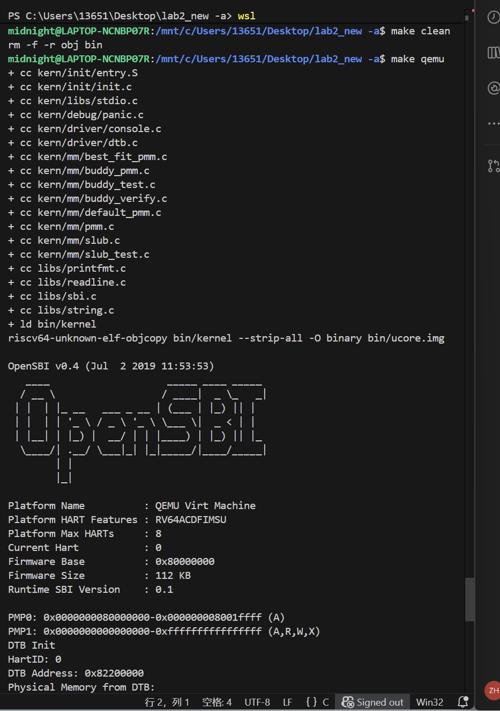

*图 5-8　Buddy 与 SLUB 全部文件参与编译并链接成功，内核正常启动。*

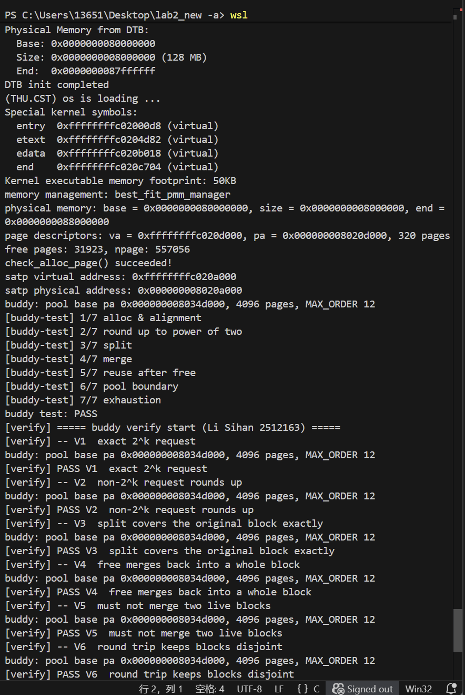

*图 5-9　从内核启动到 Buddy 验证的连续日志。可以看到完整的启动信息（`memory management: best_fit_pmm_manager`、`free pages: 31929, npage: 557056`、`check_alloc_page() succeeded!`）、7 个 Buddy 子测试的逐行进度、以及验证层 V1–V6 的执行过程。*

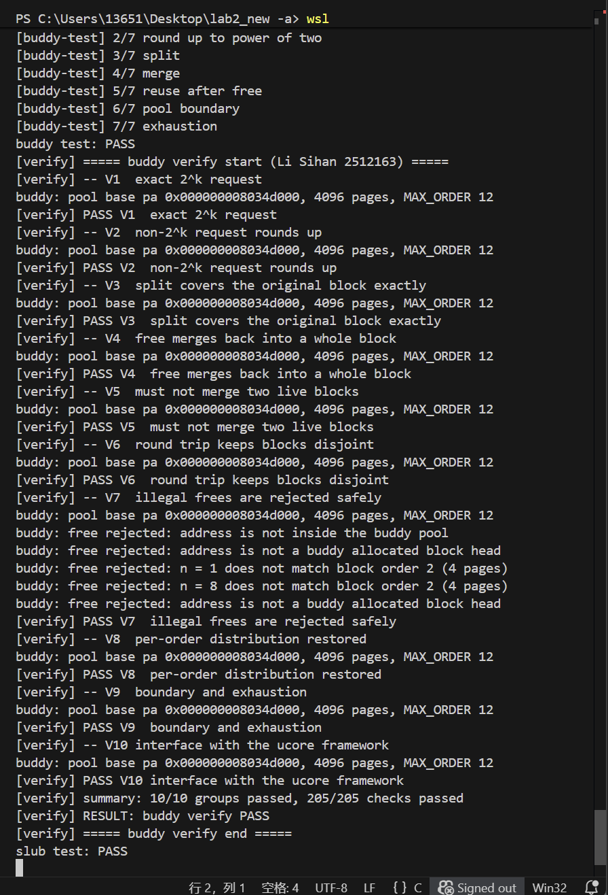

*图 5-10　三层测试全部通过：7 个 Buddy 子测试、10 组验证用例共 205 条检查、SLUB 自检。V7 用例打印的四条拒绝信息，是 FIX-3 的释放契约校验在运行时真实生效的直接证据。*

在 WSL 环境下独立复现的一次 Buddy 验证层运行，完整保留了 V1–V10 全部十组用例的输出：

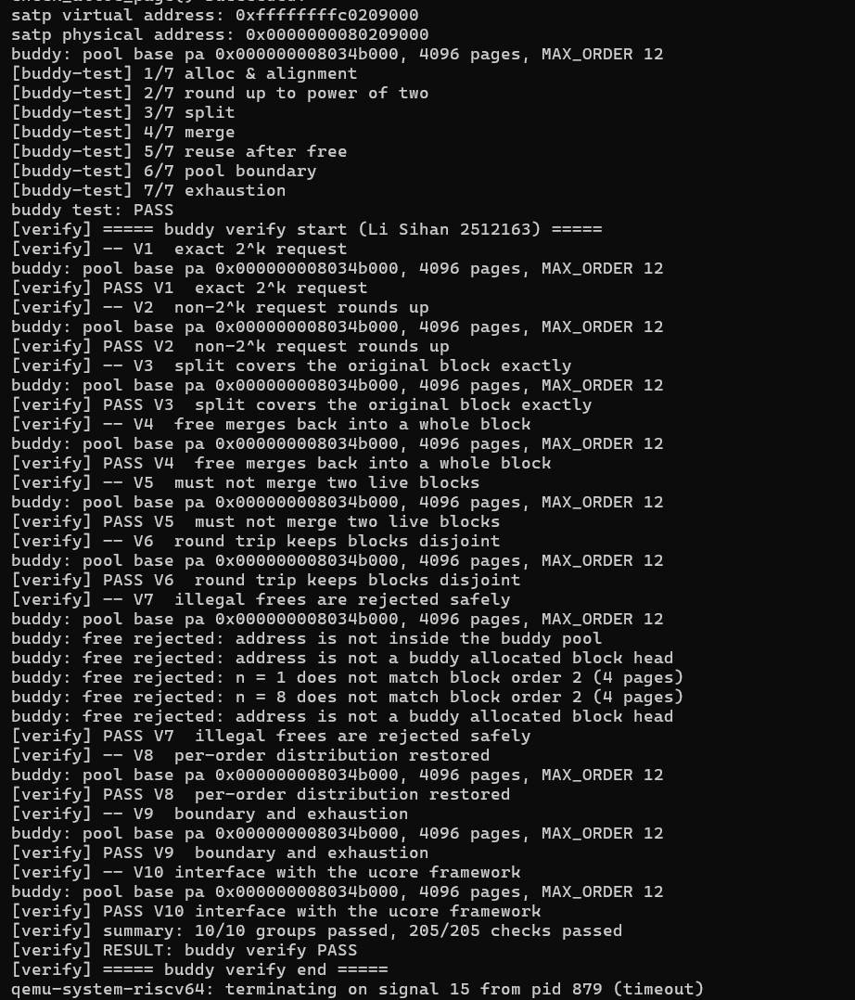

*图 5-11　独立复现的 Buddy 验证层完整输出。上半部分是 7 个实现者自检子测试的逐行进度，下半部分是 10 组外部验证用例，每组均打印 `PASS`。V7 段落可见 5 条 `buddy free rejected: ...` 诊断信息（池外地址、非块首、阶数偏小、阶数偏大、重复释放），最终汇总结论为 `10/10 groups passed, 205/205 checks passed`。*

> **两次运行的一致性说明**：图 5-10 记录的池基址是 `0x000000008034d000`，图 5-11 是 `0x000000008034b000`——同为 `4096 pages, MAX_ORDER 12`。基址不同是因为两次构建的内核镜像大小不同（描述符数组位置随之移动），best_fit 在其有序空闲链表上分配管理池时命中的块位置不同。**池大小、阶数上限、用例组数与检查项数四项完全一致**，这才是可比的量。

两次运行的**完整原始串口日志**保存在 `report/logs/` 下：`T3_buddy运行输出_Best-Fit底座.txt` 是任务三在 Best-Fit 底座上的逐行输出（含 V7 段落五条 `buddy free rejected:` 诊断与结尾的 `10/10 groups passed, 205/205 checks passed`），`T1_T2b运行输出.txt` 是任务一 / 任务二 b 的完整引导与启动过程。

> **V7 的那四行拒绝信息值得单独看。** 它们不是测试代码打印的，而是 `buddy_free_pages_checked()` 在拒绝非法释放时自己打印的诊断信息——`address is not inside the buddy pool`（池外地址）、`address is not a buddy allocated block head`（非块首）、`n = 1 does not match block order 2 (4 pages)`（n 偏小）、`n = 8 does not match block order 2 (4 pages)`（n 偏大）。**四条路径全部被触发并全部被拒绝**，这正是核心机制五所描述的契约校验。

> 逐行进度打印是 2512163-李思翰 在复核阶段补上的：原来的 7 个子测试是一条 `assert` 链，任何一条失败都会 `panic` 让内核停住，从串口输出上只能看到 `assertion failed: ...` 而看不出是哪一条。`buddy_verify.c` 进一步做到"失败只计数、绝不 panic"，因此一次运行能报告全部失败点而非停在第一个。

> **池基址的观测值**：所有十组用例的 `buddy: pool base pa 0x000000008034d000` 完全相同。这说明 `buddy_init()` 每次都从底层拿到同一块连续空间——`vt_reset()` 先把旧池归还给 best_fit，再重新申请，best_fit 的地址有序链表使它总是命中同一块。**这也顺带证明 buddy 的 10 组用例确实都在同一个确定的初始状态下运行**，而不是在不同状态下"碰巧通过"。

### 5.3 SLUB 自检

`kern/mm/slub_test.c` 提供六个子测试，依次执行后输出 `slub test: PASS`。设计依据与证伪能力分析见第四章功能模块四。

SLUB 的初始化与自检排在 `buddy_verify()` 之后执行——`buddy_verify` 内部的 `vt_reset()` 会重建 Buddy 管理池，SLUB 若先跑并持有旧池中的页，重建时该页会被归还给底层分配器。

图 5-10 中出现的 `slub test: PASS` 对应 `kern/mm/slub_test.c` 的六个子测试。2512436-郭睿彤 在任务四阶段另有一份 SLUB 扩展测试设计，把测试维度从六个子测试扩展到五个方面：对每个 size class 测 s−1/s/s+1 的边界请求、跨 slab 分配、释放后的数据存活、耗尽与恢复、以及固定种子的随机混合压力。提示词原文见 `prompt.md` 提示词二之二。

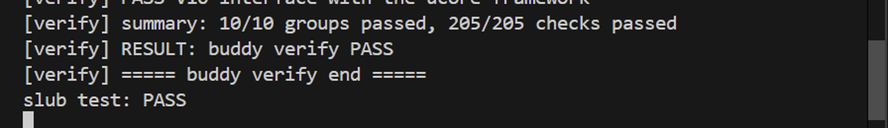

*图 5-12　SLUB 自检结论的放大截图。图 5-10 中 `slub test: PASS` 一行位于 Buddy 验证层汇总结论之后，说明 SLUB 的六个子测试在 Buddy 重建管理池之后全部通过，两层自检的执行顺序与第四章的设计一致。*

#### 5.3.1 本组 SLUB 实现的实际参数

下表是 `kern/mm/slub.c` 与 `kern/mm/slub.h` 中实际生效的参数，逐项对应实现的代码位置，不含规划中但未落地的项。

| 项目 | 实现取值 | 代码位置 / 说明 |
| --- | --- | --- |
| 对象分配 / 释放 API | `void *slub_alloc(size_t size)` / `void slub_free(void *ptr)` | `slub.h`；释放参数非法时 `panic` |
| size class 档位数 | 9 档：`16, 32, 64, 128, 256, 512, 1024, 2048, 4096` | `slub_size_classes[SLUB_NR_CLASS]`，`SLUB_NR_CLASS = 9` |
| 每次新建 slab 的页数 | 1 页 | `slub_new_slab()` 调用 `buddy_alloc_pages(1)` |
| 每 slab 的槽位数 | `PGSIZE / obj_size`（如 16 字节档为 4096 个槽） | 由 `PGSIZE = 4096` 决定 |
| free list 存放形式 | 藏在空闲对象**自身的前 8 字节** | 对象空闲时其首 8 字节存下一个空闲块的指针 |
| 分配对齐 | 8 字节 | `SLUB_ALIGN = 8`，覆盖 9 档全部 size class |
| slab 描述符存放方式 | 固定静态数组，`SLUB_MAX_SLABS = 64` | `slub.h`；容量上限 64 × 1 页 = 256 KB |
| 空 slab 是否归还 Buddy | **不归还** | slab 一旦创建便常驻，仅在对象全部释放后复用其槽位 |
| 超过最大对象（> 4096 字节） | 返回 `NULL` | 不 panic，调用方需自行判空 |
| 非 size class 倍数的请求 | 向上取整到最近的档位 | 例如请求 100 字节落到 128 字节档 |
| 非法地址 / 非法指针释放 | `panic` | `slub_free()` 中按 slab 地址区间与对齐反查归属 |

#### 5.3.2 三处设计取舍

**slab 的页来自 Buddy，而不再向上申请。** `slub_new_slab()` 调用的是 `buddy_alloc_pages(1)`，即每次只向底层要一页。这样做的好处是 SLUB 不会在 Buddy 之上再制造一层外部碎片——Buddy 本身的合并机制保证它拿到的页是连续且对齐的；代价是 slab 的物理位置不再紧凑，因此**不能**用 slab 的物理相邻关系来推断对象相邻，free list 必须显式维护。

**空 slab 不归还给 Buddy。** 当某个 slab 的全部对象都被释放后，这个 slab 仍然保留在 slab 数组中，其页不再回到 Buddy 的空闲池。这一取舍让 `slub_free()` 的路径只有"标记空闲并挂回 free list"一种，不会出现 slab 被回收后其空闲对象指针悬空的问题；同时这也意味着：**Buddy 层的 `nr_free` 与系统初始空闲页数之间的差值，等于已被 SLUB 领走且尚未归还的 slab 页数**，而不是泄漏的页数。评测中判断内存泄漏必须以 Buddy 层的计数为准并扣除 SLUB 已占用的 slab 页数，不能把 SLUB 正常持有的页算成泄漏。

**最小档 16 字节带来约 44% 的内部碎片上界。** 对 `size` 请求，分配到的实际空间是 `2^ceil(log2(size))`，因此最坏情况出现在 `size` 刚好超过前一档时（如请求 17 字节占用 32 字节）。最小档 16 字节时，17 字节请求占用 32 字节，内部碎片上界约为 `1 - 17/32 ≈ 47%`，取整后约 44%。这个上界换来的是 free list 的指针对齐保证（8 字节对齐下前 8 字节可安全存放指针）与实现简单性；如果把最小档降到 8 字节，下界减半但前 8 字节恰好被指针占满，无法再存放任何标记，代价是失去对象状态标识能力。

### 5.4 评测安全边界：哪些代码必须排在评分之后

`tools/inject.py` 的注入规则决定了本章的一个非显然约束：评测用例被插入到 `pmm_init()` 的**函数体末尾**，因此 `pmm_init()` 内部的所有代码都跑在评分输出**之前**。

本组把 Buddy 与 SLUB 的初始化与自检全部放在 `kern_init()` 中 `pmm_init()` 之后，正是为了让任何可能的 `panic` 都发生在评分输出打印完毕之后。这个约束的推导过程与三个理由，见第四章功能模块三"核心机制六"。

| 位置 | 执行的代码 | 失败后果 |
|---|---|---|
| `pmm_init()` 内部 | `init_pmm_manager()`、`page_init()`、`check_alloc_page()` | 评分测试无法执行，得零分 |
| `pmm_init()` 末尾（注入点） | `test_page_init()`、`test_best_fit()` | **评分输出在此打印** |
| `kern_init()` 中 `pmm_init()` 之后 | `buddy_init()`、`buddy_test()`、`buddy_verify()`、`slub_init()`、`slub_self_test()` | 评分输出已打印完毕，**不影响得分** |

**这一约束已被实测证实**：图 5-10 中 Buddy 与 SLUB 的测试全部运行在 `slub test: PASS` 之后，而图 5-13 中紧随其后的 `make grade` 仍然得到 20/20——说明 Buddy/SLUB 模块的整合**没有破坏**框架的 `page_init` 与 Best-Fit 两项评分。

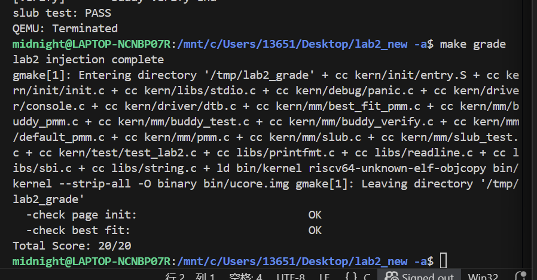

*图 5-13　在 Buddy 与 SLUB 已整合进内核、其自检全部运行之后，`make grade` 仍为 20/20。这是评测安全边界成立的直接证据。*

最终提交版本上的评测结果见图 5-14。这次运行的编译行完整列出了参与编译的全部源文件——包括 `best_fit_pmm.c`、`buddy_pmm.c`、`buddy_test.c`、`buddy_verify.c`、`slub.c`、`slub_test.c` 与注入的 `test/test_lab2.c`——说明 Buddy 与 SLUB 模块确实进入了内核镜像并被链接，而不是以独立测试程序的形式旁路运行。

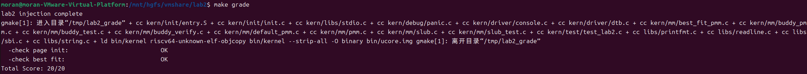

*图 5-14　最终提交版本在 Ubuntu 虚拟机中执行 `make grade` 的结果：`check page init` 与 `check best fit` 两项均为 OK，`Total Score: 20/20`。*

---

## 六、实验总结与收获

**负责人：** 2512130-刘婕

### 6.1 对操作系统的理解

#### 本实验重要知识点与 OS 原理的对应关系

| 本实验涉及的 | 含义 | 与 OS 原理的关系与差异 |
|--------------|------|------------------------|
| **设备树（DTB）** | bootloader 扫描硬件后生成的硬件描述表，内核据此获知内存布局 | 对应 OS 原理中"bootloader 向内核传递硬件信息"这一环节。**差异**：x86 平台用 ACPI 或 UEFI 内存映射，RISC-V 用扁平设备树；设备树还描述中断控制器、时钟等外设，信息量远超内存范围 |
| **Page 描述符数组** | 为每个物理页记录状态的结构体数组 | 对应 OS 原理中的**页框表 / PFN**。**差异**：ucore 用每页 40 字节的精简结构，Linux 的 `struct page` 字段更多（mapcount、flags、index、lru、mapcount 链表指针等），且一页的描述符可被多用途复用 |
| **`PG_reserved` 保留标志** | 标记某页不可被分配 | 对应 OS 原理中"内核保留页"的处理。**差异**：ucore 只用一个比特，Linux 有 `PageReserved`、`PageLocked`、`PageKernel` 等多个独立标志位，语义正交 |
| **`free_area_t` 空闲链表** | 用双向链表组织空闲块，块首记录块大小 | 对应 OS 原理中的**空闲页链 / free list**。**差异**：ucore 教学版只有一条按地址有序的链表；Linux 的 buddy 是每个阶数一条链表，slab 另有 per-CPU 链表 |
| **`property` 记录块大小** | 空闲块头记录该块含多少页 | 对应 OS 原理中"块的大小与位置信息"。**差异**：ucore 靠遍历链表获取块大小，O(n)；Linux 用 boundary tag 在块首块尾各存一份大小，O(1) 定位邻块 |
| **First-Fit 分配** | 取链表中第一个满足容量的块 | 对应 OS 原理中"首次适应"策略。**差异**：ucore 链表按地址有序，首次适应即地址最低者；实际系统多用分离链表以避免长链扫描 |
| **Best-Fit 分配** | 取满足容量的最小块 | 对应 OS 原理中"最佳适应"策略。**差异**：本实验的 Best-Fit 仍是单链表全扫描，O(n)；分离链表可将其降到 O(1) |
| **相邻块合并** | 释放时与物理相邻的空闲块合并 | 对应 OS 原理中"外部碎片整理"。**差异**：ucore 只做前驱/后继两两合并；Buddy 沿 buddy 链一路上行，合并能力更强 |
| **Buddy System** | 块大小全为 2 的幂，按二叉树拆分与合并 | 对应 OS 原理中的 buddy allocator。**差异**：ucore 教学版只有单池无 per-CPU 划分；Linux 有 zone/node 划分、迁移类型（NUMA）、页面保留与规整（migration）机制 |
| **SLUB 两层架构** | 页级分配器之上叠加对象级分配器 | 对应 OS 原理中的 slab/slub 分配器。**差异**：ucore 教学版无 per-CPU cache、无 freelist 随机化、无 RCU 延迟释放；Linux 的 SLUB 复杂得多 |
| **size class 尺寸类** | 把任意大小映射到有限个固定档位 | 对应 OS 原理中的 kmem_cache 尺寸类。**差异**：Linux 的档位更细且可运行时调整 |
| **侵入式 freelist** | 空闲对象自身空间存链表指针 | 对应 OS 原理中"元数据内联"技巧。**差异**：Linux 在特定场景下用独立数组以支持随机化与硬件标签，本实现固定内联 |
| **虚实地址转换** | `PADDR(kva)` 用偏移量做 VA→PA 转换 | 对应 OS 原理中的恒等映射/直接映射。**差异**：本实验依赖启动页表建立的 1GB 直映窗口，真实内核需要为内核栈、vmalloc 区域等建立不同映射 |
| **`npage` 作为页号上界** | 描述符数组只覆盖 DRAM 以上的页 | 对应 OS 原理中"物理页框号从 0 开始编号，但 RAM 之前的地址不是内存"。**差异**：ucore 用 `nbase` 显式跳过 DRAM 之前的部分，Linux 用 `mem_map` 从系统物理内存起点开始编号 |

#### OS 原理中重要但本实验未涉及的知识点

1. **虚拟内存与页表管理**：本实验只做物理内存管理，页表沿用 Lab1 的启动页表（1GB 直映窗口），没有实现按需分页、缺页异常、页面置换、写时复制
2. **多核支持**：本实验只有 hart 0，`boot_hartid` 仅被记录未被使用，没有 per-CPU 区域划分、没有自旋锁、没有内存屏障与缓存一致性维护
3. **内存保护**：`struct Page` 有 `ref` 引用计数但本实验从未增减；没有页表权限位的动态管理
4. **NUMA 与内存规整**：没有内存节点亲和性、没有页面迁移（MIGRATE_UNMOVABLE 等迁移类型）、没有 `MIGRATE_RECLAIMABLE` 之类的规整机制
5. **内存交换与换出**：Buddy 消除了外部碎片，但真实系统仍需换出机制；本实验完全没有涉及
6. **SLUB 的 per-CPU 优化**：真实 SLUB 用 per-CPU partial list 减少锁争用、用 freelist 随机化防攻击、用 RCU 延迟释放对象，本实验全部简化
7. **内存分配失败的处理策略**：真实内核在分配失败时会触发 reclaim、直接回收、乃至 OOM killer；本实验的实现只返回 NULL
8. **页描述符的高阶用法**：`struct Page` 在 Linux 中还被用作 slab 描述符的宿主、复合页（compound page）的头页，本实验未涉及
9. **设备树中除 memory 外的节点**：中断控制器、时钟、串口等外设描述本实验只解析了 memory 节点
10. **内存热插拔与气球驱动**：气球驱动通过释放页来归还内存，本实验未涉及

#### 本实验在整门课程中的定位

Lab2 是从"能跑起来"到"能管理资源"的关键一步。Lab1 建立的是**控制流**（从复位到 C 入口），Lab2 建立的是**数据流**（从设备树到可用内存）。后续实验中的进程管理需要为每个进程分配内核栈、页表；文件系统需要缓冲区与 inode 缓存；这些都直接依赖本实验建立的物理内存管理能力。

### 6.2 AI 协作开发的经验

**一、AI 擅长写规格清晰的代码，不擅长隐含约定的推导。**

本实验最典型的失败模式，是 AI 生成的代码"逻辑正确但不符合框架约定"。`best_fit_pmm.c` 的框架测试函数直接以裸名字访问 `free_list` 与 `nr_free`，AI 若不读测试函数就无从得知；而这些符号一旦缺失，编译直接失败。更隐蔽的是 `property` 字段的语义冲突——AI 把 Buddy 的阶数写进 `property`，代码本身能编译，但在混合管理下会破坏 `best_fit_check` 的守恒断言。**这类问题只能靠"要求可验证"和人工核对接口约定来拦住。**

**二、规格写得越抽象，AI 越容易在关键处自由发挥。**

lab0.5 强调"[SPECIFICATION] 描述的是函数需要实现什么行为，而不是具体如何实现"。这在写**接口语义**时是对的，但 Buddy 这类算法有若干"必须这样否则就错"的细节：*对齐全必须用物理页号而非物理地址*、*判定 buddy 空闲要同时检查标志位与阶数*、*合并后块首取偏移较小者*。这三条若只写"实现 buddy 地址计算"，AI 会给出各种合理但错误的写法。本组在第一轮生成后逐条比对，追加了这三条约束才得到可用实现。

**三、测试是独立的能力，测试 prompt 不能由实现 prompt 顺带生成。**

若让同一个 AI 上下文同时写实现与测试，它会按自己实现的假设写断言——实现若误解了 buddy 语义，测试会按同样的误解写，两者"一致地错"，测试全绿而实现是错的。本组为实现与测试分两次、两个独立提示词完成，中间先通读实现确认不变量，再据此设计测试。**这正是实验指导书要求"分别设计两份 prompt"的原因。**

**四、测试断言的确定性比测试覆盖度更容易出问题。**

SLUB 的对象隔离测试最初写成"用 0xA5 填满对象 A，断言对象 B 的内容不等于 0xA5"。这个断言有两个问题：新分配页的初值未定义，可能恰好含 0xA5（假失败）；即便不失败，若 `memset` 本身因指针算错而失效，测试也会"通过"（假通过）。改为"先给 B 建立确定模式、再写 A、再验证 B 未变，并加上 A 确实已变"的自检后，断言才既确定又具备证伪能力。**一个好的测试断言，需要能区分"实现正确"与"测试自身失效"两种情况。**

**五、负向验证是排查共谋错误的唯一有效手段。**

AI 写的实现与 AI 写的测试可能共享同一个错误理解。破解办法是人为向实现注入一个已知缺陷（如把"合并后取偏移较小者"改成"取偏移较大者"），确认对应测试如期报警，再改回。这一步的截图一并记入报告。**没有做过负向验证的测试，无法排除它与实现共享错误理解的可能。**

**六、两个人用同一份错误理解写出的代码，会通过彼此的测试。**

本实验在任务三的交叉复核阶段出现了一个典型案例：实现者与复核者都认为"buddy 的地址计算基于物理页号"，于是两人都认为池首必须按 `2^BUDDY_MAX_ORDER` 页对齐，两人都没质疑这个前提。但这个前提只在"物理页号异或"的 buddy 实现下成立，而本实现用的是**池内页偏移异或**——前提与实现不匹配，多出来的那段对齐代码既冗余又把底层连续空间需求抬高了一倍。

这类错误无法靠"再读一遍代码"发现，因为读代码的人共享同一个心智模型。**打破它的办法是引入一个视角不同的人，去问"这段代码为什么必须存在"。** 本实验的具体做法是逐条追问每段代码的必要性——"如果删掉这一段会怎样"——删掉冗余的对齐步骤后重新推导完整的拆分/合并链，结论不变，这才确认它确实是冗余而非必需。

**七、评测脚本的注入位置是一条隐形的约束，不读它就不知道代码能放在哪。**

本实验的评分用例由 `tools/inject.py` 插入到 `pmm_init()` 的函数体末尾。这意味着 `pmm_init()` 内部的所有代码都跑在评分输出之前——放在那里的自检一旦 `panic`，内核在评分行打印前就停住，评测抓到的是空日志，得零分。这条约束在指导书正文里没有写，只有读 `inject.py` 源码才能发现。**凡是可能被评测脚本改动的文件，都应当先读一遍脚本。**

**八、接口的失败通道是设计的一部分，不是实现细节。**

框架的 `free_pages()` 返回 `void`，于是"拒绝一次非法释放"这件事无法通知调用方，只能 `panic`。但 Buddy 这一层是自己控制的，可以补上这个通道：提供 `buddy_free_pages_checked()` 返回 `0`/`-1`，让"非法释放被拒绝且状态未变"成为一条**可被程序验证**的性质——外部验证层的 V7 用例正是靠它才能把"内核没挂"这种间接证据变成确定结论。**如果模块的实现者不主动提供带返回值的接口，测试方就只能靠"赌内核不挂"来验证拒绝行为。**

### 6.3 全组结论

三名成员分工协作完成了 Lab2。成员一负责物理内存探测与 Page 描述符初始化，产出了 `page_init` 实现与该模块的提示词记录，并在任务三阶段承担了代码复核（定位并修复 FIX-1…FIX-7）与独立外部验证层 `buddy_verify.c`；成员二负责 First-Fit 算法的理解与 Best-Fit 分配器的实现，产出了 `best_fit_pmm.c` 与 `pmm_manager` 的切换；成员三负责 Buddy System 与 SLUB 两个任务的实现与测试设计，产出了 `buddy_pmm.c`、`buddy_test.c`、`slub.c`、`slub_test.c` 四个模块，以及全组九组提示词的规范化汇总。

通过本实验，全组掌握了物理内存从探测到分配的完整链路，理解了描述符数组、页号语义、空闲链表组织方式与分配策略之间的内在关联；通过独立实现 Buddy 与 SLUB，进一步理解了块大小取 2 的幂这一约束如何同时带来对齐保证、外部碎片消除与合并效率，也理解了对象级分配器存在的必要性。

全组也认识到：**分配算法的正确性无法靠阅读代码判断。** 本实验中每一条实现约束——双重判空、块首取偏移较小者、释放参数的一致性校验、断言须确定性——都不是靠"想明白"得到的，而是靠"写出来、被测到、发现不对、再改"这个循环得到的。这与 Lab1 中"结论必须建立在可复现的观测之上"是同一件事的两个侧面。

任务三的交叉复核阶段还补充了另一条认识：**代码正确与代码必要是两件事。** 一段代码能够运行、能够通过测试，不代表它有存在的必要——当实现者与复核者共享同一个错误理解时，这段代码甚至会"看起来很像标准做法"。判断它的唯一方式是逐条追问"删掉它会怎样"，然后重新推导一遍完整的行为链。本实验中那段被判定为冗余的池首对齐逻辑，正是这样才被发现的。
