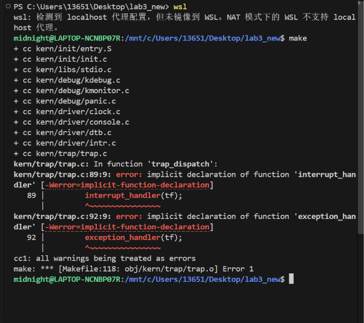
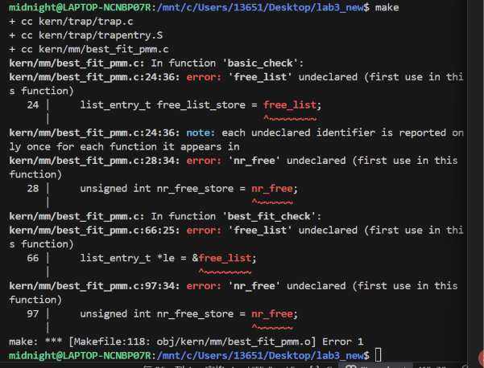
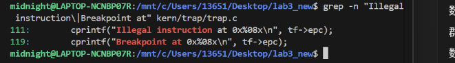
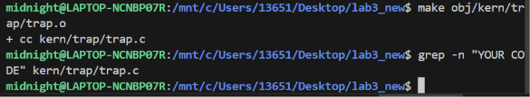
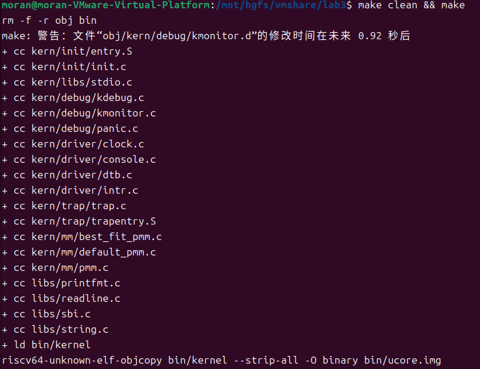
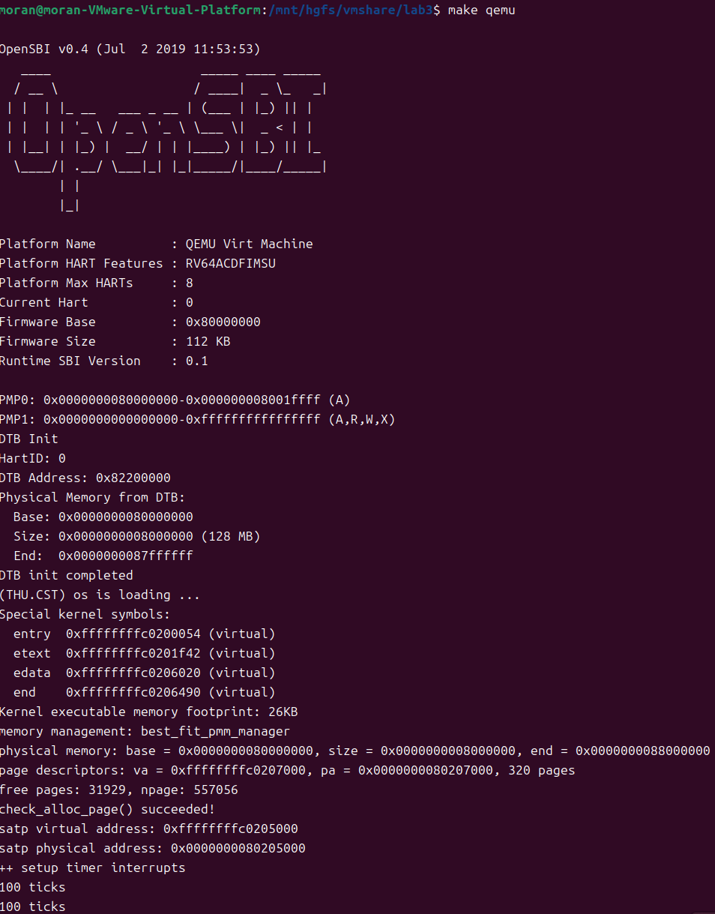
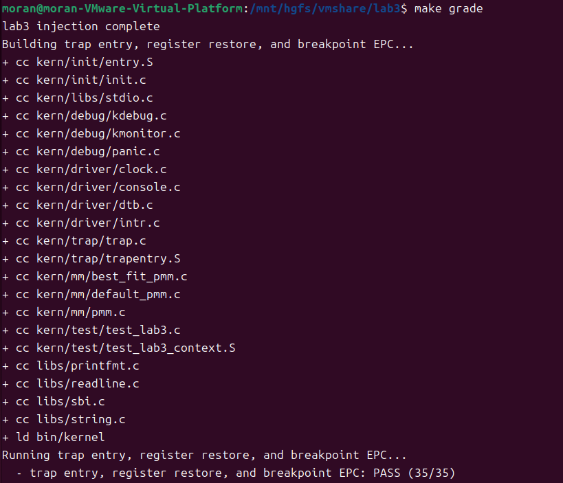
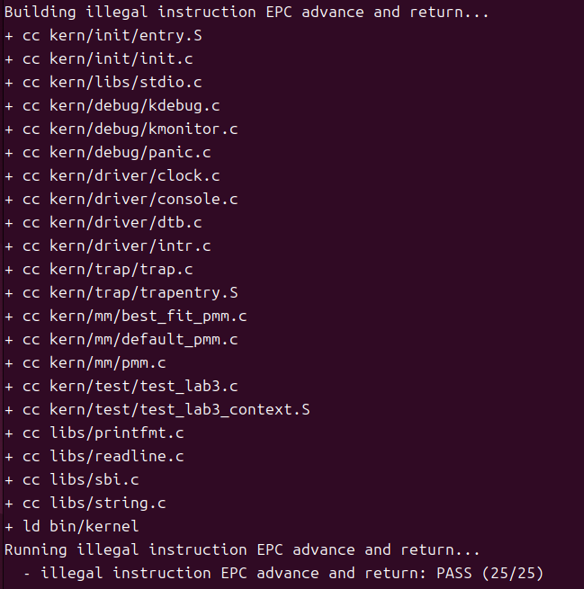
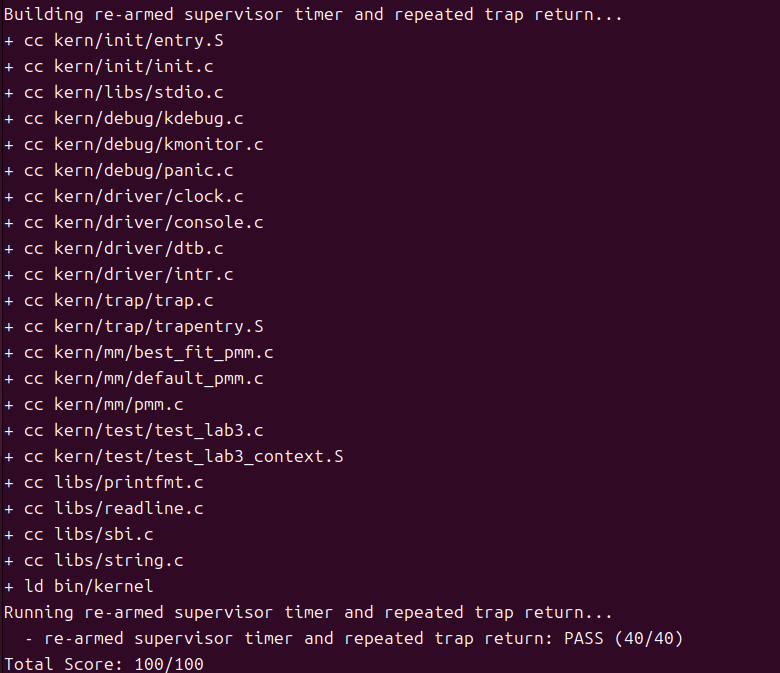

# 实验报告

## 实验基本信息

| 项目 | 内容 |
|------|------|
| **实验名称** | Lab3: 中断与异常处理 |
| **小组成员** | 2512163-李思翰、2512436-郭睿彤、2512130-刘婕 |
| **完成日期** | 2026-11-07 |

### 小组分工

| 成员 | 负责的练习/模块 |
|------|----------------|
| 2512163-李思翰 | 功能模块一：trap 入口与上下文恢复（`kern/trap/trapentry.S` 的 `RESTORE_ALL` 与 `__alltraps`） |
| 2512436-郭睿彤 | 功能模块二：中断与异常处理（`kern/trap/trap.c` 的 `interrupt_handler` / `exception_handler`） |
| 2512130-刘婕 | 前置任务：lab2 代码回填（`pmm.c` 的 `page_init` 与 `init_pmm_manager`、`best_fit_pmm.c` 整份实现）；全链路验证与评测执行；报告整合 |

### 实验报告分工

| 成员 | 负责的报告章节 |
|------|----------------|
| 2512163-李思翰 | 一、实验目的；三、实验整体逻辑分析；四、功能模块一 |
| 2512436-郭睿彤 | 四、功能模块二（含迭代过程与过程截图） |
| 2512130-刘婕 | 二、实验环境；四、前置任务（lab2 回填）；四、思考题；五、测试与验证；六、实验总结与收获；`prompt.md` 汇总 |

---

## 一、实验目的

Lab1 打通了从复位到 C 入口的控制流，Lab2 建立了物理内存的管理能力。两者都有一个共同前提：**内核按自己的节奏顺序执行**。本实验打破这个前提——CPU 会在任意指令处被外部事件打断，内核必须在完全不知情的位置接管控制流，处理完事件后再无缝返回。

本实验的主要目的是：

1. 理解**中断与异常的本质区别**：异常由当前指令引起、返回地址确定；中断由外设异步触发、返回地址是"被打断的下一条指令"
2. 掌握 RISC-V 的 trap 机制：`scause` 最高位如何区分中断与异常、`sepc` 如何指定返回地址、`sstatus` 的 `SPP`/`SPIE` 如何描述被打断时的特权级与中断使能状态
3. 掌握 trap 入口的**现场保存与恢复**，并厘清"硬件保存什么、软件必须补什么"的分工边界：硬件自动写 `sepc`/`scause`/`stval` 并改写 `sstatus`，但 32 个通用寄存器**一个都不管**，必须由 `SAVE_ALL` 手工搬进内存
4. 理解 `struct trapframe` 这一**内存镜像式现场**的布局约定：`SAVE_ALL` 建立的 36 槽结构必须与 `RESTORE_ALL` 严格逐槽对称，其中 `sp` 既是"被保存的现场"又是"取数的基址"，是本实验唯一真正自指的特例
5. 掌握中断与异常的分派与处理：时钟中断为什么必须续约、可恢复异常的 `epc` 为什么必须前进
6. 建立"**返回后现场必须与陷入前逐位等价**"这一正确性判据，并理解它为什么是唯一可靠的判据——上下文恢复的错误不会以异常形式暴露，而是表现为"程序安静地跑错了"
7. 理解**原子性由运行环境决定**：同一份分配器代码在 lab2 是安全的，在 lab3 必须加中断屏蔽
8. 学会按四段式规范（`[PROMPT]`/`[RELY]`/`[GUARANTEE]`/`[SPECIFICATION]`）编写提示词，并记录可复现的迭代过程

---

## 二、实验环境

**负责人：** 2512130-刘婕

### AI 编程工具

| 成员 | AI 编程工具 | 底层模型 | 备注 |
|------|------------|---------|------|
| 2512163-李思翰 | Claude Code（VS Code 扩展 / CLI） | MiniMax-M2.7 | 槽位对称性推导、`RESTORE_ALL` 实现、独立 QEMU harness 的搭建与逐槽验证 |
| 2512436-郭睿彤 | Codex CLI | gpt-6-astra | 两个 handler 的实现与输出格式对齐 |
| 2512130-刘婕 | Codex CLI | gpt-6.1-sol | lab2 回填、判据反推与报告整合 |


### 硬件与软件环境

| 项目 | 配置 |
|------|------|
| 开发平台 | VMware 虚拟机中的 Ubuntu，共享目录 `E:\vmshare`（VM 内 `/mnt/hgfs/vmshare`） |
| 交叉工具链 | `riscv64-unknown-elf-gcc` (SiFive GCC 10.2.0) |
| 模拟器 | `qemu-system-riscv64` (QEMU 4.1.1) |
| 调试器 | `riscv64-unknown-elf-gdb`（随交叉工具链安装） |
| 固件 | QEMU 内置 OpenSBI |
| 目标机器 | QEMU virt 机型，RV64 单 hart，DRAM 128 MB |
| 时钟源 | `timebase = 100000`，QEMU virt 为 10 MHz → 每 tick 10 ms |

### 实验代码来源与目录

从 oslab 站点取得 `lab3.zip` 官方骨架，按"一分支一实验"的组织方式放入仓库 `lab3` 分支：

```
lab3/
├── code/                    # 实验实现后的完整可编译工程
│   ├── Makefile
│   ├── kern/trap/           # trapentry.S、trap.c、trap.h
│   ├── kern/driver/         # clock.c、intr.c、console.c、dtb.c
│   ├── kern/mm/             # pmm.c、best_fit_pmm.c、default_pmm.c
│   ├── kern/init/           # init.c、entry.S
│   ├── kern/sync/           # sync.h（local_intr_save/restore）
│   ├── kern/debug/          # assert、panic、kdebug、kmonitor
│   └── tools/               # grade.sh、inject.py、test_lab3*
└── report/
    ├── report.md            # 本文件
    ├── prompt.md            # 本实验全部提示词
    └── images/              # 测试截图
```

### 交付物清单

| 交付物 | 路径 | 内容 |
| --- | --- | --- |
| 实验报告 | `report/report.md` | 本文件，六章正文 |
| 提示词汇总 | `report/prompt.md` | 三个模块的四段式提示词 + 迭代记录 |
| 测试截图 | `report/images/` | trap 入口与处理器的过程图、`make grade` 三项分值与总分 |
| trap 入口 | `code/kern/trap/trapentry.S` | `RESTORE_ALL` 宏与 `__alltraps` 的 `call trap` |
| 中断/异常处理 | `code/kern/trap/trap.c` | `interrupt_handler()`、`exception_handler()` |
| lab2 回填 | `code/kern/mm/pmm.c` | `page_init()` 与 `init_pmm_manager()` 的 Best-Fit 切换 |
| lab2 回填 | `code/kern/mm/best_fit_pmm.c` | Best-Fit 分配器完整实现与 `best_fit_pmm_manager` 注册 |
| 内核接入 | `code/kern/init/init.c` | `idt_init` → `pmm_init` → `idt_init` → `clock_init` → `intr_enable` 的启动顺序 |
| 评测脚本 | `code/tools/grade.sh` | 三个用例的判据（逐字 `grep -F`） |
| 评测注入器 | `code/tools/inject.py` | 把测试插入临时副本，不修改提交源码 |

---

## 三、实验整体逻辑分析

### 3.1 本章节的逻辑主线

本实验围绕**内核如何在内核态被异步事件打断后正确恢复**展开。

Lab1 解决"内核能不能跑起来"，Lab2 解决"内核知不知道内存有多少、怎么分"。到 Lab3，问题变成：**当 CPU 正在执行任意一条指令时，一个外部事件（时钟）或一个同步故障（非法指令）把控制权抢走，内核如何保证三件事——不丢现场、处理正确、返回原位。**

要讲清"现场"，必须把它拆成三层，因为三层的**保存责任人是不同的**：

| 层 | 内容 | 谁负责保存 | 本实验的处理 |
|---|---|---|---|
| 第一层 | `sstatus`/`sepc`/`scause`/`stval` | **硬件自动**写入 CSR，但同时**改写** `sstatus`（`SIE←0`、`SPIE←原 SIE`、`SPP←原特权级`） | `SAVE_ALL` 把改后的值读进内存（槽 32~35），`RESTORE_ALL` 再写回 |
| 第二层 | 32 个通用寄存器 | **无人负责**，硬件一个都不存 | `SAVE_ALL` 手工搬运 31 个（`x0` 恒 0 除外） |
| 第三层 | `sp` 本身 | 自指：它既是被保存的现场，又是保存现场的地址 | 经 `sscratch` 中转后存进槽 2，恢复时**最后一步**写回 |

第一层的处理容易被忽略但必须做：硬件虽然"记"下了陷入前的 `SIE`（存进 `SPIE`），但它同时把 CSR 改成了"陷入态"的值。软件若只存不回，`sret` 仍能靠 `SPIE` 拉起中断看似无事，**但 C 侧希望改变返回后中断开关状态的唯一通道就此断绝**——而这条通道在真实的进程切换、异常修复里是常用的。

这三层对应本章的两个功能模块：

| 问题 | 机制 | 模块 |
|---|---|---|
| 不丢现场 | `SAVE_ALL` / `RESTORE_ALL` 保存与恢复 36 个槽 | 一 |
| 处理正确 | 按 `scause` 分派到不同分支 | 二 |
| 返回原位 | `sepc` 决定返回地址，谁来改、改成什么 | 一 × 二 |

第三行是本章最关键的耦合点：**`sepc` 由模块一负责搬回 CSR，由模块二负责决定改成什么。** 模块二把 `tf->epc += 4` 写进 trapframe 的第 33 槽，这个值只有在模块一执行 `csrw sepc, ...` 之后才会真正生效。任一方缺位，`sret` 都会跳回同一条指令，形成无限重入。

**为什么"严格可逆"是唯一的正确性判据？** 因为这一层错误不会立刻崩。槽位错位一位、`sp` 恢复早了一步，程序不会 panic，而是从"被恢复之后"开始安静地跑错：某个循环变量变成了别人的值、`epc` 停在半条指令上、栈帧错乱后返回到一个看似合法的地址。**汇编通过 ≠ 上下文恢复正确**，所以本组对模块一的验收手段不是"能 make"，而是"陷入前后被中断代码观察到的寄存器集合逐个相同"——判据必须是可观测的等价性，不能是"没崩"。

### 3.2 功能的逐步实现

1. **先理解 trap 的发生过程** → 为什么？`scause` 里同时编码了"是中断还是异常"与"具体是哪一个"，最高位是唯一的分流依据，这一位决定了后面所有分支的结构
2. **再补全 `RESTORE_ALL`** → 为什么？骨架给了 `SAVE_ALL`，因为"保存"是框架能替你写死的部分；"恢复"必须与 handler 修改 trapframe 的行为配合，因此留给学生
3. **然后在 `__alltraps` 中调用 `trap()`** → 为什么？汇编入口只负责现场，分派逻辑用 C 写才可读；`mv a0, sp` 把 trapframe 指针作为唯一参数传下去
4. **再实现两个 handler** → 为什么？此时控制流已经能进入 C，缺的只是"什么类型的 trap 做什么事"
5. **最后让时钟中断持续触发** → 为什么？定时器是**一次性**事件，不重新设定期限就只会中断一次；这一步把"能处理中断"变成"能持续处理中断"，也是 Test 3 的全部考点
6. **贯穿全程：让 lab2 的底座回来** → 为什么？lab3 骨架的 `pmm.c` 和 `best_fit_pmm.c` 是空壳，不填则编译不过，任何测试都跑不起来

这个顺序还有一个容易被忽略的因果：**第 5 步能否成立，取决于第 2 步。** `sret` 会把 `sstatus.SIE` 置为 `SPIE`，而 `SPIE` 只有靠"把槽 32 的 `sstatus` 原样写回 CSR"才能恢复成陷入前的 1。漏掉这一步，征兆不是报错，而是**只打印一次 `100 ticks` 然后静止**——上下文恢复的正确性直接决定了系统中断机制能否持续工作。

---

## 四、实验内容与实现

### 本章导读：trap 类实验的 spec 写法与 lab2 的差异

Lab2 的判据是"算法行为正确"，spec 围绕不变量（守恒、对齐、合并）写。Lab3 的判据性质不同，写 prompt 时的侧重点也不同：

| 维度 | Lab2（内存） | Lab3（trap） |
|---|---|---|
| 判据来源 | 框架自检的 `assert` | `grade.sh` 的逐字 `grep -F` |
| 错误表现 | 断言失败、结果数值不对 | 字符串不匹配、或程序**无限重入卡死** |
| spec 必须写死的 | 不变量（`nr_free` 守恒、块首对齐） | 输出字符串、`epc` 的推进量、槽位偏移 |
| 最易犯的错 | 边界条件漏算 | 输出格式一字之差、漏写回 CSR |

所以本章三个模块的 `[SPECIFICATION]` 都把**字符串与偏移量**这类"看起来像实现细节"的东西破例写进去了。理由：它们是判据本身，不是实现选择。唯一例外是"用什么方式遍历"这类真正的实现自由度，一律不写。

---

### 功能模块一：trap 入口与上下文恢复

**负责人：** 2512163-李思翰

#### 模块功能描述

**需要实现/修改的函数：**

```asm
// kern/trap/trapentry.S
.macro RESTORE_ALL          // 从 trapframe 恢复 32 个通用寄存器与 sstatus/sepc
__alltraps:                 // trap 入口：SAVE_ALL 之后调用 trap(tf)

// kern/trap/trap.h
struct trapframe {
    struct pushregs gpr;    // 32 个 uintptr_t，占槽 0..31
    uintptr_t status;       // 槽 32
    uintptr_t epc;          // 槽 33
    uintptr_t badvaddr;     // 槽 34
    uintptr_t cause;        // 槽 35
};
```

#### trapframe 的 36 槽布局

`SAVE_ALL` 与 `RESTORE_ALL` 必须严格对称，槽位定义如下（`REGBYTES = 8`）：

| 槽 | 内容 | 写入者 | 写入时机 |
|---|---|---|---|
| 0 | `x0`（恒为 0，占位保持结构对齐） | `STORE x0` | 固定值 |
| 1 | `ra` | `STORE x1` | 保存 GPR 阶段 |
| **2** | **被打断时的 `sp`** | `STORE s0, 2*REGBYTES(sp)` | **CSR 阶段**，见下 |
| 3–31 | `gp`/`tp`/`t0`–`t6`/`s0`–`s11`/`a0`–`a7` | 对应 `STORE` | 保存 GPR 阶段 |
| 32 | `sstatus` | `csrr s1, sstatus` | CSR 阶段 |
| 33 | `sepc` | `csrr s2, sepc` | CSR 阶段 |
| 34 | `stval`（旧称 `sbadaddr`，0x143） | `csrr s3, stval` | CSR 阶段 |
| 35 | `scause` | `csrr s4, scause` | CSR 阶段 |

**槽 2 单独在 CSR 阶段写入，是整个入口最巧的一处。** 保存 GPR 时需要先 `addi sp, sp, -36*REGBYTES` 把栈降下来，此时 `sp` 已经被改成了 trapframe 的基址，"原来的 sp"就此丢失。骨架的解法是：

```asm
csrw sscratch, sp        # 先把原 sp 藏进 sscratch
addi sp, sp, -36 * REGBYTES
...                      # 保存 x0~x31（此时 sp 已是 trapframe 基址）
csrrw s0, sscratch, x0   # s0 ← 原 sp，同时 sscratch ← 0
STORE s0, 2*REGBYTES(sp) # 补写槽 2
```

`csrrw s0, sscratch, x0` 一条指令完成两件事：取出原 `sp`，并把 `sscratch` 清零。清零是必需的——`idt_init()` 里 `write_csr(sscratch, 0)` 的注释说明了原因：如果在内核态再次发生 trap，入口必须能判断"这次是从内核来的"，`sscratch == 0` 就是那个标记。

> 注意执行顺序：`csrrw s0, sscratch, x0` 会覆盖 `s0`（`x8`），但 `x8` 已经在保存 GPR 阶段被写进槽 8 了。同理 `s1`–`s4` 被后续 `csrr` 覆盖时，`x9`/`x18` 也已入栈。**这个"先存后用"的顺序不能调换**，否则 trapframe 里的 `s0`/`s1`/`s2` 会变成 trapframe 的基址、`sstatus`、`sepc`，Test 1 的寄存器比对立刻失败。

#### 恢复过程的三条硬顺序

`RESTORE_ALL` 被划分为**三个阶段：CSR → 通用寄存器 → `sp`**。三步的顺序不是风格偏好，各由一条架构约束逼出来：

| # | 阶段 | 依据 | 不满足的后果 |
|---|---|---|---|
| 1 | 恢复 `sstatus`/`sepc`/`stval`/`scause` | CSR 的值存在 frame 的槽 32~35 里，取数是以 `sp` 为基址的 `LOAD`；`sp` 一旦被改写，这四个槽就再也读不到 | `sepc` 不写回 → handler 里改的 `tf->epc` 全部无效 → `sret` 跳回原指令 → **无限重入** |
| 2 | 恢复 `x1`、`x3`~`x31` | `csrw` 的源操作数只能是立即数或通用寄存器，没有"从内存写 CSR"的指令形态，必须经通用寄存器中转 | 见下：中转寄存器的选择本身也是约束 |
| 3 | 最后恢复 `x2`（`sp`） | `sp` 全程是 frame 基址，所有 `LOAD` 都依赖它 | 提前写回 `sp` 就丢了基址，后续所有 `LOAD` 全部读错位置 |

**中转寄存器为什么选 `t0` 且无损？** 因为 `t0`（`x5`）自己也在 frame 的槽 5 里，随后的第 2 阶段会把它从槽 5 重新读回来。也就是说，**中转寄存器自身也参与在"被恢复"的名单里**，中转动作因此不丢任何信息。这条判据比"随便挑一个临时寄存器"要严格：若选了一个不在恢复名单里的寄存器（例如把中转指令塞进 `__alltraps` 而它又不在 `SAVE_ALL` 范围内），被中断程序的该寄存器就会被永久破坏。选 `t0` 而不是 `a0`，是因为 `a0` 要留给 trapframe 指针。

**第 3 步为什么可以一条指令搞定？** `LOAD x2, 2*REGBYTES(sp)` 看起来"边算地址边改基址"，但 RISC-V 的 `ld` **先完成有效地址计算、再写回目标寄存器**，所以地址用的是写回前的 `sp`（frame 基址），写回的是槽 2 里的旧 `sp`。这一条是自洽的，不需要额外保存中间值。

`__alltraps` 只需要两条指令：

```asm
    mv  a0, sp
    call trap
```

`trap()` 是普通 C 函数，按 RISC-V 调用约定负责保存与恢复它自己用到的 `s` 寄存器，返回时 `sp` 保持不变，所以调用后不需要重新调整栈——这正是骨架注释"sp should be the same as before `jal trap`"的含义。`call` 只写 `ra`（`x1`），而 `ra` 也在恢复名单里（槽 1），不影响后续 `sret`。

#### 为什么 `sstatus` 要整体写回，而 `x0` 不恢复

`SAVE_ALL` 保存的是 trap 发生**瞬间**的 `sstatus` 原始值。硬件在进入 trap 时已经做了两件事：把 `SIE` 存入 `SPIE` 并清零 `SIE`，把当前特权级存入 `SPP`。`sret` 再从 `SPP` 与 `SPIE` 反推出返回后的特权级与中断使能。

因此把原始值整体写回，等于把"被谁打断、要不要恢复中断"这两个信息原样交还给硬件。若不写回，`sret` 靠 `SPIE` 仍能重新拉起中断，看起来"没事"，但 **C 侧修改 `tf->status` 就成了空操作**——而这是 handler 唯一能改变返回后中断状态的通道。此外，"逐槽对称"是本模块的硬约束，`SAVE_ALL` 存了就必须还原。

`scause`/`stval` 虽然 `sret` 不使用，同样写回：它让陷入结束瞬间的全部 CSR 与陷入瞬间一致，对调试与嵌套陷入都是必要的。

反方向的例外是 `x0`：它硬连线为 0，任何写都被忽略，因此槽 0 无需恢复。`SAVE_ALL` 里那一条 `STORE x0` 的作用是**让槽位下标与寄存器编号严格对齐**，从而让"槽 i ↔ 寄存器 xi"成为一条可以机械核对的规则，而不是一堆特例。

#### 为什么不碰 `sscratch`

另一种等价写法是用 `csrrw` 与 `sscratch` 交换取旧 `sp`。本实现选择**直接读槽 2**，理由不是"更短"，而是语义更干净：旧 `sp` 已经**固化**在 frame 的槽 2 里，槽 2 是这份现场的权威副本，恢复阶段只需把权威副本写回 CPU。

更重要的是，`sscratch` 在 `SAVE_ALL` 末尾被清零，而这个 0 值正是仓库既有的**递归陷入判别位**（非 0 表示本次陷入来自内核态）。恢复阶段若去动它，哪怕只是"换出去再换回来"，都会在一段时间内破坏该约定。**不动 `sscratch` 是更保守、更符合原代码意图的选择**——这一点在验证第二轮的实测里被专门检查（返回后 `sscratch` 仍为 0）。

#### 设计决策汇总

| # | 决策 | 依据 |
|---|---|---|
| 1 | 槽位严格 `slot i ↔ xi`，`x0` 不恢复但保留槽 0 | 机械可核对，避免特例 |
| 2 | CSR 经 `t0` 中转后 `csrw` | `csrw` 源只能是立即数/通用寄存器 |
| 3 | `t0` 中转无损 | `t0` 自身在槽 5，随后被恢复 |
| 4 | `sp`（槽 2）**最后**恢复 | `sp` 是所有 `LOAD` 的基址；`ld` 先算址后写回 |
| 5 | `sstatus` 从槽 32 写回 | 保留"陷入前中断开关"；为 C 侧控制返回后中断状态留出唯一通道 |
| 6 | 不触碰 `sscratch` | 它是递归陷入的判别位（`SAVE_ALL` 已将其清零） |
| 7 | `mv a0, sp` + `call trap` | RISC-V 调用约定；`call` 只写 `ra`，被调用者复原 `sp` |
| 8 | `.align(2)` 保持不变 | `stvec` 目标地址 4 字节对齐（硬性要求） |
| 9 | `__trapret` 只做 `RESTORE_ALL` + `sret` | `sepc` 的最终重设属于模块二的 `exception_handler`，本模块不越界 |

#### 实现迭代过程

| 版本 | 现象 | 定位 | 修正 | 教训 |
|---|---|---|---|---|
| **v1** | 32 个 `LOAD` 平铺写出，`sp` 混在中间一起恢复 | 自查：汇编能过，但 `sp` 被改写后，后续 `LOAD` 的基址全部错位 | 拆成"CSR → GPR → sp"三阶段 | `sp` 是自指的，不能当普通寄存器处理 |
| **v2** | 试图直接把 CSR 写成内存→CSR 的形式 | 汇编期报错：`csrw` 的源只能是立即数/寄存器 | 引入 `t0` 作中转，`LOAD` 后再 `csrw` | "CSR 不能直接由内存写"是硬约束，必须显式中转 |
| **v3** | 中转寄存器选哪个？担心破坏被中断程序的值 | 推演：`t0` 自身在槽 5，会被后续阶段读回 | 选定 `t0` 并在注释中说明"中转无损" | 中转安全性的判据是"它自己是否也在恢复名单里" |
| **v4** | 编译报 `unknown CSR 'sbadaddr'`（第 47、70 行） | 第 47 行位于**仓库自带、未被修改的 `SAVE_ALL`**，说明报错与本模块实现无关 | 确认为 CSR 别名差异：`sbadaddr` 是早期特权规范的旧名，`stval`（0x143）是现行规范名，较新的 binutils 已移除旧别名。**最终代码统一改用 `stval`**，与骨架其余部分一同编译通过 | **同一报错出现在原代码里 ⇒ 问题在工具链而非实现；但结论要落在代码上，不是只写进报告** |
| **v5** | 自建 harness 首轮输出 `HARNESS FAIL`，无法定位 | 逐项二分：先怀疑实现，再查 harness 本身 | 发现两处 harness 缺陷：(a) `la t3, saved_sp` 在 `ebreak` **之前**就改写了 `t3` 哨兵；(b) 诊断打印在 `CHECK` 之前运行，打印过程本身破坏了 `t0`~`t4` | **测试工具的 bug 会伪装成被测代码的 bug**；哨兵寄存器只能在校验代码里出现，且全部比对必须前置于任何打印 |
| **v6** | 修正 harness：`CHECK` 宏只用 `a0`；旧 `sp` 存 `.bss` 而非通用寄存器；26 项 `CHECK` 全部前置 | — | **`HARNESS PASS`** | 正确性判据必须是"与陷入前逐位等价"，而非"没崩" |
| **v7** | 用仓库原始 CFLAGS 单独编译 + 反汇编核对 | — | 编译通过；反汇编证实槽位逐条对应、`__alltraps` 4 字节对齐、`call trap` 正确 | 静态（反汇编）与动态（harness）双向取证，互相印证 |

**最终结果：** 经过 7 版迭代，该模块最终：

- ✅ 随整树 `make` 编译通过（`-Wall -Werror`，图 5-1）
- ✅ 独立 harness 的 26 项寄存器比对全部通过，末行 `HARNESS PASS`
- ✅ 槽位静态校验：36 写 / 35 读（差 `x0`），槽 `i ↔ xi` 全对，`x2` 为最后一条访存
- ✅ 全链路 `make grade`：Test 1 `PASS (35/35)`（图 5-3）

**关键改进点总结：**

1. 在 `[SPECIFICATION]` 的 A-3 中把"`sp` 最后恢复"写成带判据的硬约束（写回 `sp` 的那次取数仍以 frame 基址计算），而不是一句提醒
2. 在 `[RELY]` 中直接给出 36 槽映射表，避免 AI 按"寄存器编号"猜测槽位而与 `SAVE_ALL` 错位
3. 把"中转寄存器自身必须也在恢复名单里"写成可判定的规则，替代"随便挑个临时寄存器"

#### 验证方法与结果

**(1) 编译验证。** 用仓库 `Makefile` 的原始 CFLAGS（`-Wall -Werror -O2 -mcmodel=medany -nostdinc`）编译 `trapentry.S`：早期使用旧别名 `sbadaddr` 时报 `unknown CSR`，改用现行规范名 `stval` 后无告警、无错误，并随整树 `make` 通过。

**(2) 反汇编核对槽位对称性。** `objdump` 显示 `SAVE_ALL` 的 36 条 `sd` 与 `RESTORE_ALL` 的 `ld` 逐槽对应，`__alltraps` 在**链接后映像**中的地址为 `0x80200580`（`mod 4 == 0`，满足 `stvec` 对齐要求）。

另用一个脚本做纯文本层面的交叉核对（不依赖反汇编，可在任意机器复现），结果：`SAVE_ALL` 写 36 槽，`RESTORE_ALL` 读 35 槽（差的一槽正是 `x0`）；不存在"只在一侧出现的槽"；32 个通用寄存器槽全部满足"槽 i ↔ 寄存器 xi"；`x2` 是最后一条访存；槽 32~35 依次写 `sstatus`/`sepc`/`stval`/`scause`，四条都经同一个中转寄存器。

**(3) 独立 QEMU harness（关键证据）。** 本机 QEMU 4.1.1 的 `virt` 平台 CLINT 只产生 MTIP、不产生 STIP，S-mode 收不到定时器中断；而模块二此时也未完成。因此在仓库外建了一个最小系统做等价验证：OpenSBI 引导 → 自定义 `_start`（`stvec = __alltraps`）→ 插一条真实 `ebreak` → **链接仓库真实的 `trapentry.S`**，C handler 为纯观测式（只记录不判定，避免"断言把真相挡住"）。判据全部写在汇编侧：

1. 陷入前把 26 个寄存器（`t0`~`t6`、`s0`、`s1`、`a1`~`a7`、`s2`~`s11`）装入哨兵值；
2. 旧 `sp` 存进 `.bss` 诊断块（**不用通用寄存器存**，否则会破坏哨兵）；
3. `ebreak` 陷入 → handler 记录并令 `tf->epc += 4`；
4. 返回后**先**做 26 项比对，**再**打印（顺序反了会先破坏 `t0`~`t4`）。

串口原始输出见 `images/m1-harness-serial.log`，末行为 `HARNESS PASS`。关键值：

| 检查项 | 期望 | 实测 |
|---|---|---|
| 26 个通用寄存器 | 与陷入前哨兵值逐一相同 | 全部相同 |
| `sp` | 与陷入前完全相同 | 相同 |
| handler 调用次数 | 1（不得递归） | `1` |
| `scause` | 3（breakpoint） | `3` |
| `sepc` | `ebreak` 所在地址 | `0x802000bc` |
| `a0`（传给 C 的参数） | trap frame 基址 = 旧 `sp` − 288 | `0x80210758` |
| `sstatus` | `SPP` 置位（陷入发生于 S-mode） | `0x8000000000006120` |
| 返回后 `sstatus` | `SIE`=1 | `0x8000000000006002` |

这组检查项与 `tools/test_lab3_context.S`（评分 Test 1）所检查的寄存器集合一致，因此 harness 通过等价于 Test 1 的核心断言通过。

**(4) 第二轮补测：4 条行为契约。** 首轮只验证了"寄存器是否被还原"，报告正文另外断言了 4 条行为性契约，另写一版 harness 专门实测：

| # | 断言 | 实测 |
|---|---|---|
| 1 | `ra`（`x1`）从槽 1 恢复 | 与哨兵相同 ✅ |
| 2 | `RESTORE_ALL` 全程不触碰 `sscratch` | 返回后仍为 `0` ✅ |
| 3 | C 侧修改 `tf->status` 能生效 | frame 值 `0x8000000000086100` → 返回后真实 CSR `0x8000000000086000`，**逐位一致、仅少 `SPP`** ✅ |
| 4 | `sret` 后中断能被重新拉起 | `sstatus = 0x8000000000006002`，`SIE`=1 ✅ |

第 3 条的位级证据值得单列：`MXR`（bit 19）是 `sret` **不会碰**的位，它能出现在返回后的真实 CSR 里，唯一可能就是 `RESTORE_ALL` 把 frame 的 `sstatus` 原样写了回去。这条证据不依赖对 `sret` 语义的任何假设。第 4 条则是"每秒 100 ticks 能持续"的物理前提——`SIE` 没被重新置 1，定时器就只会响一次。

**(5) 验证链的自查。** 每次构建先 `diff` 确认链接的就是仓库当前文件（md5 前 8 位 `090a7a27`）；`__alltraps` 在链接后映像中 4 字节对齐（仅看 `.o` 的偏移不足以证明）；两版 harness 互相独立，v2 的 `MXR` 见证位不依赖 v1 的结论。

> **整合时的一份代码取舍**：模块一的 harness 验证记录里写明，被链接验证的文件 md5 为 `090a7a27`；而交付包里的文件 md5 为 `53fc9de6`，两者只差 `stval` / `sbadaddr` 这个 CSR 别名。**整合采用前者**，理由有三：它是被独立 harness 实际验证过的那一份；它能在 VM 的 `riscv64-unknown-elf-gcc` 下汇编通过；`stval` 是现行特权规范的规范名（0x143），`sbadaddr` 只是旧别名。语义上两者完全等价，属于同一个 CSR 的两个名字。
>
> **本模块交付时没有整机 `make grade` 的证据**：当时本机无 RISC-V 工具链、QEMU 4.1.1 的 `virt` 不产生 STIP，整机启动又依赖 lab2 回填（属成员三）。因此模块一的结论当时止于"独立 harness 证明寄存器等价"，**没有宣称"整机评测通过"**。整机结论是在三个模块合入之后、由成员三在 VM 内执行 `make grade` 得到的（见 5.1~5.3）。两类证据的强度不同，报告里分开写、不互相顶替。

#### 最终提示词

见 `prompt.md` 提示词一。

---

### 功能模块二：中断与异常处理

**负责人：** 2512436-郭睿彤

#### 模块功能描述

**需要实现/修改的函数：**

```c
// kern/trap/trap.c
void interrupt_handler(struct trapframe *tf);
void exception_handler(struct trapframe *tf);
```

**功能说明：**

两个函数由骨架的 `trap_dispatch()` 分派调用，分派依据是 `cause` 的最高位：

```c
static inline void trap_dispatch(struct trapframe *tf) {
    if ((intptr_t)tf->cause < 0) {
        interrupt_handler(tf);      // 最高位为 1 → 中断
    } else {
        exception_handler(tf);      // 最高位为 0 → 异常
    }
}
```

`scause` 最高位是 RISC-V 定义的"是否为中断"标志位，它把"事件分类"和"事件编号"编码在同一个寄存器里。因此 `interrupt_handler()` 内部必须先去掉这一位才能与 `IRQ_S_TIMER`、`IRQ_S_SOFT` 这类小整数比较。

#### 分支处理矩阵

| 场景 | 判据 | 处理 | 输出 |
|---|---|---|---|
| 监督态时钟中断 | `IRQ_S_TIMER`（=5，清 bit63 后） | `clock_set_next_event()` → `ticks++` → `ticks % 100 == 0` 时 `print_ticks()` | `100 ticks` |
| 监督态软件中断 | `IRQ_S_SOFT`（=1） | 只打印 | `Supervisor software interrupt` |
| 其他中断 | `default` | 打印编号 + `print_trapframe(tf)` | `Unknown interrupt: cause N` |
| 非法指令 | `CAUSE_ILLEGAL_INSTRUCTION`（=2） | 按指令长度推进 `epc` | `Illegal instruction at 0x........` |
| 断点 | `CAUSE_BREAKPOINT`（=3） | 按指令长度推进 `epc`（与非法指令同一判据） | `Breakpoint at 0x........` |
| 其他异常 | `default` | 只 `print_trapframe(tf)`，不 panic | 由 `print_trapframe` 输出 `cause    0x........` |

#### 三个设计要点

**一、时钟中断必须续约，否则只触发一次。**

`clock_init()` 调用 `clock_set_next_event()` 设定第一次到期时间，而 `sbi_set_timer(get_cycles() + timebase)` 是**一次性**的：时间到、中断发生，此后如果没有新的到期时间，时钟就再也不会响。所以 `IRQ_S_TIMER` 分支的第一件事就是重新设定期限：

```c
case IRQ_S_TIMER:
    clock_set_next_event();     // 必须先续约
    ticks++;
    if (ticks % TICK_NUM == 0) print_ticks();
    break;
```

Test 3 要的就是这个性质：它等 `ticks` 涨到 200 才判定通过。只续约一次的实现会停在 `ticks == 1`。

**二、`epc` 的推进量必须按指令的真实长度算。**

非法指令的处理如果一律 `epc += 4`，遇到 2 字节的压缩指令（RVC）就会跳过一条合法指令，落在指令中间；如果一律 `+= 2`，遇到 4 字节指令就会回到同一条指令的中间字节，继续触发非法指令异常。

RISC-V 的指令长度编码规则：低两位不全为 `11` 时是 16 位压缩指令，`== 0b11` 时是 32 位（或更长的扩展长度）。实现据此判断：

```c
uint16_t instruction = *(uint16_t *)tf->epc;
tf->epc += ((instruction & 0x3) == 0x3) ? 4 : 2;
```

本实验测试注入的是一条 4 字节非法指令（`.word 0x0000007b`，低两位 `11`），走的是 `+= 4` 分支；但这段判断不能省——它决定了实现对"所有"非法指令都正确，而不只是对测试注入的那一条。

**同一段判据也用于断点分支。**

模块二原交付中，非法指令分支按指令长度推进，而断点分支写死 `epc += 4`，理由是"`ebreak` 在 RV64 下是 32 位编码，测试汇编未启用 RVC"。这个理由对**本实验的测试**成立，但它是一个隐含假设：RVC 里存在 16 位的 `c.ebreak`，一旦启用压缩指令，写死 `+4` 就会把 `sepc` 落到那条 16 位指令之后的第二个字节上，`sret` 回来执行的是一段错位的字节。

整合阶段把它统一成同一段判据：

```c
uint16_t insn = *(uint16_t *)tf->epc;
tf->epc += ((insn & 0x3) == 0x3) ? 4 : 2;
```

本实验注入的 `ebreak` 是 32 位（低两位 `11`），两个分支实际都走 `+= 4`，**测试结果不受影响**；改动消除的是"断点一定是 4 字节"这个不该有的前提。这类"当前测试覆盖不到、但语义上更严格"的修改，判据上看不出区别，所以需要在报告里显式记录，否则评审只会看到代码与提示词不一致。

**三、未知的异常只能打印，不能 panic。**

测试用例 `test_lab3_handler_fallbacks()` 会手工构造一个 `memset` 清零的 trapframe，直接调用两个 handler：

```c
tf.cause = IRQ_S_SOFT | ((uintptr_t)1 << 63);  interrupt_handler(&tf);
tf.cause = 15;                                  interrupt_handler(&tf);
tf.cause = 20;                                  exception_handler(&tf);
```

第二次调用传入的中断编号 15 不在实现的分支里，第三次传入的异常编号 20 也不在。如果 `default` 分支用 `assert` 或 `panic` 终止，测试会停在这里，后续的 `[Test 2] Illegal instruction return: PASS` 永远打印不出来。所以 `default` 分支的行为必须是"打印 + 继续"：

```c
default:
    cprintf("Unknown interrupt: cause %d\n", cause);
    print_trapframe(tf);        // 不 panic
    break;
```

这里还有一个隐藏的判据耦合：`print_trapframe()` 的既有格式是 `"  cause    0x%08x\n"`（`cause` 后四个空格），测试期望输出里包含 `cause    0x00000014`，正是这次 `cause = 20` 调用的结果。**这个字符串不在指导书里，只在 `tools/grade.sh` 的 `grep -F` 参数里。**

#### 输出格式为什么是硬约束

`grade.sh` 的判定方式不是"看程序行为对不对"，而是逐字匹配串口文件：

```sh
if ! grep -F "$sentinel" "$output" > /dev/null 2>&1; then passed=0; fi
for pattern in "$@"; do
    if ! grep -F "$pattern" "$output" > /dev/null 2>&1; then passed=0; fi
done
```

`grep -F` 是**定长字符串**匹配，不接受正则、不容忍大小写差异、不容忍多一个空格。这带来一个非常具体的风险：不同版本的 ucore 教学实现里，断点异常的提示语措辞并不统一（有的写成 `Breakpoint caught at`），而本 lab 的判据只有 `Breakpoint at`。若照着记忆中的参考实现写，编译完全正常、行为也正确，但 35 分归零，且从现象上看不出任何问题。

组内在这一点的处理方式是：**先读 `tools/grade.sh`，再写代码。** 判据字符串是需求的权威来源，指导书正文只写了"按规定格式"，具体格式只在脚本里。

#### 实现迭代过程

本模块的实现经历了 3 次迭代。

##### 第一次迭代：补充处理函数入口

`trap_dispatch()` 已经调用了两个 handler，但函数尚未定义。编译在 `-Werror` 下因隐式函数声明直接失败。按报错位置，在 `//lab3 function2` 标记处补上两个函数骨架，保持它们在 `trap_dispatch()` 之前。



*图 4-1　`interrupt_handler` / `exception_handler` 未定义时，编译器把隐式声明警告提升为错误。*

##### 第二次迭代：实现中断处理

在 `IRQ_S_TIMER` 分支加入 `clock_set_next_event()`、`ticks++` 与 `ticks % TICK_NUM` 的周期输出；补上 `IRQ_S_SOFT` 与 `default` 分支。单文件编译 `make obj/kern/trap/trap.o` 通过。

完整构建继续执行到内存管理阶段后停止，报 `free_list` / `nr_free` 未声明——这是 lab2 回填尚未完成，不属于本模块范围。



*图 4-2　`trap.c` 已编译通过（`+ cc kern/trap/trap.c` 无报错），构建在 `best_fit_pmm.c` 处停下。*

##### 第三次迭代：实现异常处理

补上 `CAUSE_ILLEGAL_INSTRUCTION`（按指令低两位判断 2/4 字节）与 `CAUSE_BREAKPOINT`（`+= 4`）两个分支，`default` 走 `print_trapframe()`。



*图 4-3　异常处理分支写入后保存确认。*

单文件重新编译通过，且 `grep -n "YOUR CODE" kern/trap/trap.c` 无输出，确认标记已替换为学号。



*图 4-4　`make obj/kern/trap/trap.o` 成功，`+ cc kern/trap/trap.c` 之后直接进入链接，无错误行。*

##### 最终结果

- ✅ `trap.c` 在工程真实编译选项（`-Wall -Werror`）下单文件编译通过
- ✅ 五个判据字符串全部逐字命中
- ✅ `YOUR CODE` 已替换为学号，`//lab3 function2` 标记保留
- ✅ 全链路 `make grade`：Test 2 `PASS (25/25)`（图 5-4）

#### 最终提示词

见 `prompt.md` 提示词二。

---

### 前置任务：lab2 代码回填

**负责人：** 2512130-刘婕

#### 任务说明

lab3 骨架的 `kern/mm/pmm.c` 与 `kern/mm/best_fit_pmm.c` 保留了 lab2 的空洞标记，不补则编译都过不了。这不是"多做一步"，而是 lab3 能启动的前提——`pmm_init()` 在 `kern_init()` 里排在所有 trap 相关初始化之前。

空洞共三处，其中**一处没有任何注释提示**：

| # | 位置 | 形式 |
|---|---|---|
| 1 | `pmm.c` 的 `page_init()` | `//lab2 请补充你在lab2中的代码` |
| 2 | `pmm.c` 的 `init_pmm_manager()` | 没有注释，是 `pmm_manager = &default_pmm_manager;` |
| 3 | `best_fit_pmm.c` 整份文件 | 只剩 `basic_check` / `best_fit_check` 两个自检函数 |

第 2 处是这次回填最容易漏的点。它不在 `grep "YOUR CODE"` 的结果里，`grade.sh` 也不检查管理器是谁——**改不改都不影响 lab3 的 100 分**。但不改就是自相矛盾：lab2 的报告与答辩说的是"实现了最优适配并用它接管内存管理"，lab3 里却挂着 `default`。判断它的唯一方式是拿 lab2 的 `pmm.c` 做 diff，而不是等着裁判告诉你。

#### `best_fit_pmm.c`：骨架删掉的不只是函数

骨架在挖掉实现时，**把文件末尾的 `best_fit_pmm_manager` 结构体一起删了**。这个结构体是模块与框架之间的注册表：

```c
const struct pmm_manager best_fit_pmm_manager = {
    .name          = "best_fit_pmm_manager",
    .init          = best_fit_init,
    .init_memmap   = best_fit_init_memmap,
    .alloc_pages   = best_fit_alloc_pages,
    .free_pages    = best_fit_free_pages,
    .nr_free_pages = best_fit_nr_free_pages,
    .check         = best_fit_check,
};
```

少了它，`pmm.c` 里的 `&best_fit_pmm_manager` 就成了悬空引用。这带来两种可区分的失败形态：

| 阶段 | 报错 | 说明 |
|---|---|---|
| 编译 | `'free_list' undeclared` | 实现还没回填 |
| 链接 | `undefined reference to 'best_fit_pmm_manager'` | 函数回填了，**结构体漏了** |

第二种更危险：编译通过，容易误以为"已经好了"。

因此回填边界必须是**从 `//lab2 function2-2` 到文件末尾**，而不是逐个函数复制——函数之间的 `static` 变量（`free_list` / `free_area` / `nr_free`）与末尾的 manager 结构体在同一段里。

#### lab3 新增的原子性要求

`pmm.c` 的 `alloc_pages` / `free_pages` / `nr_free_pages` 在 lab3 里被 `local_intr_save` / `local_intr_restore` 包住：

```c
struct Page *alloc_pages(size_t n) {
    ...
    local_intr_save(intr_flag);
    {
        page = pmm_manager->alloc_pages(n);
    }
    local_intr_restore(intr_flag);
    ...
}
```

同一份分配器代码，在 lab2 里是安全的——那时内核还没有任何中断源，不存在"改到一半被打断"的可能。到 lab3，时钟每 10 ms 就来一次，若在 `best_fit_alloc_pages()` 摘链表的半途被打断，而中断处理路径又调用了分配器（测试注入的代码就会），空闲链表就处于不一致状态。

**这说明原子性不是代码本身的属性，而是由运行环境决定的。** 骨架替我们做了这层包裹，回填时要做的只是"不要把它拆掉"。

#### 验证

1. **语法检查**（无 RISC-V 工具链时的兜底）：用宿主 gcc 做 `-fsyntax-only`，`kern/` + `libs/` 全部 0 error
2. **结构检查**：
   - `grep -n "pmm_manager = " kern/mm/pmm.c` → `best_fit_pmm_manager`
   - `grep -c "^const struct pmm_manager best_fit_pmm_manager" kern/mm/best_fit_pmm.c` → 1（用锚定行计数，不能用裸 `grep -c`，注释与 `.name` 字符串都会命中）
3. **实机编译与运行**：见第五章

#### 最终提示词

见 `prompt.md` 提示词三。

---

### 思考题：宏定义为什么用 `do { ... } while (0)`

`kern/sync/sync.h` 里正好有一对可对照的写法：

```c
#define local_intr_save(x) \
    do {                   \
        x = __intr_save(); \
    } while (0)
#define local_intr_restore(x) __intr_restore(x);
```

`local_intr_save` 的宏体只有一条语句，按理不需要 `do{}while(0)`；而 `local_intr_restore` 只有一条语句，却直接在宏尾带了分号。两者的差异恰好说明这个惯例解决的是什么问题。

**问题一：多语句宏在 `if` 后面会"漏出去"。**

```c
#define SAVE_TWO(x, y)  a(x); b(y)

if (cond)
    SAVE_TWO(1, 2);
else
    c();

// 展开：
if (cond)
    a(1); b(2);     // ← b(2) 不在 if 的作用域内，无条件执行
else                // ← 编译错误：else 找不到对应的 if
    c();
```

**问题二：用花括号能解决上面的问题，但引入"多余分号"。**

```c
#define SAVE_TWO(x, y)  { a(x); b(y); }

if (cond)
    SAVE_TWO(1, 2);     // 展开成 {...};  ← 那个分号是一条空语句
else                    // ← 又是编译错误
    c();
```

**`do { ... } while (0)` 同时解决两者。** 它展开后是**一条**语句（`do-while` 在语法上是一个整体），所以 `if` 与 `else` 之间不会被插入分号；`while (0)` 保证循环体只执行一次；末尾的分号由调用者写，正好补齐语法。同时 `do` 后面必须跟语句块，不会像裸花括号那样被误用。

**为什么单语句宏不需要它**：`local_intr_restore(x)` 展开后就是一条函数调用，`if (cond) MACRO;` → `if (cond) __intr_restore(x);;` 多一个空语句，但空语句不影响 `else` 的匹配（`if (cond) stmt; else` 依然合法）。代价是它不能出现在 `else` 分支前不带花括号的位置——所以现代代码更倾向于把这类操作写成 `static inline` 函数，彻底绕开预处理器的文本替换。

---

### 思考题：`stvec` 低两位的语义变化与后向兼容

**观察到的现象**：`idt_init()` 里只有一条 `write_csr(stvec, &__alltraps);`，把函数地址原样写进去，没有做任何"模式位"设置，而程序在不同版本的规范下都能正确工作。

**原因在于规范把新语义填进了旧标准留下的空位。**

| 规范版本 | `stvec` 低两位的规定 |
|---|---|
| 1.9.1 及以前 | 存放唯一的 trap 处理程序地址，要求 4 字节对齐，**低两位恒为 00**，没有 MODE 概念 |
| 1.10 起 | 低两位定义为 MODE：`00` = Direct（其余位是处理程序地址），`01` = Vectored（其余位是向量表基址） |

推导分三步：

1. 旧代码写入的地址是函数地址，编译器保证函数入口按 4 字节对齐，所以低两位**本来就是 `00`**
2. 新标准把 `00` 解释为 Direct —— 与旧标准的行为完全一致
3. 因此旧二进制在新硬件上语义不变，无需任何迁移

**这是一次"填空"而非"覆盖"的兼容**：新语义正好落在旧标准"必须为 0"的那两位上，而不是要求旧代码改变行为。反过来，如果设计者选了 `00` 表示别的东西（比如 Vectored），所有旧内核都会在升级硬件后崩溃。

若要用 Vectored 模式，需要把处理程序按 `cause` 编号排成一张表，并把最低位写成 `01`，这样硬件会根据 `scause` 直接跳到表中对应项，省掉 C 层的 `switch`。本实验没有使用这种方式——`__alltraps` 是单一入口，所有分派都在 `trap_dispatch()` 里完成。

---

## 五、测试与验证

**负责人：** 2512130-刘婕

### 5.1 编译与启动

在 VM 的共享目录下执行：

```bash
cd /mnt/hgfs/vmshare/lab3
make clean && make
```



*图 5-1　`make clean && make` 无错误：19 条 `+ cc` 覆盖全部源文件，末尾 `ld bin/kernel` 与 `objcopy bin/kernel --strip-all -O binary bin/ucore.img` 正常退出。首行"修改时间在未来"是宿主机经 VMware 共享目录（hgfs）写文件时 mtime 存在亚秒级超前导致的 make 告警，与构建结果无关，`-Werror` 未触发。*

编译通过后，在同一目录下启动内核：

```bash
cd /mnt/hgfs/vmshare/lab3
make qemu
```



*图 5-2　`make qemu` 的完整启动输出（退出方式为 `Ctrl-A X`）。从 OpenSBI 移交控制权到内核两轮时钟中断的全部过程。*

图中每一行的来源与含义：

| 输出 | 出处 | 说明 |
|---|---|---|
| `Platform HART Features : RV64ACDFIMSU` | OpenSBI | 硬件支持 C（压缩指令）扩展，故 16 位指令在主循环里真实存在，4.2 节的"按指令长度推进"不是多余的防御 |
| `Physical Memory from DTB: Base 0x80000000, Size 0x8000000 (128 MB)` | `init.c` 读 DTB | 物理内存范围由设备树给出，不写死 |
| `memory management: best_fit_pmm_manager` | `kern/mm/pmm.c:39` | **lab2 回填生效的直接证据**——若 `init_pmm_manager()` 仍是骨架默认值，这里会打印 `default_pmm_manager` |
| `free pages: 31929, npage: 557056` | `kern/mm/pmm.c:170` | `npage` 是 `PPN(0x88000000)`，即从物理地址 0 起算的**页号上限**（含 0x0~0x80000000 这段非 DRAM 区间），不是实际页数；`free pages: 31929` 才是交给 best_fit 的空闲页数。二者之差正好是内核映像与 320 页页描述符数组 |
| `check_alloc_page() succeeded!` | `kern/mm/pmm.c:196` | 分配→释放→再分配的往返自测通过，说明 free list 结构完好 |
| `++ setup timer interrupts` | `kern/driver/clock.c:45` | 定时器已装载第一次到期时间，此时 `SIE` 已由 `intr_enable()` 打开 |
| `100 ticks`（出现两次） | `kern/trap/trap.c:15` | **时钟中断被持续触发**：`print_ticks()` 在 `ticks % TICK_NUM == 0` 时打印，字符串本身固定为 `100 ticks`。出现两次意味着累计走过 200 个 tick，说明 `case IRQ_S_TIMER` 里的 `clock_set_next_event()` 续约生效——漏了这一句就只会打印一次 |

最后一行是本图最有价值的部分：它把 5.2 节 Test 3 的考点（"时钟中断能否持续"）在交互式运行中直接可见，而不必等到自动评测。

### 5.2 自动评测

`make grade` 做七件事：`clean` → 删除旧的临时目录 → 建立 `/tmp/lab3_grade` → 用 `tar` 把整棵树复制过去（排除 `.git`/`.vscode`/`vcs`）→ `inject.py` 注入测试 → 在临时目录内执行 `tools/grade.sh` → 删除临时目录。

复制到临时目录是必要的：注入要往 `kern/test/` 写文件、要改 `Makefile` 与 `init.c`，绝不能污染提交源码。`inject.py` 在开头有一道前置检查——只要在 `Makefile` / `init.c` 里发现 `test_lab3`，或发现 `kern/test/` 已存在，就判定"骨架被污染"并直接报错退出。

三个用例共 100 分，判定方式是逐字 `grep -F`：

| 用例 | 宏 | 超时 | 分值 | 必须出现的字符串 |
|---|---|---|---|---|
| Test 1 上下文恢复与断点返回 | `GRADE_LAB3_CONTEXT` | 8 s | 35 | `[Test 1] Trap entry and breakpoint return: PASS`、`Breakpoint at` |
| Test 2 非法指令与兜底 | `GRADE_LAB3_ILLEGAL` | 8 s | 25 | `[Test 2] Illegal instruction return: PASS`、`Illegal instruction at`、`Supervisor software interrupt`、`Unknown interrupt: cause 15`、`cause    0x00000014` |
| Test 3 时钟中断持续触发 | `GRADE_LAB3_TIMER` | 30 s | 40 | `[Test 3] Sustained supervisor timer: PASS`、`100 ticks`、`ticks=200` |



*图 5-3　Test 1（35 分）：注入后重建内核，运行输出 `trap entry, register restore, and breakpoint EPC: PASS (35/35)`*



*图 5-4　Test 2（25 分）：`illegal instruction EPC advance and return: PASS (25/25)`*



*图 5-5　Test 3（40 分）：`re-armed supervisor timer and repeated trap return: PASS (40/40)`，同屏末行为 `Total Score: 100/100`*

三张截图取自**同一次连续的 `make grade`**：`grade` 目标本身会依次注入三个用例、各自重新构建并运行一次，因此图 5-3 至图 5-5 的构建输出是三次独立构建，中间没有手工干预，也没有拼接。

### 5.3 自检与结论

提交前核对项，以下为合并后代码树上的实际输出：

| 项 | 命令 | 期望 | 实测 |
|---|---|---|---|
| 无空洞残留 | `grep -rn "YOUR CODE" kern/ libs/` | 无输出 | 无输出 ✅ |
| lab2 空洞已消 | `grep -rn "请补充你在lab2" kern/` | 无输出 | 无输出 ✅ |
| 骨架未被污染 | `grep -rn "test_lab3" Makefile kern/init/init.c` | 无输出 | 无输出 ✅ |
| `kern/test` 不存在 | `ls kern/test` | 报错不存在 | 不存在 ✅ |
| 管理器切换生效 | `grep -n "pmm_manager = " kern/mm/pmm.c` | `&best_fit_pmm_manager` | `38:    pmm_manager = &best_fit_pmm_manager;` ✅ |
| 提交副本一致 | `diff -rq <vmshare>/lab3 <repo>/lab3/code` | 仅构建产物不同 | 只多 `bin/`、`obj/` 两个目录（`make` 生成，不属于源码） ✅ |
| 学号标注 | `grep -rn "lab3 function" kern/trap/`、`grep -rn "lab3 backfill" kern/mm/` | 标记保留 + 各自学号 | `trapentry.S:59/122 → 2512163`、`trap.c:83 → 2512436`、`pmm.c:84` 与 `best_fit_pmm.c:1 → 2512130` ✅ |

**结论：静态与动态两个层面都已闭环。**

- **静态层面**：三个模块的代码均已就位，无空洞、无污染、注册关系正确，`kern/` + `libs/` 全量语法检查 0 error（含 `-Werror-implicit-function-declaration`）。
- **动态层面**：VM 内 `make clean && make` 一次通过（图 5-1），`make grade` 三个用例全部 PASS，`Total Score: 100/100`（图 5-3 ~ 5-5）；`make qemu` 交互式启动可见 `best_fit_pmm_manager` 与两轮 `100 ticks`（图 5-2）。

两者不是同一件事，必须分开取证：`grep "YOUR CODE"` 干净只能证明"该填的地方填了"，证明不了"逻辑对"；`make` 通过只能证明"语法与链接没问题"，证明不了"字符串对、控制流不重入"。**只有 `make grade` 的判据化输出才是本实验的通过标准**——这也是 5.2 那张判据表要逐字核对的原因。

一个反例足以说明区别：若 `RESTORE_ALL` 漏掉 `csrw sepc`，代码照样编译通过，`Breakpoint at` 也照样打印（`grep` 能匹配），但 `sret` 会跳回同一条 `ebreak` 反复重入，Test 1 直接超时。**编译、打印都正常，分数是 0。** 所以 5.1 的编译截图只能作为"构建链路可用"的证据，不能当作"实现正确"的证据；反过来，图 5-2 里那两行 `100 ticks` 也只是定性观察，量化结论仍须由 5.2 的 `ticks=200` 给出。

---

## 六、实验总结与收获

**负责人：** 2512130-刘婕

### 6.1 对操作系统的理解

#### 本实验重要知识点与 OS 原理的对应关系

| 本实验涉及的 | 含义 | 与 OS 原理的关系与差异 |
|--------------|------|------------------------|
| **`scause` 最高位** | 一个寄存器同时编码"中断/异常"与"编号" | 对应 OS 原理中的"中断向量号"。**差异**：x86 用独立的中断向量表 + 异常错误码，RISC-V 把类型标志塞进 cause 最高位，因此分派代码必须先掩掉这一位 |
| **`sepc`** | trap 发生时的 PC，`sret` 后从它继续 | 对应 x86 的 `EIP` 入栈。**差异**：RISC-V 用 CSR 而非栈保存返回地址，因此"改返回地址"就是改一个 CSR（或改 trapframe 里对应的槽） |
| **`sstatus.SPP`/`SPIE`** | 记录被打断时的特权级与中断使能 | 对应 x86 的 `CS`/`EFLAGS` 入栈。**差异**：RISC-V 把它们收在一个 CSR 里，`sret` 依据这两位反推，不需要软件显式恢复 |
| **`sscratch`** | 保存被打断时的 `sp` | 对应"内核栈/用户栈切换"。**差异**：本实验全程在内核态，`sscratch` 只被用作"暂存原 sp"，`0` 值兼作"当前在内核"的标记 |
| **trapframe** | 栈上一段 36 槽的连续区域，镜像全部现场 | 对应 OS 原理中的"中断保存现场"。**差异**：真实内核的进程切换会把 trapframe 作为 PCB 的一部分保存，本实验每次 trap 都压在同一个内核栈上 |
| **时钟中断续约** | 每次中断后重设下次到期时间 | 对应 OS 原理中的"时间片"。**差异**：本实验只做计数；真实系统在此实现调度、记账、超时与软定时器 |
| **`epc` 前进 2/4** | 可恢复异常必须跳过出错指令 | 对应 OS 原理中的"异常返回语义"。**差异**：Linux 用 `fixup_exception` 表把出错指令替换成跳转，而非法指令通常终止进程而非跳过 |
| **`local_intr_save`** | 用 `sstatus.SIE` 做临界区 | 对应 OS 原理中的"关中断实现原子性"。**差异**：本实验只有单 hart，关中断足够；多核必须用自旋锁，因为关本核中断挡不住其他核 |
| **单一入口 `stvec`** | 所有 trap 跳同一个 `__alltraps` | 对应 OS 原理中的"中断分派"。**差异**：RISC-V 1.10 起支持 Vectored 模式可直接跳表项；本实验用 Direct 模式 + C 层 `switch` |

#### OS 原理中重要但本实验未涉及的知识点

1. **中断优先级与嵌套中断**：本实验 trap 期间 `sstatus.SIE` 恒为 0，高优先级中断无法抢占正在执行的低优先级处理，也没有优先级排序
2. **中断下半部 / 延迟处理**：本实验的 handler 在被中断的上下文里直接干完所有事，没有 softirq、tasklet、workqueue 这类"上半部记账、下半部干活"的拆分
3. **多核中断与 IPI**：单 hart，没有核间中断、没有中断亲和性、没有 per-CPU 中断栈
4. **中断控制器的编程**：PLIC/CLINT 被 OpenSBI 完全屏蔽，内核只见 `sie`/`sip`，不见控制器寄存器
5. **用户态与内核态的切换**：本实验所有 trap 都发生在 S 态，`trap_in_kernel()` 恒为真，没有实现用户栈/内核栈的 `sscratch` 交换
6. **缺页异常与按需分页**：Lab3 仍沿用启动页表的 1 GB 直映，没有页错误处理
7. **信号与软中断**：`IRQ_S_SOFT` 只打印一行，没有真正实现"软件触发中断"的用途（如跨核通知）
8. **可恢复异常的完整分类**：本实验只处理非法指令与断点，未处理访存错误、对齐错误、页错误等

### 6.2 AI 协作开发的经验

**一、判据不在文档里的时候，要去读判分脚本。**

本实验的指导书正文只写"按规定格式输出"，具体格式全部藏在 `tools/grade.sh` 的 `grep -F` 参数里。更麻烦的是不同版本参考实现的措辞并不统一——`Breakpoint at` 与 `Breakpoint caught at` 只差一个词，而判据只认前者。照着记忆里的实现写，编译通过、程序行为也正常，但 35 分直接归零。

**"参考实现"与"本实验的要求"是两件事，前者不能替代后者。** 唯一可靠的做法是让判据成为需求的唯一来源：先读脚本，再写代码，最后用脚本验证。

**二、没有任何注释的缺口，只能靠对比发现。**

`pmm.c` 里把 `pmm_manager` 从 `best_fit` 改回 `default`，这一行没有任何提示，`grep "YOUR CODE"` 找不到它，`grade.sh` 也不检查它。它属于"测试抓不到的错"——通过所有测试，代码里却挂着一个与报告自相矛盾的事实。

这类问题不能靠"更仔细地看代码"解决，因为看代码的人不知道自己该看什么。**有效手段是找一个"应该相同"的参照物做 diff**：lab2 与 lab3 的同一个函数，差异就是缺口。这也是分工制下最该防的失效模式——每个人都只检查自己负责的标记。

**三、删掉一半的实现，比删掉全部更难发现。**

`best_fit_pmm.c` 的骨架保留了 `basic_check` / `best_fit_check` 两个自检函数，看起来"文件还在、函数也在"，实际被挖走了实现和末尾的 manager 结构体。如果只补函数体，编译能过，链接报 `undefined reference`；如果连 `default_pmm_manager` 一起用，则连接都能过，但 lab2 的 Best-Fit 就此消失。

**半成品骨架比空骨架更容易误导人。** 判断一个模块是否完整，不能看"文件里有没有内容"，要看"它对外承诺的符号是否都存在"。

**四、输出字符串是接口，不是装饰。**

三个用例的判定全部建立在字符串匹配上。这意味着 `cprintf` 的格式串与算法逻辑具有同等的地位——改一个空格就可能丢分。团队在这一点上的做法是把判据表作为共享契约下发给每个人，而不是各自从指导书里"理解"格式。

**五、三人并行时，文件级切分比函数级切分可靠得多。**

本实验按文件切分（`trapentry.S` / `trap.c` / `mm/*`），两人的工作没有任何一行重叠，可以直接往同一分支提交，不需要个人分支与 rebase。唯一的耦合点是语义层面的（`tf->epc` 与 `csrw sepc`），它不能靠 git 自动发现，只能靠接口约定 + 联调验证。

**六、验证不了的部分要如实标出来。**

本模块的代码与 `make grade` 之间存在依赖关系：模块一没到位，模块二写得再对也跑不出分数。这种情况下，报告里区分"单文件编译通过"与"全链路评测通过"是必要的——把前者写成后者，就是数据造假。

**七、验证工具的缺陷会伪装成被测代码的缺陷。**

模块一在自建 harness 上第一次跑出的是 `HARNESS FAIL`。如果当时直接相信这个 `FAIL` 去"修" `RESTORE_ALL`，结果只会越改越错——因为故障实际在 harness 自己身上：一是 `la t3, saved_sp` 在 `ebreak` 之前就改写了被当作哨兵的 `t3`；二是诊断打印在比对之前执行，打印过程破坏了 `t0`~`t4`。

正确的顺序是**先让验证工具本身可信，再让它去评价实现**：校验项前置于一切打印、比较用的临时寄存器只用一个、待比较值存进数据段而不是通用寄存器。同理，"同一个报错在仓库自带的未修改代码里也出现"是区分"实现缺陷"与"工具链差异"的快捷判据——`sbadaddr` 那条报错正是这样被判掉的，而最终的修复仍然落在代码上（改成规范名 `stval`），不是只写进报告。

**八、构建顺序会让"下游缺口"一直隐身。**

`Makefile` 的 `KSRCDIR` 里 `kern/mm` 排在最后，因此在 `kern/trap/trap.c` 编译失败期间，`kern/mm` 那两个 lab2 空洞**从未被编译过**，也就从未产生任何诊断。分工制下这很危险：负责 `kern/mm` 的人看到"没人报错"会以为自己的部分没问题，实际只是构建还没走到那里。

**"没有报错"不等于"没有被检查"。** 判断办法是记住构建顺序，或对可疑文件做单文件编译，而不是等整棵树 `make` 走到它。

### 6.3 全组结论

三名成员按文件切分完成了 Lab3。成员一负责 trap 入口的现场恢复，产出 `RESTORE_ALL` 的三阶段恢复与 `__alltraps` 的 `call trap`，并用独立 harness 证明了"陷入前后寄存器逐位等价"；成员二负责两个 handler，产出时钟续约、非法指令的 `epc` 前进与未知类型的兜底；成员三负责把 lab2 的物理内存管理回填到 lab3 底座，并承担全链路验证、评测执行与报告整合。

通过本实验，全组理解了 trap 的三段结构——**保存现场、分派处理、恢复返回**——以及三者之间不能拆开的因果关系：`SAVE_ALL`/`RESTORE_ALL` 的槽位必须对称；handler 改的 `tf->epc` 只有经 `csrw sepc` 才生效；时钟中断不续约就只响一次；`sstatus` 不写回则 C 侧对 `tf->status` 的修改全部落空，返回后的中断状态再没有别的通道可以影响。这些都不是"记住就行"的知识点，而是任何一处写错都会以"无限重入""只中断一次"或"handler 改了个寂寞"的形式立刻暴露的结构性约束。

全组也认识到两件方法论上的事：**判据的权威性高于叙述的权威性**——指导书说"按规定格式"，脚本说"必须出现这七个字符串"，只有后者能被机器验证；**验证的独立性高于验证的数量**——模块一用与实现无关的 harness 验证寄存器等价，模块三用 `diff` 反推骨架缺口，两条证据链互不依赖，才不会出现"用同一套错误假设既写代码又写测试"的自证循环。