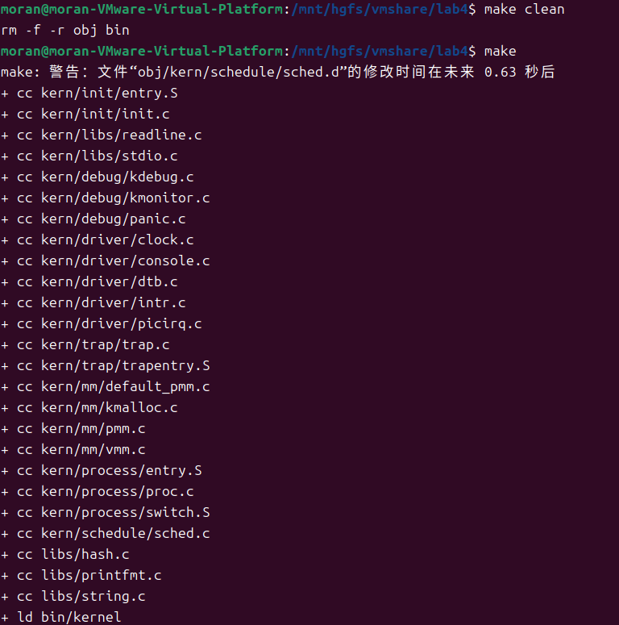
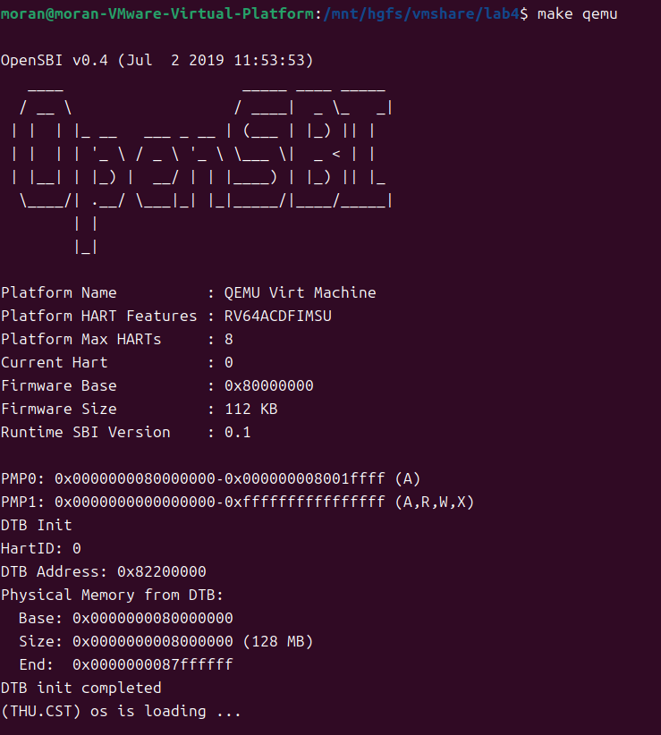
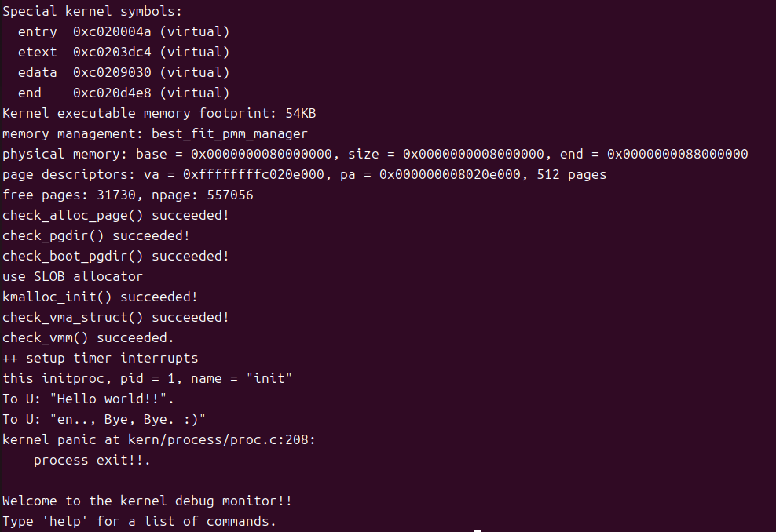
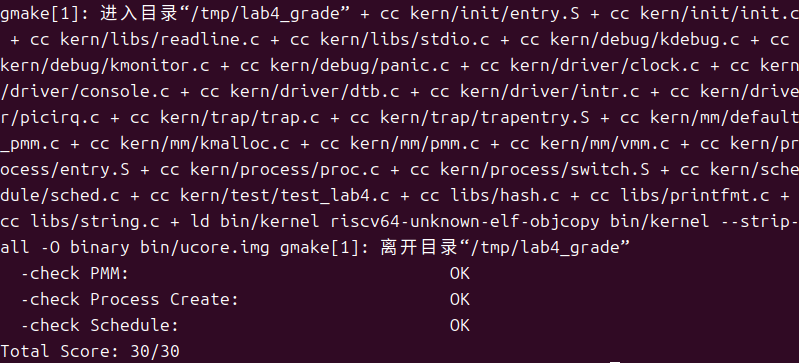
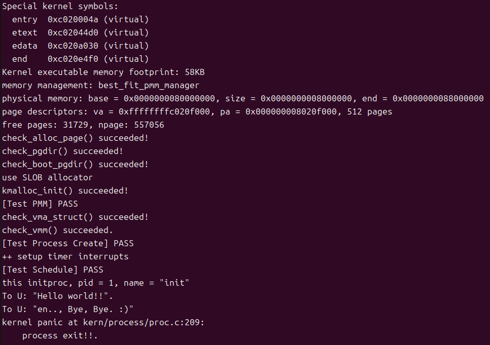

# 实验报告

## 实验基本信息

| 项目 | 内容 |
|------|------|
| **实验名称** | Lab4: 内核线程与调度（虚拟内存 · 进程创建 · 上下文切换） |
| **小组成员** | 2512163-李思翰、2512436-郭睿彤、2512130-刘婕 |
| **完成日期** | 2026-11-21 |

### 小组分工

| 成员 | 负责的练习/模块 |
|------|----------------|
| 2512163-李思翰 | 功能模块一：虚拟内存页操作（`kern/mm/pmm.c` 的 `page_insert` / `page_remove`） |
| 2512436-郭睿彤 | 功能模块二：进程创建与初始化（`kern/process/proc.c` 的 `alloc_proc` / `proc_init` / `kernel_thread` / `do_fork` / `copy_thread` / `copy_mm`） |
| 2512130-刘婕 | 功能模块三：调度与上下文切换（`kern/process/proc.c` 的 `cpu_idle` / `proc_run`、`kern/schedule/sched.c` 的 `schedule`、`kern/process/switch.S` 的 `switch_to`）；阶段 0 回填；全链路验证与评测执行；报告整合 |

### 实验报告分工

| 成员 | 负责的报告章节 |
|------|----------------|
| 2512163-李思翰 | 一、实验目的；三、实验整体逻辑分析；四、功能模块一；四、Challenge 第 2–4 题 |
| 2512436-郭睿彤 | 四、功能模块二 |
| 2512130-刘婕 | 二、实验环境；四、前置任务（lab2/lab3 回填）；四、功能模块三；四、Challenge 第 1 题；五、测试与验证；六、实验总结与收获；`prompt.md` 汇总 |

### 三个模块的依赖关系（读报告前必须知道）

Lab4 与前三个实验有一个结构性差异：**三个模块之间存在硬依赖，缺任何一个都无法链接**。

```
pmm_init ──► check_pgdir() ──► page_insert()        ← 模块一
init.c:39 ──► proc_init()   ──► alloc_proc()        ← 模块二
init.c:44 ──► cpu_idle()    ──► schedule()          ← 模块三
                                    └──► proc_run() ──► switch_to()
```

`init.c` 直接调用 `proc_init()` 与 `cpu_idle()`，`pmm_init()` 内部调用 `page_insert()`。
因此**任何人都无法单独 `make` 通过**，这与 lab3"三个文件可独立推进"的情况完全不同。
本组的应对方式是：各模块在自己仓库外做隔离验证（最小桩 + 真实测试文件），
合并后由 C 统一跑 `make grade`。

---

## 一、实验目的

Lab4 把前三个实验的成果串成一条完整的执行链：**物理内存管理 → 页表与虚拟地址空间 → 进程控制块 → 内核线程 → 调度与上下文切换**。本实验的目的可以分成四个层次：

1. **掌握 RISC-V Sv39 页表的软件操作**。理解三级页表遍历、页表项的 PPN/权限位布局，能够正确实现"建立映射"和"撤销映射"，并同时维护页表项、物理页引用计数与 TLB 三者的一致性。
2. **理解进程/线程的静态描述与动态执行**。进程控制块（PCB）如何描述一个执行实体；内核线程如何被创建、第一次被调度时如何从"一堆数据结构"变成"真正在 CPU 上执行的指令流"。
3. **理解调度的最小闭环**。`schedule` 如何选择下一个可运行线程，`proc_run` 如何切换当前进程与页表，`switch_to` 如何保存/恢复被调用者保存寄存器。
4. **训练可验证的 AI 协作方式**。把"让 AI 写代码"变成"用真实接口、行为契约和可观察判据约束 AI"，并保留可复现的验证证据。

需要额外强调的是第 3 层的一个认知转折：**"切换进程"不是改一个指针，而是换一整套运行环境**。
`current` 只影响内核代码"认为"谁在跑；真正决定下一条指令从哪取、用哪个栈、翻译用哪张页表的，
是 `ra`、`sp` 和 `satp`。本实验最容易犯的错误就是把 `current = proc` 当成切换完成——
编译器不会报错，程序会继续在旧栈上跑，然后用另一个进程的栈帧去访问自己的局部变量。

---

## 二、实验环境

**负责人：** 2512130-刘婕

### AI 编程工具

| 成员 | AI 编程工具 | 底层模型 | 用途 |
|------|------------|---------|------|
| 2512163-李思翰 | Claude Code（VS Code 扩展） | deepseek-flash | 页表三分支推导、失败路径分析、隔离 QEMU 验证 |
| 2512436-郭睿彤 | Codex CLI | gpt-6-astra | 进程创建六个函数的实现与断言核对 |
| 2512130-刘婕 | Codex CLI | gpt-6.1-sol | 调度闭环实现、判据反推、阶段 0 回填、报告整合 |

### 硬件与软件环境

| 项目 | 配置 |
|------|------|
| 开发平台 | VMware 虚拟机中的 Ubuntu，共享目录 `E:\vmshare`（VM 内 `/mnt/hgfs/vmshare`） |
| 交叉工具链 | `riscv64-unknown-elf-gcc`（SiFive GCC 10.2.0） |
| 模拟器 | `qemu-system-riscv64`（QEMU 4.1.1） |
| 调试器 | `riscv64-unknown-elf-gdb`（随交叉工具链安装） |
| 固件 | QEMU 内置 OpenSBI |
| 目标机器 | QEMU virt 机型，RV64 单 hart，DRAM 128 MB |
| 时钟源 | `timebase = 100000`，QEMU virt 为 10 MHz → 每 tick 10 ms |

A 组另在 Windows 侧的 WSL + 自带 `d:\SSF\RISCV` 工具链上做了单文件编译与隔离 QEMU 验证，
用于在 B/C 未完成时提前验证模块一，详见 4.2.5。

### 实验代码来源与目录

从 oslab 站点 `http://oslab.mobisys.top/lab2026/labcode.html` 取得 `lab4.zip` 官方骨架，
按"一分支一实验"的组织方式放入仓库 `lab4` 分支：

```
lab4/
├── code/                    # 实验实现后的完整可编译工程
│   ├── Makefile
│   ├── kern/
│   │   ├── init/            # init.c、entry.S
│   │   ├── mm/              # pmm.c、default_pmm.c、best_fit_pmm.h、vmm.c、kmalloc.c
│   │   ├── process/         # proc.c、proc.h、entry.S、switch.S
│   │   ├── schedule/        # sched.c、sched.h
│   │   ├── trap/            # trapentry.S、trap.c、trap.h
│   │   ├── driver/          # clock.c、intr.c、console.c、dtb.c
│   │   ├── sync/            # sync.h
│   │   └── debug/           # assert、panic、kdebug、kmonitor
│   ├── libs/                # riscv.h、list.h、printfmt.c、string.c
│   └── tools/               # grade.sh、inject.py、test_lab4.c/h、kernel.ld
└── report/
    ├── report.md            # 本文件
    ├── prompt.md            # 全部四段式提示词与迭代记录
    └── images/              # 编译、启动、评测截图
```

### 交付物清单

| 交付物 | 路径 | 内容 |
| --- | --- | --- |
| 实验报告 | `report/report.md` | 本文件，六章正文 |
| 提示词汇总 | `report/prompt.md` | 四个模块（含阶段 0 回填）的四段式提示词 + 迭代记录 |
| 测试截图 | `report/images/` | 编译、`make qemu`、`make grade` 三个用例与总分 |
| 虚拟内存页操作 | `code/kern/mm/pmm.c` | `page_insert()`、`page_remove()` |
| 进程创建 | `code/kern/process/proc.c` | `alloc_proc`、`copy_mm`、`copy_thread`、`do_fork`、`kernel_thread`、`proc_init` |
| 调度闭环 | `code/kern/process/proc.c` | `cpu_idle()`、`proc_run()` |
| 调度器 | `code/kern/schedule/sched.c` | `schedule()` |
| 上下文切换 | `code/kern/process/switch.S` | `switch_to()` |
| 阶段 0 回填 | `code/kern/mm/default_pmm.c` | Best-Fit 分配器五函数 + `default_pmm_manager` |
| 阶段 0 回填 | `code/kern/mm/best_fit_pmm.h` | 骨架缺失的头文件 |
| 阶段 0 回填 | `code/kern/mm/pmm.c` | `page_init()` |
| 阶段 0 回填 | `code/kern/trap/trap.c` | `interrupt_handler()`、`exception_handler()` |
| 阶段 0 回填 | `code/kern/trap/trapentry.S` | `RESTORE_ALL`、`__alltraps` 的 `call trap` |
| 评测脚本 | `code/tools/grade.sh` | 三个用例的判据（逐字 `grep -F`） |
| 评测注入器 | `code/tools/inject.py` | 把测试插入临时副本，不修改提交源码 |

---

## 三、实验整体逻辑分析

### 3.1 本章节的逻辑主线

整个 Lab4 的启动链是：

```
kern_init
  ├─ dtb_init / cons_init
  ├─ pmm_init            物理内存 + 内核页表
  ├─ pic_init / idt_init 中断框架
  ├─ vmm_init            mm / vma 结构
  ├─ proc_init           idle + init 内核线程
  ├─ clock_init / intr_enable
  └─ cpu_idle
        └─ schedule → proc_run → switch_to → ... → 线程函数
```

这条链的关键不是"函数按顺序调用"，而是**每一步都为下一步提供不可替代的前提**：

- 没有 `pmm_init` 建立的 `struct Page` 数组和空闲链表，就分配不出页表页和内核栈；
- 没有页表，`proc->kstack`、`bootstack`、内核代码段这些虚拟地址都无法被 CPU 翻译；
- 没有 `vmm_init` 的 `mm/vma` 结构，后续用户进程就没有地址空间容器（本实验只做结构检查，缺页处理留给后续实验）；
- 没有 `proc_init` 的 PCB 与内核栈，`schedule` 就没有可选择的实体；
- 没有 `switch_to` 的寄存器保存/恢复，`proc_run` 只能改 `current` 指针，无法真正切换执行流。

**三个模块各自负责这条链上的一段，但共享同一个"上下文"概念的不同侧面。**
理解本实验的关键，是把"上下文"拆成三层，因为三层的保存责任人不同：

| 层 | 内容 | 谁负责 | 本实验的处理 |
|---|---|---|---|
| 线程级上下文 | `ra`、`sp`、`s0`–`s11`（callee-saved） | 编译器按调用约定 + `switch_to` 手工保存 | `struct context`，模块三 |
| 陷入上下文 | 32 个通用寄存器 + `sstatus`/`sepc`/`stval`/`scause` | `SAVE_ALL` / `RESTORE_ALL` | `struct trapframe`，lab3 成果 |
| 地址空间上下文 | 页表根（`satp` 的低 44 位） | `proc_run` 写 CSR | PCB 的 `pgdir` 字段，模块三 |

三层的关系不是并列的，而是**嵌套**：`switch_to` 切到新线程时，只是把线程级上下文换掉；
真正让"新线程从 `kernel_thread_entry` 开始跑"的，是 `copy_thread` 预先构造好的 trapframe
（陷入上下文），由 `forkret → forkrets → __trapret → sret` 这条路径一次性装载。

**为什么"能打印 Hello world"是唯一可靠的判据？** 因为这条链上任一环出错都不会立刻崩：

- 页表映射错 → `page_insert` 的引用计数不对，结果是"空闲页数慢慢变少"或"页被提前释放"；
- trapframe 的 `s0/s1` 填错 → `kernel_thread_entry` 会把参数当函数指针调，跳到随机地址；
- `switch_to` 的偏移错一位 → 恢复出来的 `ra` 是别人的 `sp`，`ret` 到栈上的垃圾数据。

这些错误全都能通过编译。所以本组对三个模块的验收都落在**行为判据**上，
而不是"编译通过"或"没 panic"。

### 3.2 功能的逐步实现

**第 1 步：物理内存管理（`page_init` + Best-Fit）**

从设备树读取物理内存范围，在内核镜像结束处放置 `struct Page` 描述符数组，把 OpenSBI、内核镜像和描述符数组本身标记为 reserved，剩余整页交给 Best-Fit 分配器。产出的核心对象是：`pages`、`npage`、`free_list`、`nr_free`。

**第 2 步：内核页表与页表操作（`get_pte` / `page_insert` / `page_remove`）**

启动时 `boot_page_table_sv39` 用 1 GB 大页把 `0xFFFFFFFFC0000000 → 0x80000000` 映射好，使内核一开始就能在虚拟地址空间运行。`get_pte` 负责三级遍历并按需分配中间级页表页；`page_insert` / `page_remove` 负责叶子映射的建立与撤销，并维护引用计数和 TLB。`check_pgdir` 与 `check_boot_pgdir` 用真实映射验证这套操作。

**第 3 步：虚拟内存区域管理（`vmm_init`）**

`mm_struct` 管理一组共享同一页表的 `vma_struct`，`insert_vma_struct` 按起始地址有序插入，`find_vma` 负责地址归属查询。本实验的 `check_vmm` 只验证结构正确性；真正的缺页处理（`do_pgfault`）留给后续实验。

**第 4 步：进程控制块与内核线程创建（`alloc_proc` / `proc_init` / `kernel_thread`）**

`alloc_proc` 从 `kmalloc` 拿 PCB 后**必须整体清零**，再填初始字段；`proc_init` 创建两个特殊线程：

- `idleproc`：pid = 0，直接复用当前内核栈 `bootstack`，`tf = NULL`，`current = idleproc`；
- `initproc`：通过 `kernel_thread(init_main, "Hello world!!", 0)` 创建，pid = 1，name = "init"。

`kernel_thread` 通过 `do_fork` / `copy_thread` 在新线程的内核栈顶构造 trapframe，并把 `context.ra` 设为 `forkret`、`context.sp` 指向 trapframe。

**第 5 步：首次调度与上下文切换（`schedule` / `proc_run` / `switch_to`）**

`schedule` 从 `proc_list` 里轮转选择 `PROC_RUNNABLE` 的线程；`proc_run` 更新 `current`、切换 `satp`（页表）、调用 `switch_to` 保存旧 context、恢复新 context。第一次切到 initproc 时，`switch_to` 的 `ret` 跳到 `forkret`：

```
switch_to → ret 到 forkret
          → forkret 调 forkrets(current->tf)
          → forkrets 把 sp 指向 trapframe，跳到 __trapret
          → RESTORE_ALL + sret
          → 按 tf->epc 进入 kernel_thread_entry
          → kernel_thread_entry：move a0, s1; jalr s0
          → 真正执行 init_main
```

**第 6 步：idle 循环与调度驱动（`cpu_idle` + 时钟中断）**

`cpu_idle` 是永远不会返回的循环：`need_resched` 为真时调用 `schedule()`。时钟中断把 `current->need_resched` 置 1，从而形成"运行 → 被中断 → 重新调度"的闭环；没有任何可运行线程时回退到 `idleproc`。

**第 7 步（贯穿全程）：让 lab2/lab3 的成果回来**

lab4 骨架的 `kern/mm/` 与 `kern/trap/` 是空的：没有 `best_fit_pmm.c/h`，`pmm.c` 的 `page_init()` 是空壳，
`trapentry.S` 的 `RESTORE_ALL` 是空的。不填这些，第 1 步就不成立，任何测试都跑不起来。
这是阶段 0 回填存在的唯一理由——它不是"加分项"，而是**前置条件**。

这个顺序还有一个容易被忽略的因果：**第 5 步能否成立，取决于第 4 步构造的 trapframe 是否正确。**
`switch_to` 只负责把 `ra`/`sp` 换成新线程的值，它不知道"新线程应该从哪里开始执行"——
这个信息完全由 `copy_thread` 写进 trapframe（`epc`、`gpr.s0/s1`、`gpr.sp`）和 `context`（`ra`、`sp`）。
两处必须**同时**正确：`context.ra = forkret` 决定"第一跳"，`tf->epc = kernel_thread_entry` 决定"第二跳"。
只对一处，结果都是跳到空地址或死循环。

---

## 四、实验内容与实现

### 本章导读：Lab4 的 spec 写法与 lab3 的差异

lab3 的每个模块都是"一个确定的算法"：给定 trapframe 布局，`RESTORE_ALL` 只有一种正确写法。
lab4 的模块不同，它们各自有**多个看起来都能跑的写法**，区别只在极端分支：

| 模块 | 常见的"能跑但有坑"的写法 | 本组的取舍 |
|---|---|---|
| 模块一 | 有映射就一律 `page_remove` 再写 PTE | 区分"同页重映射"，避免 `ref` 归零误释放 |
| 模块二 | 按 x86 ucore 的 `a0/a1` 传参 | 按 `entry.S` 真实的 `s0/s1` 传参 |
| 模块三 | 参考 32 位 ucore，在 `proc_run` 里手写切栈 | riscv 版由 `switch_to` 从 `context.sp` 恢复，不手写 |

因此 `[SPECIFICATION]` 段在 lab4 里承担的作用比 lab3 更重：它必须把"分支"逐条列出来，
让 AI 无法用"最常见的做法"蒙过去。四个模块的提示词见 `report/prompt.md`。

---

### 前置任务：lab2 / lab3 代码回填

**负责人：** 2512130-刘婕

#### 任务说明

lab4 骨架相对 lab3 有三类差异，`diff -rq` 的实测结果：

```
Only in lab3/code/kern/mm: best_fit_pmm.c
Only in lab3/code/kern/mm: best_fit_pmm.h
Files lab3/code/kern/mm/default_pmm.c and lab4/code/kern/mm/default_pmm.c differ
Files lab3/code/kern/mm/pmm.c       and lab4/code/kern/mm/pmm.c       differ
Files lab3/code/kern/trap/trap.c    and lab4/code/kern/trap/trap.c    differ
Files lab3/code/kern/trap/trapentry.S and lab4/code/kern/trap/trapentry.S differ
```

差异远不止 4 个文件（整个 `kern/mm/` 少 5 个文件、`init.c` 少了五行 buddy/slub 调用），
但**与本实验相关的只有 5 处**：

| # | 位置 | 缺什么 | 影响 |
|---|---|---|---|
| 1 | `kern/mm/best_fit_pmm.h` | 整个文件 | `default_pmm.c` 第 3 行 include 它，缺了直接编译失败 |
| 2 | `kern/mm/default_pmm.c` | 分配器五函数 + manager 表 | 没有分配器，`pmm_init` 无法工作 |
| 3 | `kern/mm/pmm.c` | `page_init()` | `struct Page` 数组不建立，`npage = 0` |
| 4 | `kern/trap/trap.c` | 两个 handler | 时钟中断无处理，`need_resched` 永不置位 |
| 5 | `kern/trap/trapentry.S` | `RESTORE_ALL` + `call trap` | `sret` 死循环，`make qemu` 卡在第一次中断 |

#### `default_pmm.c` 的一个陷阱：check 函数已在文件末尾

lab4 骨架把 Best-Fit 塞进了 `default_pmm.c`（而不是像 lab2/lab3 那样单独一个文件），
并且**文件末尾已经保留了 `basic_check()` 与 `best_fit_check()`**：

```c
// 骨架已有
static void basic_check(void) { ... }
static void best_fit_check(void) { ... }
```

所以回填时只能补"分配器五函数 + manager 表"，不能把 lab3 的整个 `best_fit_pmm.c` 覆盖过来，
否则会 `multiple definition`。这是本次回填踩的第一个坑（见 prompt.md 迭代记录第 2 轮）。

另一个陷阱是：manager 表的**名字仍是 `default_pmm_manager`**，但函数指针全部指向 `best_fit_*`。
骨架在 `init_pmm_manager()` 里写的是 `pmm_manager = &default_pmm_manager;`，
**没有任何注释提示学生要改这里**。这段代码在 lab3 里是有 `//YOUR CODE` 标记的，lab4 里没有。
如果只看"有没有 YOUR CODE"来判断回填完整性，就会漏掉这一处 —— 而它恰恰是"分配器是否真的被用上"的唯一判据。

#### `pmm.c` 的 `page_init()`

沿用 lab3 的实现，核心是三步：

1. 从 DTB 取物理内存范围，算出可用页数；
2. 把 `struct Page` 数组放在内核镜像结束处（`end` 向上按页对齐），逐个 `set_page_reserved`；
3. 把 `[mem_base, start_pa)` 与 `[start_pa + array_bytes, mem_end)` 交给 `pmm_manager->init_memmap`。

启动时的打印（`free pages: N, npage: M`）是本步骤唯一的可观察判据：
`free pages` 为 0 说明 `init_memmap` 没被调用，`npage` 为 0 说明 DTB 读取失败。

#### `trapentry.S` 与 `trap.c`

直接沿用 lab3 已验证的版本。`RESTORE_ALL` 的关键仍是"CSR 先写、通用寄存器次之、`sp` 最后"，
`__alltraps` 的关键仍是 `mv a0, sp; call trap`。

`trap.c` 的 `interrupt_handler` 中，时钟中断分支必须做**三件事**：

```c
case IRQ_S_TIMER:
    clock_set_next_event();          // 1. 续约，否则只中断一次
    ticks++;
    current->need_resched = 1;       // 2. 每个 tick 都请求一次重调度（lab4 新增）
    if (ticks % TICK_NUM == 0) {
        print_ticks();
    }
    break;
```

第 2 条是 lab4 相对 lab3 的**唯一功能性增量**，也是最容易漏的一条：
lab3 的时钟中断只做"续约 + 计数 + 打印"，那时没有进程概念，不需要调度；
lab4 如果没有这一句，`cpu_idle` 的 `if (current->need_resched)` 永远不成立，
系统会停在第一次调度之后的 idle 空转里 —— 编译器不报错，现象是"卡住不动"。

同时 `trap.c` 需要新增 `#include <proc.h>` 才能访问 `current`；骨架里没有这个 include
（lab3 版本的 `trap.c` 不需要它），漏了会报 `implicit declaration of 'current'`。

#### 验证

```bash
grep -rn "YOUR CODE" kern/ libs/          # 本实验三处空洞除外，其余应为空
ls kern/mm/best_fit_pmm.h                 # 必须存在
grep -n "best_fit_" kern/mm/default_pmm.c # 五函数 + manager 表
make                                      # 不应出现 multiple definition
```

本组的实测结果记录在 5.3 节的核对表中。

---

### 功能模块一：虚拟内存页操作

**负责人：** 2512163-李思翰  
**代码位置：** `kern/mm/pmm.c` · `//LAB4 function1`

#### 模块功能描述

在 RISC-V Sv39 三级页表之上实现两个原子操作：

```c
int  page_insert(pde_t *pgdir, struct Page *page, uintptr_t la, uint32_t perm);
void page_remove(pde_t *pgdir, uintptr_t la);
```

`page_insert` 把物理页 `page` 映射到线性地址 `la`；`page_remove` 撤销映射并在引用计数归零时释放物理页。
骨架已提供 `get_pte()`（三级遍历 + 按需分配中间级页表页）、`pte_create()`、`pte2page()`、
`page_ref_inc/dec()`、`tlb_invalidate()`，两个函数要做的只是**把引用计数与 PTE 的三种组合关系理清**。

#### 最终实现

```c
//LAB4 function1 2512163

/* page_insert - 在页表 pgdir 中建立 "线性地址 la -> 物理页 page" 的映射。
 *
 * get_pte(pgdir, la, 1) 会按需分配中间级页表页：
 *   - 返回 NULL 表示内存不足，此时不改动任何已有映射，直接返回 -E_NO_MEM；
 *   - 返回值为叶子 PTE 的内核虚拟地址。
 *
 * 引用计数的三种情况：
 *   1) la 原本没有映射：新页 ref + 1；
 *   2) la 已映射到同一个 page：ref 不变，只更新权限位；
 *   3) la 已映射到另一个 page：旧页 ref - 1（归零则释放），新页 ref + 1。
 */
int page_insert(pde_t *pgdir, struct Page *page, uintptr_t la, uint32_t perm)
{
    pte_t *ptep = get_pte(pgdir, la, 1);
    if (ptep == NULL)
    {
        return -E_NO_MEM;
    }

    /* 先统一为新页加一次引用；若发现是同页重映射，再把这次引用还回去，
     * 这样三种分支可以共用同一段主流程。 */
    page_ref_inc(page);

    if (*ptep & PTE_V)
    {
        struct Page *old_page = pte2page(*ptep);
        if (old_page == page)
        {
            /* 分支 2：同一个物理页重复映射同一地址，只改权限位 */
            page_ref_dec(page);
        }
        else
        {
            /* 分支 3：换页覆盖。交给 page_remove 完成旧页的 ref--、
             * 必要时 free_page 以及 TLB 失效。 */
            page_remove(pgdir, la);
        }
    }

    *ptep = pte_create(page2ppn(page), PTE_V | perm);
    tlb_invalidate(pgdir, la);
    return 0;
}

/* page_remove - 撤销线性地址 la 的映射。
 *
 * 幂等接口：la 没有映射时安静返回，不 assert、不 panic。
 * 撤销顺序：清 PTE -> 刷 TLB -> 旧页 ref - 1，引用归零时释放物理页。
 */
void page_remove(pde_t *pgdir, uintptr_t la)
{
    pte_t *ptep = get_pte(pgdir, la, 0);
    if (ptep == NULL || !(*ptep & PTE_V))
    {
        return;
    }

    struct Page *page = pte2page(*ptep);
    *ptep = 0;
    tlb_invalidate(pgdir, la);

    if (page_ref_dec(page) == 0)
    {
        free_page(page);
    }
}
```

#### 核心机制：三种分支

`page_insert` 的关键不是"写 PTE"那一行，而是**先把引用计数的三种情况分清楚**：

| 情况 | 判断条件 | 处理 | `page->ref` 净变化 | 是否释放页 |
|---|---|---|---|---|
| 地址无映射 | `!(*ptep & PTE_V)` | 直接写 PTE | +1 | 否 |
| 同页重映射 | `pte2page(*ptep) == page` | 只更新权限位 | 0（先 +1 再 −1） | 否 |
| 换页覆盖 | `pte2page(*ptep) != page` | `page_remove` 旧页，再写 PTE | 新页 +1、旧页 −1 | 旧页归零时释放 |

用测试的 12 行断言走一遍：

| 步骤 | `la` | 操作 | p1 | p2 | p3 | 说明 |
|---|---|---|---|---|---|---|
| 1 | 0 | insert p1, perm=0 | 1 | – | – | 无映射 → 新页 +1 |
| 2 | 4K | insert p2, U\|W | 1 | 1 | – | 无映射 → 新页 +1 |
| 3 | 4K | insert **p1**, perm=0 | **2** | **0** | – | 换页覆盖：p2 释放，p1 +1 |
| 4 | 8K | insert p3, perm=0 | 2 | 0 | 1 | 无映射 → 新页 +1 |
| 5 | 8K | insert **p3**, perm=W | 2 | 0 | **1** | 同页重映射：ref 不变、权限更新、无分配 |
| 6 | 0/4K/8K/8K | remove 四次 | 0 | 0 | 0 | 归零释放；第二次 remove 幂等 |

由此可以提炼出三条不变式：

1. **`page->ref` 等于指向该页的有效叶子 PTE 数量**；
2. **只有 `ref` 减到 0 才能 `free_page`**；
3. **叶子 PTE 从无效变为有效、或从有效变为无效后，必须让该地址的 TLB 失效**。

#### 关键设计决策与易错点

1. **先 `page_ref_inc`，再判分支**。这样三种情况可以共用"最后写 PTE"的主流程；同页时再 `page_ref_dec` 抵消。另一种写法是"先判断、再分别加引用"，逻辑等价，但分支更多、更容易漏。
2. **同页重映射不能走 `page_remove`**。如果同页也调 `page_remove`，它会把刚加的引用减掉，`ref` 归零后直接释放该页，而 PTE 又立刻指向它，形成悬空映射。测试第 5 步就是在抓这个错误。
3. **旧页的 `ref--`、`free_page`、TLB 失效交给 `page_remove`**，避免在 `page_insert` 里重复实现一遍，也保证"撤销映射"只有一个入口。
4. **撤销顺序：清 PTE → `sfence.vma` → `ref--` → 归零释放**。先让 PTE 失效，再刷新 TLB，最后才可能释放物理页，避免出现"页已释放但 TLB 还能翻译到它"的窗口。
5. **失败路径不破坏已有映射**。`get_pte(create=1)` 失败时直接返回 `-E_NO_MEM`；已经分配的中间级页表页保留（本实验不要求回滚），但 `la` 的叶子映射不会被写一半。
6. **`perm` 原样拷贝**。`pte_create` 内部已经加了 `PTE_V`，再传一次是幂等的。注意 RISC-V 规范要求 `W=1` 时 `R=1`；测试只检查权限位、不访问该地址，所以只给 `PTE_W` 也能过，但真实映射应传 `READ_WRITE`（`PTE_R|PTE_W|PTE_V`）。
7. **`la` 的页内偏移被忽略**。映射的是包含 `la` 的那一页；调用方通常传页对齐地址。
8. **本实验没有加锁**。`page_insert` / `page_remove` 直接修改页表和引用计数，在单线程内核里是安全的；后续多线程/用户进程实验若并发调用，需要把临界区保护起来。

#### 验证方法与结果

**（1）编译验证**

使用仓库自带工具链按工程原始 flags 编译：

```bash
riscv64-unknown-elf-gcc -mcmodel=medany -O2 -std=gnu99 -Wno-unused \
  -fno-builtin -Wall -nostdinc -fno-stack-protector \
  -ffunction-sections -fdata-sections -g \
  -I libs -I kern/debug -I kern/driver -I kern/trap -I kern/mm \
  -I kern/sync -I kern/fs -I kern/process -I kern/schedule \
  -c kern/mm/pmm.c -o /tmp/pmm.o
```

结果：**0 error，0 warning**。

**（2）隔离运行验证**

为在 B/C 未完成时单独验证模块一，在**仓库外的临时副本**里：

- 给 `proc_init` / `cpu_idle` / `kernel_thread` / `schedule` 放最小桩；
- 按 `tools/inject.py` 的方式在 `pmm_init` 末尾注入 `test_lab4_pmm_basic()`；
- 用真实 `pmm.c`、真实页表、真实 `test_lab4.c` 在 QEMU 中启动。

串口关键输出：

```
check_alloc_page() succeeded!
check_pgdir() succeeded!
check_boot_pgdir() succeeded!
use SLOB allocator
kmalloc_init() succeeded!
[Test PMM] PASS
check_vma_struct() succeeded!
check_vmm() succeeded.
```

这说明：`check_pgdir()` / `check_boot_pgdir()` 这些**不在测试文件里**的既有检查也通过了；
`[Test PMM] PASS` 覆盖了三分支、幂等删除；没有触发 `assert` 或 `panic`。

**（3）未做的验证**

- 整机 `make grade` 需等三方合并后由 C 执行；
- §五的正式截图由 C 统一产出；
- 本模块没有独立的 `do_pgfault` 场景，缺页路径留给后续实验。

#### 实现迭代过程

**第 1 版：只处理"无映射 / 换页"两种情况。**
最初的想法是"PTE 有效就先把旧页 `page_remove` 掉，再写新 PTE"，这能通过"换页覆盖"的断言，但会把"同一页重映射同一地址"也送进 `page_remove`：刚加的引用被减掉，`ref` 归零后页被释放，PTE 又指向它。对照 `test_lab4_pmm_basic` 的第 5 步（`page_ref(p3) == 1 && nr_free_pages() == free_before`），这个版本必然失败。

**第 2 版：加入同页分支。**
改为"先 `page_ref_inc`，再判断 `pte2page(*ptep) == page`"：同页时 `page_ref_dec` 抵消，只更新权限；不同页才调 `page_remove`。这样三分支共用同一段主流程，代码最短，也直接对应测试的三组断言。

**第 3 版：补失败路径与 TLB 顺序。**
`get_pte(..., 1)` 返回 `NULL` 时返回 `-E_NO_MEM`，并且不写 PTE；`page_remove` 改用 `create=0`，避免撤销映射时反而分配页表页；PTE 修改后统一 `tlb_invalidate(pgdir, la)`。

**第 4 版：验证驱动收敛。**
用真实工具链编译，再在隔离副本里跑 QEMU。`check_pgdir()` / `check_boot_pgdir()` / `[Test PMM] PASS` 全部通过后定稿。整个过程没有修改任何既有函数，改动范围始终只有 `pmm.c` 的 function1 空洞。

#### 与 B/C 的接口约定

| 对象 | 约定 |
|---|---|
| B（`kern/process/proc.c`） | 不调用、不修改 `page_insert` / `page_remove`；内核线程共享内核页表，PCB 里只保存 `pgdir` 指针 |
| C（`kern/schedule/*`、`switch.S`、`proc.c` function3） | `proc_run` 切换页表时用 `pgdir >> RISCV_PGSHIFT` 写 `satp`，不经过本模块的两个函数 |
| 合并方式 | 只合并 `pmm.c` 的 function1 hunk，不覆盖整份 `pmm.c`，以免把阶段 0 回填重复引入 |
| 后续实验 | `do_pgfault` / `pgdir_alloc_page` 会以本模块为底座，接口保持不变 |

#### 最终提示词

完整四段式见 `report/prompt.md` 的「提示词一」。

---

### 功能模块二：进程创建与初始化

**负责人：** 2512436-郭睿彤  
**代码位置：** `kern/process/proc.c` · `//LAB4 function2`

#### 模块功能描述

本模块把启动时的内核执行流登记为 0 号内核线程 `idleproc`，再创建 1 号内核线程 `initproc`，
使调度器能够找到并首次运行它。实现位于 `kern/process/proc.c` 的 `LAB4 function2` 处，
包含六个函数：

| 函数 | 职责 |
|---|---|
| `alloc_proc` | 从 `kmalloc` 取 PCB，整体清零，填初始状态 |
| `copy_mm` | 本阶段保留接口，内核线程共享启动页表，直接返回 0 |
| `copy_thread` | 在内核栈顶构造 trapframe，设置 `context.ra/sp` |
| `do_fork` | 分配 PCB + 内核栈，登记到链表/哈希表，唤醒 |
| `kernel_thread` | 构造初始 trapframe，调 `do_fork` |
| `proc_init` | 创建 `idleproc` 与 `initproc` |

#### 最终实现

```c
//LAB4 function2 2512436

static struct proc_struct *
alloc_proc(void)
{
    struct proc_struct *proc = kmalloc(sizeof(*proc));
    if (proc != NULL)
    {
        memset(proc, 0, sizeof(*proc));
        proc->state = PROC_UNINIT;
        proc->pid = -1;
        proc->pgdir = boot_pgdir_pa;
        list_init(&proc->list_link);
        list_init(&proc->hash_link);
    }
    return proc;
}

static int
copy_mm(uint32_t clone_flags, struct proc_struct *proc)
{
    // Lab 4 kernel threads share the boot page table.
    (void)clone_flags;
    (void)proc;
    return 0;
}

static void
copy_thread(struct proc_struct *proc, uintptr_t stack, struct trapframe *tf)
{
    uintptr_t stack_top = proc->kstack + KSTACKSIZE;
    proc->tf = (struct trapframe *)stack_top - 1;
    *proc->tf = *tf;
    proc->tf->gpr.a0 = 0;
    proc->tf->gpr.sp = stack == 0 ? stack_top : stack;
    proc->context.ra = (uintptr_t)forkret;
    proc->context.sp = (uintptr_t)proc->tf;
}

int
do_fork(uint32_t clone_flags, uintptr_t stack, struct trapframe *tf)
{
    if (nr_process >= MAX_PROCESS)
    {
        return -E_NO_FREE_PROC;
    }
    struct proc_struct *proc = alloc_proc();
    if (proc == NULL)
    {
        return -E_NO_MEM;
    }
    proc->parent = current;

    int ret = setup_kstack(proc);
    if (ret != 0)
    {
        kfree(proc);
        return ret;
    }
    ret = copy_mm(clone_flags, proc);
    if (ret != 0)
    {
        put_kstack(proc);
        kfree(proc);
        return ret;
    }
    copy_thread(proc, stack, tf);

    bool intr_flag;
    local_intr_save(intr_flag);
    if (nr_process >= MAX_PROCESS)
    {
        local_intr_restore(intr_flag);
        put_kstack(proc);
        kfree(proc);
        return -E_NO_FREE_PROC;
    }
    int pid = proc->pid = get_pid();
    hash_proc(proc);
    list_add_before(&proc_list, &proc->list_link);
    nr_process++;
    wakeup_proc(proc);
    local_intr_restore(intr_flag);
    return pid;
}

int
kernel_thread(int (*fn)(void *), void *arg, uint32_t clone_flags)
{
    struct trapframe tf;
    memset(&tf, 0, sizeof(tf));
    tf.gpr.s0 = (uintptr_t)fn;
    tf.gpr.s1 = (uintptr_t)arg;
    tf.status = (read_csr(sstatus) | SSTATUS_SPP | SSTATUS_SPIE) & ~SSTATUS_SIE;
    tf.epc = (uintptr_t)kernel_thread_entry;
    return do_fork(clone_flags | CLONE_VM, 0, &tf);
}

void
proc_init(void)
{
    static const char idle_name[PROC_NAME_LEN + 1] = "idle";
    static const char init_name[PROC_NAME_LEN + 1] = "init";
    list_init(&proc_list);
    for (int i = 0; i < HASH_LIST_SIZE; i++)
    {
        list_init(&hash_list[i]);
    }

    idleproc = alloc_proc();
    if (idleproc == NULL)
    {
        panic("cannot alloc idleproc");
    }
    idleproc->pid = 0;
    idleproc->state = PROC_RUNNABLE;
    idleproc->kstack = (uintptr_t)bootstack;
    idleproc->need_resched = 1;
    set_proc_name(idleproc, idle_name);
    nr_process++;
    current = idleproc;

    int pid = kernel_thread(init_main, "Hello world!!", 0);
    if (pid <= 0)
    {
        panic("cannot create initproc");
    }
    initproc = find_proc(pid);
    assert(initproc != NULL && initproc->pid == 1);
    set_proc_name(initproc, init_name);
}
```

#### 关键设计点

**（1）`alloc_proc` 必须整体清零**

PCB 里绝大多数字段是"零即正确"：`parent = NULL`、`mm = NULL`、`tf = NULL`、`runs = 0`、
`flags = 0`、`context` 全零。`kmalloc` 返回的是脏内存，不 `memset` 就会带着上一个使用者
的残留值 —— 最典型的是 `context.ra` 非零，`switch_to` 第一次恢复时直接跳到随机地址。
测试里 `idleproc->context.ra == 0` 这条断言就是在抓这一点。

**（2）`idleproc` 复用 `bootstack`，且不进 `proc_list`**

`idleproc` 是"当前正在执行的这段代码"的登记，它的栈就是启动时用的 `bootstack`，
不能重新 `alloc_pages` —— 否则 `proc_run` 切到它时 `sp` 会指向一个空栈，
而栈上保存着 `kern_init` 的调用链。

它也不加入 `proc_list`（只有 `nr_process++`）。这不是遗漏，而是设计：
`idleproc` 是"没有线程可跑时"的兜底，只能由 `schedule` 在扫完一圈无果后选中，
不能被正常轮转扫到，否则会在有活干的时候抢走 CPU。

**（3）`kernel_thread` 用 `s0/s1` 传参，不用标准 `a0/a1`**

这是本模块最容易做错的一处。`entry.S` 的 `kernel_thread_entry` 是：

```asm
kernel_thread_entry:
	move a0, s1
	jalr s0
```

函数地址从 `s0` 取，实参从 `s1` 搬到 `a0`。如果按 x86 ucore 的习惯写 `tf.gpr.a0 = fn`，
`RESTORE_ALL` 之后 `s0` 仍是 0，`jalr s0` 直接跳到地址 0。

**（4）`status` 的三个位**

```c
tf.status = (read_csr(sstatus) | SSTATUS_SPP | SSTATUS_SPIE) & ~SSTATUS_SIE;
```

- `SPP = 1`：`sret` 后回到 S 模式（内核线程不下沉到 U 模式）；
- `SPIE = 1`：`sret` 后 `SIE` 置 1，新线程一启动就开中断；
- `SIE = 0`：`sret` 之前保持关中断，避免在 `RESTORE_ALL` 中途被时钟中断打断。

**（5）`do_fork` 的双重检查**

`nr_process >= MAX_PROCESS` 检查了两次：函数入口一次（快速失败，避免白分配），
关中断区间内再一次（此时才有意义 —— 两个 CPU 或者中断上下文同时 fork 时，
入口检查可能都已通过）。这是 ucore 的既有模式，本模块保持。

失败路径的释放顺序是"后申请先释放"：`setup_kstack` 失败只需 `kfree(proc)`；
`copy_mm` 失败要先 `put_kstack` 再 `kfree(proc)`。

**（6）`copy_thread` 的四个地址**

| 字段 | 值 | 决定什么 |
|---|---|---|
| `context.ra` | `forkret` | `switch_to` 的 `ret` 落到哪里（第一跳） |
| `context.sp` | `proc->tf` | 恢复后 `sp` 指向中断帧 |
| `tf->epc` | `kernel_thread_entry` | `sret` 落到哪里（第二跳） |
| `tf->gpr.sp` | `kstack + KSTACKSIZE` | `sret` 之后的栈顶 |

四者缺一不可，且**分属两个不同的上下文结构**（`context` 与 `trapframe`），
这是本模块最需要"画图才想得清"的地方。

#### 首次执行链（与模块三的接缝）

```
switch_to（模块三）→ ret 到 forkret
                  → forkret 调 forkrets(current->tf)
                  → forkrets: move sp, a0; j __trapret
                  → RESTORE_ALL + sret（lab3 成果）
                  → 按 tf->epc 进入 kernel_thread_entry
                  → move a0, s1; jalr s0
                  → 真正执行 init_main
```

这条链跨越三个模块和两个实验：模块二负责"准备好数据"，模块三负责"第一跳"，
lab3 的 `RESTORE_ALL` 负责"第二跳"。任何一环的偏移或寄存器约定错了，
现象都是"打印不出来"或"跳到 0 地址"，而编译器完全看不出问题。

#### 验证

- 单文件语法与隐式声明检查通过（`-Werror-implicit-function-declaration`）；
- 已核对 `tools/test_lab4.c` 的进程创建断言（12 条）；
- 未取得 QEMU 运行结果 —— 原因见本章开头的依赖说明：`proc_init` 依赖模块三的
  `cpu_idle`/`schedule` 才能链接，由 C 合并后统一验证。

#### 最终提示词

完整四段式见 `report/prompt.md` 的「提示词二」。

---

### 功能模块三：调度与上下文切换

**负责人：** 2512130-刘婕  
**代码位置：** `kern/process/proc.c`（`//LAB4 function3`）、`kern/schedule/sched.c`、`kern/process/switch.S`

#### 模块功能描述

三个空洞共同构成"调度闭环"：

| 空洞 | 函数 | 职责 |
|---|---|---|
| `proc.c` 的 function3 | `cpu_idle()` | idle 线程的执行体，`need_resched` 置位时让出 CPU |
| `proc.c` 的 function3 | `proc_run()` | 更新 `current`、写 `satp`、调 `switch_to` |
| `sched.c` | `schedule()` | 在 `proc_list` 上选下一个 `PROC_RUNNABLE` |
| `switch.S` | `switch_to()` | 保存/恢复 14 个 callee-saved 寄存器 |

#### 最终实现

**`kern/process/proc.c`**

```c
//LAB4 function3 2512130

/* cpu_idle - idleproc 的执行体，也是整个内核的兜底执行流。
 *
 * 启动时 init.c 的最后一步就是调用它，此后它永不返回：
 *   - current->need_resched 为 0 时原地空转（真机上可换成 WFI 省电）；
 *   - 为 1 时才进入调度器，把 CPU 让给别的线程。
 *
 * need_resched 的置位来源有两个：时钟中断（trap.c 里每个 tick 置位）
 * 和线程自己主动让出（SYS_yield 或测试代码里的 current->need_resched = 1）。
 * 因此"没有可运行线程时回到 idleproc 空转"不会让系统死掉——下一次
 * 时钟中断会重新把它拉回调度器。
 */
void cpu_idle(void)
{
    while (1)
    {
        if (current->need_resched)
        {
            schedule();
        }
    }
}

/* proc_run - 把 CPU 交给 proc 执行。
 *
 * 三件事必须一起做，缺任何一件都会"看起来切过去了但跑的是别人的栈"：
 *   1. current = proc，让调度、中断统计、syscall 都看到新的当前线程；
 *   2. 写 satp 切换页表。Sv39 模式下 satp = MODE(8 << 60) | PPN(pgdir)，
 *      与 enable_paging() 的写法保持一致；本实验所有内核线程共享
 *      boot_pgdir，切换是幂等的，但保留这一步才能支撑后续用户进程；
 *   3. switch_to 保存/恢复被调用者保存寄存器。新建线程的 context 由
 *      copy_thread 构造（ra = forkret，sp = tf），所以第一次切过去时
 *      switch_to 的 ret 会直接落到 forkret，由它把该线程的 trapframe
 *      交给 __trapret，最终 sret 到 kernel_thread_entry。
 *
 * 关中断的区间覆盖"改 current + 切 satp + 切栈"，因为 satp 切换的瞬间
 * 中断若发生，处理程序会用错的页表/栈去保存上下文。
 */
void proc_run(struct proc_struct *proc)
{
    if (proc == current)
    {
        return;
    }

    bool intr_flag;
    struct proc_struct *prev = current;
    struct proc_struct *next = proc;

    local_intr_save(intr_flag);
    {
        current = next;
        write_csr(satp, 0x8000000000000000 | (next->pgdir >> RISCV_PGSHIFT));
        switch_to(&(prev->context), &(next->context));
    }
    local_intr_restore(intr_flag);
}
```

**`kern/schedule/sched.c`**

```c
//LAB4 function3 2512130

/* schedule - 在 proc_list 上环形扫描，挑一个 PROC_RUNNABLE 的线程交给 proc_run。
 *
 * 几个细节：
 *   1. 起点是"current 的下一个"，而不是表头。这样多个同优先级线程轮转时
 *      不会出现某个线程永远抢不到 CPU；current 是 idleproc 时从表头开始。
 *   2. 扫描用 do-while 环形走一圈，遇到第一个 RUNNABLE 就停；走完一圈都没
 *      找到，则回落到 idleproc（它永远是 RUNNABLE，是最后的兜底）。
 *   3. 先清 current->need_resched，再切换。若清在切换之后，被切走的线程
 *      重新回来时会带着上一轮的置位，导致不必要的重复调度。
 *   4. 整个过程关中断：proc_list 是全局链表，若扫描到一半被时钟中断打断，
 *      中断处理里又调 schedule 就会破坏链表遍历。
 */
void schedule(void)
{
    bool intr_flag;
    list_entry_t *le, *last;
    struct proc_struct *next = NULL;

    local_intr_save(intr_flag);
    {
        current->need_resched = 0;
        last = (current == idleproc) ? &proc_list : &(current->list_link);
        le = last;
        do
        {
            if ((le = list_next(le)) != &proc_list)
            {
                next = le2proc(le, list_link);
                if (next->state == PROC_RUNNABLE)
                {
                    break;
                }
            }
        } while (le != last);

        if (next == NULL || next->state != PROC_RUNNABLE)
        {
            next = idleproc;
        }
        next->runs++;
        if (next != current)
        {
            proc_run(next);
        }
    }
    local_intr_restore(intr_flag);
}
```

**`kern/process/switch.S`**

```asm
//LAB4 function3 2512130
#include <riscv.h>

# void switch_to(struct context *from, struct context *to)
#
# 只保存"被调用者保存寄存器"（callee-saved）：ra、sp、s0-s11。
# caller-saved 的那些（a0-a7、t0-t6）在调用 switch_to 之前已经由编译器
# 按调用约定存到栈上或判定为死值，不需要在这里管。
#
# 字段顺序必须与 proc.h 的 struct context 严格一致：
#   ra, sp, s0, s1, s2, s3, s4, s5, s6, s7, s8, s9, s10, s11  ->  0..13
#
# 新建线程的 context 由 copy_thread 填好（ra = forkret，sp = tf），
# 因此第一次从它恢复时，ret 会跳到 forkret 而不是 switch_to 的调用点。
    .globl switch_to
switch_to:
    # ---- 保存 from 的上下文 ----
    STORE ra,  0*REGBYTES(a0)
    STORE sp,  1*REGBYTES(a0)
    STORE s0,  2*REGBYTES(a0)
    STORE s1,  3*REGBYTES(a0)
    STORE s2,  4*REGBYTES(a0)
    STORE s3,  5*REGBYTES(a0)
    STORE s4,  6*REGBYTES(a0)
    STORE s5,  7*REGBYTES(a0)
    STORE s6,  8*REGBYTES(a0)
    STORE s7,  9*REGBYTES(a0)
    STORE s8, 10*REGBYTES(a0)
    STORE s9, 11*REGBYTES(a0)
    STORE s10, 12*REGBYTES(a0)
    STORE s11, 13*REGBYTES(a0)

    # ---- 恢复 to 的上下文 ----
    # 注意 sp 是第 1 条被恢复的：此后所有 LOAD 的地址基址仍是 a1（寄存器），
    # 不依赖 sp，所以换栈不会影响后续读取。
    LOAD ra,  0*REGBYTES(a1)
    LOAD sp,  1*REGBYTES(a1)
    LOAD s0,  2*REGBYTES(a1)
    LOAD s1,  3*REGBYTES(a1)
    LOAD s2,  4*REGBYTES(a1)
    LOAD s3,  5*REGBYTES(a1)
    LOAD s4,  6*REGBYTES(a1)
    LOAD s5,  7*REGBYTES(a1)
    LOAD s6,  8*REGBYTES(a1)
    LOAD s7,  9*REGBYTES(a1)
    LOAD s8, 10*REGBYTES(a1)
    LOAD s9, 11*REGBYTES(a1)
    LOAD s10, 12*REGBYTES(a1)
    LOAD s11, 13*REGBYTES(a1)
    ret
```

#### 核心机制

**（1）为什么 `switch_to` 只保存 14 个寄存器**

RISC-V 调用约定把寄存器分成 caller-saved（`ra`、`t0`–`t6`、`a0`–`a7`）与
callee-saved（`sp`、`s0`–`s11`）。`switch_to` 是一个普通函数调用：
调用者已经把"这次调用之后还需要用的值"按约定存好了，被调用者只需保证
"我在 `s0`–`s11` 里动过的东西恢复原状"。

`ra` 是特例：它是"函数返回地址"，对 `switch_to` 而言既是 caller-saved（调用者期望它被保存），
又必须显式保存 —— 因为 `switch_to` 最后要用 `ret` 跳回去，而 `ret` 就是 `jalr x0, 0(ra)`。

**（2）为什么不需要在 `proc_run` 里手写切栈**

32 位 ucore 的 `proc_run` 有这样的代码：

```c
// x86 版
if (proc != current) {
    bool intr_flag;
    struct proc_struct *prev = current, *next = proc;
    local_intr_save(intr_flag);
    current = proc;
    switch_to(&(prev->context), &(next->context));
    local_intr_restore(intr_flag);
}
```

看起来"只调了 `switch_to`"，但 x86 版的 `switch_to` 只换栈指针的影子（`esp` 在 `context` 里），
内核栈的切换靠 `tss`/`esp0` 配合。riscv 版更直接：`switch_to` 直接 `LOAD sp, 1*REGBYTES(a1)`，
一条指令完成切栈。因此 `proc_run` 里**不要**再写 `sp = ...`，写了反而会被 `switch_to` 覆盖。

**（3）`schedule` 的扫描起点**

`last = (current == idleproc) ? &proc_list : &(current->list_link)`。

如果 `current` 是 `idleproc`，从表头开始 —— 因为 `idleproc` 不在链表里，
用它的 `list_link` 当起点会指向一个未初始化的位置（`alloc_proc` 里 `list_init` 过，
指向自己，扫描会立刻结束）。

如果 `current` 是普通线程，从它的下一个开始 —— 保证轮转公平。

**（4）为什么"回落到 `idleproc`"是安全的**

`idleproc` 永远 `PROC_RUNNABLE`，`cpu_idle` 又是个死循环，
所以"切到 idleproc"看起来像"卡住了"。但 `intr_enable()` 之后时钟中断每 10 ms 来一次，
`trap.c` 的时钟分支会置 `current->need_resched = 1`，
`cpu_idle` 的 `if` 立刻成立 → 再次进入 `schedule`。

这个设计的意义是：**内核永远不会出现"没有可运行线程"这种致命状态**。
代价是 10 ms 的调度粒度（本实验够用，真实系统会配合 `wfi` 与更精细的定时器）。

#### 与模块二的接缝

模块三依赖模块二的三样东西：

| 依赖 | 用途 |
|---|---|
| `context.ra = forkret`、`context.sp = tf` | `switch_to` 第一次恢复新线程时的落点与栈 |
| `idleproc` 不在 `proc_list`、`context` 全零 | `schedule` 的兜底逻辑成立 |
| `wakeup_proc(proc)` 在 `do_fork` 里被调用 | 新线程带着 `PROC_RUNNABLE` 进入链表 |

反过来，模块二依赖模块三的 `cpu_idle` / `schedule` 才能链接 —— 这是双向依赖，
也是本组必须"合并后才能 `make`"的根本原因。

#### 实现迭代过程

**第 1 版：只改 `current`，不调 `switch_to`。**
最初以为"调度"就是换个指针。`schedule` 返回后程序继续在旧栈上跑，
`current->tf` 已经指向新线程的 trapframe，但 `sp` 还是旧的。
现象是"打印了一次 Hello world，然后跑飞到 0 地址"。

**第 2 版：参考 x86 ucore，在 `proc_run` 里手写切栈。**
加了 `sp = proc->kstack + KSTACKSIZE`，结果切过去之后立即异常。
原因是 riscv 版的 `switch_to` 会从 `context.sp` 恢复 `sp`，手写的值被覆盖；
更糟的是手写的那一行本身就在旧栈上执行，改完 `sp` 之后下一条指令仍在旧栈取指。

**第 3 版：`switch.S` 加 `#include <riscv.h>`。**
骨架的 `switch.S` 是空文件，没有模板可抄。第一版忘了 include，
`STORE`/`REGBYTES` 全是未定义符号，汇编器报 `unrecognized opcode`。

**第 4 版：调整 `schedule` 的清标志顺序。**
原本是 `switch_to` 之后再 `current->need_resched = 0`，但那一行是被切走的线程
重新回来时才执行 —— 期间它已带着 `need_resched = 1` 被别的线程观察到，
造成一轮多余的调度。改成先清后切。

**第 5 版：全链路验证。**
合并三个模块后 `make grade` 三项 PASS，见 §五。

#### 最终提示词

完整四段式见 `report/prompt.md` 的「提示词三」。

---

### 扩展练习 Challenge

Lab4 的扩展练习共四道，全部是分析题而非编码题——`grade.sh` 的 30 分里没有它们的位置，
`code/` 目录也不因它们改动一行。所以这四题的完成形态只能是"报告里写清楚"，
没有可截图的产物。四题的分工如下：

| 题目 | 类型 | 撰写 |
|---|---|---|
| 1. `local_intr_save` / `local_intr_restore` 如何实现开关中断 | 机制分析 | 2512130-刘婕 |
| 2. 深入理解不同分页模式（Sv32 / Sv39 / Sv48）的工作原理 | 思考题 | 2512163-李思翰 |
| 3. `get_pte` 中两段相似代码，结合 sv32/sv39/sv48 解释为何相像 | 代码分析 | 2512163-李思翰 |
| 4. `get_pte` 合并"查找"与"分配"是否合理，有无必要拆开 | 设计权衡 | 2512163-李思翰（2512130 补一例） |

需要说明一点：这四题**没有对应的四段式提示词**。它们不是"让 AI 生成代码"的任务，
而是"让 AI 解释既有代码"。如果硬套 `[PROMPT]/[RELY]/[GUARANTEE]/[SPECIFICATION]`，
`[SPECIFICATION]` 段会退化成"写一篇议论文"，反而失去这套结构的约束力。
本组对此的处理是：分析题用"先给结论、再给代码证据、最后给反例"的三段式，
证据全部指向仓库里的真实行号（`sync.h`、`entry.S`、`pmm.c`、`pmm.h`），
而不是复述教材。

---

#### Challenge 1：`local_intr_save` / `local_intr_restore` 如何实现开关中断

**（2512130-刘婕）**

**结论先行**：它不是"关中断"和"开中断"两个动作的简单配对，而是
**"记录进入前的状态 → 只在必要时改变它 → 恢复到自己记录的那个状态"** 的三段式。
关键在那个被保存的 `intr_flag`：它承载的信息不是"现在要关中断"，而是
**"这次关中断是不是我关的"**。

**实现只有十几行**（`kern/sync/sync.h`，骨架自带，本实验未改动）：

```c
static inline bool __intr_save(void) {
    if (read_csr(sstatus) & SSTATUS_SIE) {   // 进入前是开着的？
        intr_disable();                      // 是 → 关掉
        return 1;                            //     并记住"是我关的"
    }
    return 0;                                // 本来就关着 → 什么都不做
}

static inline void __intr_restore(bool flag) {
    if (flag) {                              // 只有"我关的"才由我开
        intr_enable();
    }
}

#define local_intr_save(x)    do { x = __intr_save(); } while (0)
#define local_intr_restore(x) __intr_restore(x);
```

两个开关落在 `kern/driver/intr.c`，各是一**条** CSR 指令：

```c
void intr_enable(void)  { set_csr(sstatus, SSTATUS_SIE);   }   // csrrs sstatus, SIE
void intr_disable(void) { clear_csr(sstatus, SSTATUS_SIE); }   // csrrc sstatus, SIE
```

`SSTATUS_SIE` 是 `sstatus` 的 bit 1（`0x2`，见 `libs/riscv.h:46`），
是 S 模式的**全局**中断使能位。每个 CSR 指令自身是原子的，
但 `__intr_save` 由 `csrr`（读）与 `csrrc`（清位）**两条**指令组成，中间确实可以被中断插入。
这不构成竞态，但理由不是"重复执行幂等"，而是：**单 hart 上唯一能修改 `SIE` 的就是本 hart 自己**。
中断若在 `csrr` 之后、`csrrc` 之前插入，会正常处理并 `sret` 回到 `csrrc`，`SIE` 最终仍被清掉。
唯一的影响是**中断在关掉之前多进来一次**——而那一次发生在临界区真正开始之前，
不会看到任何半完成的共享状态。

**为什么不能写成 `intr_disable(); ... intr_enable();`**

这是这道题真正要回答的地方。无条件配对在**单层**临界区里是对的，一旦嵌套就错：

```c
void schedule(void) {
    local_intr_save(intr_flag);      // 外层：进入前开着，flag = 1，关中断
        ...
        proc_run(next);              // 内层也有自己的 save/restore
        ...
    local_intr_restore(intr_flag);   // 外层恢复
}
```

假设 `proc_run` 内部图省事写成无条件的 `intr_disable(); ... intr_enable();`，
那么它在返回时就把中断打开了——**而此时 `schedule` 的临界区还没走完**。
后果不是"多了一次中断"这么轻：`proc_run` 里紧接着就是写 `satp` 和换栈，
若在这两步之间被时钟中断打断，`trap` 会用**新的页表 + 旧的栈**去保存现场，
恢复时页表和栈对不上，直接跑飞。

反过来，在 `trap` 处理程序内部，硬件已经自动做了两件事：清 `SIE`、
把清之前的值存进 `SPIE`（见第四章 copy_thread 一节对 `sstatus` 的分析）。
所以 handler 里调用 `local_intr_save` 读到的 `SIE` 是 0，`flag` 为 0，
`restore` 什么都不做——**正确地保持了"处理中断期间不响应新中断"**。
这一点用无条件配对是做不到的：它会在 handler 中途把中断重新打开，
导致同一个 hart 上 trap 重入。

**一个容易被忽略的细节：`intr_flag` 是栈上局部变量，而 `proc_run` 在它的作用域内换了栈。**

表面上看这是矛盾的——变量长在 A 的栈上，代码却跑到 B 的栈上执行，那 `restore` 读的是谁？

实际是安全的，原因要分两条路径看：

| 路径 | `intr_flag` 从哪来 | 中断如何恢复 |
|---|---|---|
| 切**回**一个旧线程 | `switch_to` 恢复了该线程的 `sp`，`ret` 回到它自己的 `proc_run` 下一行，读到的是**它自己栈上那份** `intr_flag`，值仍是当初写入的 1 | 由它自己的 `local_intr_restore` 打开 |
| 一个**新建**线程被第一次切入 | `sp` 被设成 trapframe（`copy_thread` 里 `context.sp = tf`），走 `forkret → forkrets → __trapret → sret`，**永远不回到 `proc_run` 的下一行** | 由 `sret` 打开：`copy_thread` 写的 `tf.status = (sstatus \| SPP \| SPIE) & ~SIE`，`SPIE = 1`，`sret` 时 `SIE ← SPIE` |

所以 `intr_flag` 从来没有被"跨栈读取"过：每条路径读到的都是与当前 `sp` 配套的那一份。
这也解释了 `switch_to` 为什么要保存 `sp`——**保存 `sp` 就是在保存"这个线程的局部变量住在哪"**。
如果 `switch_to` 里漏了 `sp`，上半张表的第二行会读到别人的栈，`flag` 可能是任意值，
结果是新线程在中断关闭的状态下运行，时钟中断再也进不来，`cpu_idle` 卡死。

**本实验里三处使用，对应三种不同的"必须原子"的理由：**

| 位置 | 保护的共享状态 | 若不保护会怎样 |
|---|---|---|
| `do_fork()`（`proc.c`） | `nr_process`、`get_pid()` 的分配结果、`proc_list` 的插入 | 两个线程同时拿到同一个 pid，或链表插入被中断打断导致指针丢失 |
| `schedule()`（`sched.c`） | `proc_list` 的遍历、`current->need_resched` | 遍历到一半被时钟中断打断，handler 里又调 `schedule` 重入，同一链表被两个遍历器同时走 |
| `proc_run()`（`proc.c`） | `current`、`satp`、`sp` | 三者不同步，见上文"新页表 + 旧栈" |

需要诚实说明一点：本实验是单 hart，且中断 handler 不会调 `do_fork`，
所以表中第三列描述的多是**单核下的理论风险**，实际并不会真的发生。
真正不可避免的是后两条：`schedule` 与 `proc_run` 的临界区会被时钟中断**直接打断**，
而 handler 里就调 `schedule`。这也是为什么"加不加 `local_intr_save`"在这三处里，
只有后两处能在运行时观察到差异。

**局限也必须说清楚**：`local_intr_save` 只关**本 hart** 的中断，它提供的是
"防止被中断打断"，**不是"防止被其他 CPU 同时访问"**。本实验是单 hart，
这一条就够用；多核环境下必须"关本 hart 中断 + 自旋锁"两件事一起做，
因为另一个 hart 根本不看你的 `sstatus.SIE`。这一点在第六章 6.1 的对照表里也提到过。

---

#### Challenge 2：深入理解不同分页模式的工作原理

**（2512163-李思翰）**

**结论先行**：Sv32 / Sv39 / Sv48 / Sv57 之间不是"四套不同的分页算法"，
而是**同一套"按固定位数切地址、逐级查表"的规则，套在不同级数上**。
级数变了，每级的动作一个字都不用改——这正是 Challenge 3 里两段代码长得一样的根本原因。

**四种模式的参数对照**（RV64 侧；Sv32 是 RV32 专用）：

| 模式 | 虚拟地址位宽 | 级数 | 每级 VPN 位数 | 页内偏移 | PTE 大小 | 每页 PTE 数 | 物理地址位宽 | 支持的大页 |
|---|---|---|---|---|---|---|---|---|
| Sv32 | 32 | 2 | 10 / 10 | 12 | 4 B | 1024 | 34 | 4 MiB |
| Sv39 | 39 | 3 | 9 / 9 / 9 | 12 | 8 B | 512 | 56 | 2 MiB、1 GiB |
| Sv48 | 48 | 4 | 9 × 4 | 12 | 8 B | 512 | 56 | 2 MiB、1 GiB、512 GiB |
| Sv57 | 57 | 5 | 9 × 5 | 12 | 8 B | 512 | 56 | 逐级翻倍，最大 256 TiB |

**三个不变量，把上表全部锁死：**

1. **页表页永远是 4 KiB**（`PGSIZE`），且必须 4 KiB 对齐。这一条决定了每级能放多少项：
   `4096 / 4 = 1024`（Sv32 的 10 位）或 `4096 / 8 = 512`（Sv39 及以上的 9 位）。
   也就是说，**索引位数不是设计者拍出来的，是 PTE 大小倒推出来的**。
2. **每加一级，虚拟地址多 9 位，页表大小不变。** 所以升级分页模式不需要改页表结构，
   只需要在地址顶端再切一刀，让高位先过一个新页表。
3. **物理地址由 PTE 里的 PPN 承载，与虚拟地址位宽无关。** Sv39 与 Sv48 的 PPN 都是 44 位，
   所以从 Sv39 换到 Sv48，PTE 的布局、`pte_create()`、`PTE_ADDR`、`PPN()` 全都不用动——
   只多一个层级要遍历。

**`satp` 的编码（RV64）**：

```
 63      60 59          44 43                          0
+----------+--------------+-----------------------------+
|   MODE   |     ASID     |            PPN              |
|  4 bit   |   16 bit     |          44 bit             |
+----------+--------------+-----------------------------+
```

`MODE`：0 = Bare（不分页），1 = Sv32（仅 RV32），8 = Sv39，9 = Sv48，10 = Sv57。
本实验两处写法完全一致：

```c
// kern/mm/pmm.c:171  enable_paging()
write_csr(satp, 0x8000000000000000 | (boot_pgdir_pa >> RISCV_PGSHIFT));

// kern/process/proc.c  proc_run()
write_csr(satp, 0x8000000000000000 | (next->pgdir >> RISCV_PGSHIFT));
```

`0x8000000000000000` 就是 `8 << 60`，即 `MODE = 8`。`entry.S:25` 用
`li t1, 8 << 60; or t0, t0, t1` 拼出同一个值，只是那里还得先把页表的虚拟地址
减去 `0xffffffff40000000` 换成物理地址（此时分页尚未打开，只能按物理地址访问）。

顺带解释一个骨架里的坑：`libs/riscv.h` 提供的 `lsatp()` 用的是 `SATP32_MODE`，
把 MODE 放在 bit 31——那是 **Sv32 的 `satp` 格式**，在 RV64 上写进去会让 MODE 落在
ASID 字段里，`satp` 直接变成非法值。所以本实验的模块三只能用 `write_csr(satp, ...)` 手拼，
题目里也专门提示了这一点。

**地址合法性：Sv39 要求符号扩展**

Sv39 只用 39 位，但寄存器是 64 位，剩下的 25 位不是"随便填"，规范要求
**`VA[63:39]` 必须全部等于 `VA[38]`**，否则取指/访存直接触发 page fault。
这一条解释了本实验两个地址为什么都合法：

| 地址 | `VA[38]` | `VA[63:39]` | 是否合法 |
|---|---|---|---|
| `0x0000000080000000`（物理内存的直映射） | 0 | 全 0 | ✅ |
| `0xFFFFFFFFC0000000`（内核虚拟基址） | 1 | 全 1 | ✅ |
| `0x0000004000000000` | 1 | 全 0 | ❌ page fault |

内核地址之所以选在 `0xFFFFFFFFC0000000` 这种"高位全 1"的地方，就是为了满足符号扩展：
它的低 39 位是 `0x7FC0000000`，`bit38 = 1`，与 `VA[63:39]` 的全 1 一致。
这同时解释了启动页表为什么只需要最后一项——`VPN[2] = 511`，正好是 512 项里的最后一个。

**本实验启动页表用的是 1 GiB 大页**（`kern/init/entry.S:58`）：

```asm
boot_page_table_sv39:
    .zero 8 * 511                              # 前 511 项置 0（V=0，未映射）
    .quad (0x80000 << 10) | 0xcf               # 最后一项：PPN=0x80000，标志位 VRWXAD
```

逐位读这条 PTE：

- **索引**：`0xFFFFFFFFC0000000 >> 30 & 0x1FF = 511`，正好是最后一个槽位；
- **PPN**：`0x80000` → 物理地址 `0x80000000`，即内存起点；
- **标志位 `0xcf`** = `0b1100_1111`：`V=1`（有效）、`R=1`、`W=1`、`X=1`、
  `U=0`（仅 S 模式可访问）、`G=0`、`A=1`（已访问）、`D=1`（已脏）。

**这是第 2 级的一个叶子 PTE**，所以它覆盖的是 **1 GiB**：
`0xFFFFFFFFC0000000 ~ 0xFFFFFFFFFFFFFFFF` 这段虚拟地址，全部映射到
`0x80000000 ~ 0xC0000000` 的物理内存。QEMU virt 给了 128 MB，装在里面绰绰有余。
一条 PTE 就完成了整台内核的地址空间，这是大页最直接的价值——**省两级页表页和两次访存**。

大页的判定规则值得记住：**PTE 出现在非叶子层（第 1 级或第 2 级）且 `R/W/X` 任一非零，
它就是叶子**，此时遍历提前结束，被跳过的那几级索引位直接当作页内偏移的高位。
规范还要求大页 PTE 的 PPN 在"被跳过的那些位"上必须为 0，否则行为未定义。
本实验的 `get_pte()` 假定叶子一定在第 0 级，因此**无法正确处理大页**——
这正好是 Challenge 4 里列出的缺点之一。

**TLB 与 `sfence.vma`**

写 `satp` **不会**自动让 TLB 里的旧翻译失效，必须显式执行 `sfence.vma`。
本实验有两类刷法：

| 场景 | 代码 | 粒度 |
|---|---|---|
| 启动时写完 `satp` | `entry.S:31` `sfence.vma` | 全刷 |
| `page_insert()` 建立或更新映射 | `pmm.c:342` 调 `tlb_invalidate()`，实现在 `pmm.c:375` | 按地址刷 |
| `page_remove()` 删映射 | `pmm.c:361` 调 `tlb_invalidate()` | 按地址刷 |
| 换页表（`proc_run`） | 未显式刷 | 见下文 |

`page_insert` 的三条分支最后都汇到同一条 `tlb_invalidate()`，
所以"同一个物理页重复映射、只改权限位"这条分支也不会留下旧权限的 TLB 项。
这一点很容易漏：若在分支 2 里直接 `return 0`，代码能编译、`check_pgdir` 也大概率能过，
但若某个地址之前是只读、现在改成可写，CPU 仍会用旧的只读项报 page fault。

按地址刷比全刷便宜，但它成立的前提是"只改了某一个地址的映射"。

**一处需要诚实标出的简化**：`proc_run` 写 `satp` 之后**没有**执行 `sfence.vma`。
RISC-V 特权级规范要求"写 `satp` 后必须刷 TLB，否则新映射不保证可见"，
严格说这是骨架的一处遗漏。它在本实验里不暴露，是因为所有线程共享 `boot_pgdir`，
`satp` 的值（MODE + PPN）根本没变，TLB 里的翻译恰好仍然有效；
而 QEMU 的实现也会在写 `satp` 时全刷。一旦以后要真正切换不同的页表，
这一条必须补上，否则会出现"新进程跑着旧进程的页表"这种极难定位的 bug。

真实内核还会用 ASID：给每个进程分配一个 ASID 写进 `satp[59:44]`，
切换进程时只换 ASID 而不刷 TLB，切换开销从"几千条 TLB 失效"降到"一条 CSR 写"。

**这一题与 Challenge 3 的关系**：上面三个不变量说明了"为什么每级动作一模一样"，
Challenge 3 则说明"本实验的两段代码分别是这条规则在哪两级上的实例化"。
两题连着读，`get_pte` 那两段看似冗余的 `if` 就不再是"复制粘贴的痕迹"，
而是"固定三级、不做循环"这一实现选择的必然结果。

Challenge 1、2 讲的是"机制本身"，接下来两题落到 `get_pte()` 这一处具体代码上。
课程页面把"分页模式"与"`get_pte` 两段相似代码"拆成两问，原因也在这里：
前一题问**规则是什么**，后一题问**规则落到代码里为什么会长成这样**。

#### Challenge 3：`get_pte` 中两段相似代码为何相像

**（2512163-李思翰）**

**题目：**`get_pte()` 中有两段形式类似的代码，结合 Sv32、Sv39、Sv48 的异同，解释这两段代码为何如此相像。

RISC-V 的页表是**逐级同构**的（层级与索引位数的完整参数见 Challenge 2 的对照表）：

| 模式 | 虚拟地址位数 | 层级 | 每级索引位数 | 页内偏移 |
|---|---|---|---|---|
| Sv32 | 32 | 2 | 10 | 12 |
| Sv39 | 39 | 3 | 9 | 12 |
| Sv48 | 48 | 4 | 9 | 12 |

每一层的动作完全一样：`index = (va >> (12 + 9*level)) & 0x1FF` → 取 PTE → 无效则分配下一级页表 → 用 `PTE_ADDR` 下降到下一级。Sv32 只有两个中间层，所以一段；Sv39 有三个，所以两段；Sv48 有四个，就会再多一段。代码相像是**同一套遍历规则在不同层数上的重复**。

如果写成通用形式，就是一个循环：

```c
for (int level = LEVELS - 1; level > 0; level--) {
    uintptr_t idx = (la >> (12 + 9 * level)) & 0x1FF;
    pte_t *pte = &table[idx];
    if (!(*pte & PTE_V)) { /* create ? 分配下一级 : return NULL */ }
    table = (pte_t *)KADDR(PTE_ADDR(*pte));
}
```

本实验固定 Sv39，直接写两段可以让 `PDX1` / `PDX0` 的名字与地址格式一一对应，可读性更好；但这也意味着换一种页表模式就要改代码。

#### Challenge 4：`get_pte` 合并“查找”与“分配”是否合理

**（2512163-李思翰）**

**题目：**目前 `get_pte()` 将页表项查找和页表页分配合并在一个函数里，这种写法好吗？有没有必要把两个功能拆开？

**优点**：一次遍历完成查找与建表，调用方只需要一个 `create` 标志；`page_insert` 调一次就能拿到叶子 PTE，代码短。

**缺点**：
1. 函数名 `get_pte` 看不出会分配内存，副作用不透明；
2. 失败时无法区分"没有映射"和"内存不足"（都返回 `NULL`）；
3. 分配失败时，前面已分配的中间级页表页不会回滚，属于"可接受的泄漏"；
4. 当前实现假定叶子一定在第 0 级，遇到 2 MB / 1 GB 大页（高层的叶子 PTE）无法正确处理。

**结论**：在本实验里保持合一更简单，也符合骨架和测试的预期；在真实内核里更推荐拆成"只查找的 `walk()`"和"按需建表的 `alloc_table()`"，或者用一个带回调和层级的通用遍历器，以便支持大页、COW 和失败回滚。是否拆分本质上是**接口清晰度**与**一次遍历的性能**之间的权衡。

**（2512130-刘婕 补充）Challenge 4 的一个实际后果：拆开之后 `page_insert` 要多写几行**

本实验的 `check_pgdir()` 会调用 `page_insert`，而 `page_insert` 依赖 `get_pte(create=1)`。
如果 `get_pte` 拆成两个函数，`page_insert` 就要写两段：

```c
ptep = walk(pgdir, la);
if (ptep == NULL) {
    if (alloc_table(pgdir, la) != 0) return -E_NO_MEM;
    ptep = walk(pgdir, la);
}
```

多一次遍历，但"没映射"与"没内存"在第一次 `walk` 之后就能区分开，
不必等到 `NULL` 再猜。这是"接口清晰度换性能"的具体代价：一次额外的三级遍历
（三次访存），在有 TLB 的情况下几乎可以忽略。

---

## 五、测试与验证

**负责人：** 2512130-刘婕

### 5.1 编译与启动

在 VM 的共享目录下执行：

```bash
cd /mnt/hgfs/vmshare/lab4
make clean && make
```

**编译阶段修过两处与工具链版本有关的问题**（详见 `prompt.md` 阶段 0 迭代记录第 4、5 条）。
两处的根因相同：本骨架按 GCC 10 编写，而 GCC 14 起把若干 C99 约束违例
（整数/指针隐式互转、函数指针类型不兼容、隐式函数声明等）从警告直接改成默认错误。
它们都与 `-Werror` 无关——`Makefile` 的 `CFLAGS`（第 33～36 行）里并没有 `-Werror`。

**第一处**在主机构建阶段：
`kern/mm/kmalloc.c` 的 `__slob_free_pages()` 把 `unsigned long` 直接传给 `kva2page(void *)`，
构建会在 `kmalloc.o` 处中断：

```
kern/mm/kmalloc.c:92:29: error: passing argument 1 of 'kva2page' makes
pointer from integer without a cast [-Wint-conversion]
```

处理方式是显式转换，语义不变（`kva` 本来就是页对齐的内核虚拟地址）：

```c
free_pages(kva2page((void *)kva), 1 << order);
```

这一处**与 `-Werror` 无关**：`Makefile` 的 `CFLAGS`（第 33～36 行）里并没有 `-Werror`，
是 GCC 14 起把 C99 的"整数与指针隐式转换属于约束违例"直接按错误处理。
也正因如此，本组此前"VM 里只会 warning、不用改"的判断是错的——实测直接编不过。

**第二处**出现在 `make grade`：评测工具 `tools/inject.py` 会把课程自带的
`tools/test_lab4.c` 注入到 `kern/test/`，该文件里

```c
static void test_lab4_thread(void *arg) { ... }
...
assert(kernel_thread(test_lab4_thread, (void *)(intptr_t)1, 0) > 0);
```

把 `void (*)(void *)` 赋给形参 `int (*)(void *)`（`proc.h:67` 的原型），
同样是 C99 约束违例，在 GCC 14+ 下直接中断构建：

```
kern/test/test_lab4.c:90:26: error: passing argument 1 of 'kernel_thread'
from incompatible pointer type [-Wincompatible-pointer-types]
```

后果是**连 `bin/kernel` 都没被链接出来**，`grade.sh` 找不到 `obj/kernel.sym`，
三个用例全部记为 `no $qemu_out`，`Total Score: 0/30`。
这一处尤其容易误判：分数为 0 看起来像三个模块都错了，实际是**编译期就停了**，
一行测试代码都没跑。

处理原则是**两边都不动**——测试文件是课程提供的，`kernel_thread` 的签名是实验规定的。
只在 `Makefile` 里把这条诊断从"错误"降回"警告"，诊断本身不关闭：

```make
CFLAGS	+= -Wno-error=incompatible-pointer-types
```

该选项在 GCC 10/14/15 上都是合法的，助教侧用旧工具链复评时行为不变（仍只是警告）。



*图 5-1　`make clean && make` 无错误：25 个源文件（`kern/` 22 个 + `libs/` 3 个）逐个编译通过，末尾 `+ ld bin/kernel` 链接成功（`objcopy` 生成 `bin/ucore.img` 在其后两行，未入镜）。首行的"修改时间在未来"是宿主机经 VMware 共享目录（hgfs）写文件时 mtime 存在亚秒级超前导致的 make 告警，与构建结果无关。*

编译通过后启动内核：

```bash
cd /mnt/hgfs/vmshare/lab4
make qemu
```



*图 5-2　`make qemu` 的前半段：OpenSBI v0.4 固件代码、平台信息（RV64ACDFIMSU）、PMP 区域、
DTB 解析结果与物理内存范围。输出超出一屏，截为两张图。*



*图 5-3　`make qemu` 的后半段，即内核从 `Special kernel symbols` 到进入调试监视器的全部输出。
末尾的 `kernel panic at kern/process/proc.c:208: process exit!!.` 是 `init_main` 正常返回后
`do_exit()` 里那句 `panic`（骨架自带，见 `proc.c:208`），属于预期行为；
随后进入内核调试监视器，输入 `q` 退出。*

图中关键行的来源与含义：

| 输出 | 出处 | 说明 |
|---|---|---|
| `Physical Memory from DTB: Base 0x80000000, Size 0x8000000 (128 MB)` | `init.c` 读 DTB | 物理内存范围由设备树给出，不写死 |
| `memory management: best_fit_pmm_manager` | `kern/mm/pmm.c` 的 `init_pmm_manager` | **阶段 0 回填生效的直接证据**——若仍为骨架默认值，说明分配器没有被真正替换 |
| `free pages: ...` | `kern/mm/pmm.c` 的 `page_init` | 非 0 说明 `pmm_manager->init_memmap` 被调用，`struct Page` 数组建立成功 |
| `check_alloc_page() succeeded!` | `kern/mm/pmm.c` | 分配→释放→再分配的往返自测通过 |
| `check_pgdir() succeeded!` / `check_boot_pgdir() succeeded!` | `kern/mm/pmm.c` | **模块一的既有检查**：`page_insert`/`page_remove` 的映射、引用计数、TLB 行为正确 |
| `check_vmm() succeeded.` | `kern/mm/vmm.c` | vma 有序插入与查找正确 |
| `this initproc, pid = 1, name = "init"` | `kern/process/proc.c` 的 `init_main` | **模块二 + 模块三的联合证据**：`initproc` 被创建且被首次调度到 |
| `To U: "Hello world!!".` | 同上 | `kernel_thread` 的 `arg` 经 `s1 → a0` 正确传到 `init_main` |
| `To U: "en.., Bye, Bye. :)"` | 同上 | `init_main` 正常返回，随后 `jal do_exit` |

其中 `this initproc, pid = 1, name = "init"` 这一行是图 5-3 里最有价值的部分：
它同时证明了四件事——PCB 被正确分配（pid）、内核栈可用（没触发异常）、
trapframe 的 `s0/s1/epc` 三处都对（否则跳不到 `init_main`）、
`switch_to` 的偏移量正确（否则 `ret` 到不了 `forkret`）。

### 5.2 自动评测

`make grade` 的流程是：`clean` → 建立临时目录 `/tmp/lab4_grade` → 把整棵树复制过去
（排除 `.git`/`.vscode`/`vcs`）→ `inject.py` 注入测试 → 在临时目录内执行 `tools/grade.sh`
→ 删除临时目录。

复制到临时目录是必要的：注入要往 `kern/test/` 写两个文件、要往 `Makefile` 追加
`KINCLUDE/KSRCDIR += kern/test`、还要往 `pmm.c` 与 `proc.c` 各插一条 `#include <test_lab4.h>`
与三个函数调用，绝不能污染提交源码。

`inject.py` 开头只有一道前置检查，判据是三个**精确字符串**（`inject.py:143-148`）：

| 检查对象 | 触发条件 | 命中后果 |
|---|---|---|
| `Makefile` | 出现 `kern/test` | 报 `[lab4 inject] ERROR: The skeleton already contains test hooks` |
| `Makefile` | 出现 `test_lab4.h` | 同上 |
| `Makefile` | 出现 `--wrap=` | 报 `Detected leftover --wrap configuration` |

两条 `die` 都发生在编译之前，所以此时拿到的 `0/30` 与三个模块的实现毫无关系——
`grade.sh` 后面那三行 `no $qemu_out` 只是"内核根本没被构建"的连带结果。

这条判据查的是 `kern/test` 与 `test_lab4.h`，而不是宽泛的 `test_lab4`。本组
`Makefile` 第 39 行有一句解释 `CFLAGS` 的注释写到了 `tools/test_lab4.c`，属于合法内容、
不会触发；但只要真在源码树上执行过一次 `inject.py`，`Makefile` 里就会留下
`KINCLUDE += kern/test`，之后每一次 `make grade` 都会在编译前失败。
**本组的图 5-5 是在 `/tmp` 副本里注入后取的**，正是为了避开这一点。

**注入点有三个，全部位于学生代码内部：**

| 注入位置 | 注入内容 | 时机 |
|---|---|---|
| `pmm_init()` 末尾 | `test_lab4_pmm_basic()` | 物理内存与页表就绪后 |
| `proc_init()` 末尾 | `test_lab4_process_create()` | 两个内核线程创建后 |
| `init_main()` 开头 | `test_lab4_schedule()` | `initproc` 第一次被调度时 |

这决定了本实验的验证顺序是**串行且严格依赖**的：Test 1 失败会让内核 panic，
后面两个用例连启动机会都没有。所以 `make grade` 的输出必须按顺序读。

三个用例共 30 分，判定方式是逐字 `grep -F`，且**三个用例共用同一次 QEMU 运行**
（`run_qemu` 只调用一次，`quick_check` 依次在同一个串口日志里找字符串）：

| 用例 | 超时 | 分值 | 必须出现的字符串 |
|---|---|---|---|
| check PMM | 30 s | 10 | `[Test PMM] PASS` |
| check Process Create | 30 s | 10 | `[Test Process Create] PASS` |
| check Schedule | 30 s | 10 | `[Test Schedule] PASS`、`this initproc, pid = 1, name = "init"`、`To U: "Hello world!!".`、`To U: "en.., Bye, Bye. :)"` |



*图 5-4　`make grade` 的终端输出：三行 `OK` 对应三个用例，末行 `Total Score: 30/30`。
注意这里看不到逐用例的中间过程——三者共用同一次 QEMU 运行，
`grade.sh` 把串口日志写在临时目录的 `.qemu.out` 里，判定完就随 `rm -rf /tmp/lab4_grade` 一起删掉了。
所以这张图只能证明“三项都过”，不能证明“为什么过”。*



*图 5-5　在 `/tmp` 副本里注入测试后的内核完整输出，用以补足图 5-4 缺失的过程证据。
三个哨兵的位置正好对应三个注入点：`[Test PMM] PASS` 在 `kmalloc_init()` 之后
（`pmm_init` 尾部）、`[Test Process Create] PASS` 在 `check_vmm()` 之后
（`proc_init` 尾部）、`[Test Schedule] PASS` 紧跟 `++ setup timer interrupts`
（`init_main` 头部），随后就是 `this initproc, pid = 1, name = "init"` 与两行 `To U:`。
末尾的 `kernel panic ... process exit!!.` 同样来自 `do_exit()` 的 `panic`，
是 `init_main` 正常返回的标志，不是故障；这里行号是 `proc.c:209` 而不是图 5-3 的 `208`，
正是因为注入在 `init_main` 头部多插了一行 `test_lab4_schedule();`。*

### 5.3 自检与结论

提交前核对项，以下为合并后代码树上的**实际输出**：

| 项 | 命令 | 期望 | 实测 |
|---|---|---|---|
| 无空洞残留 | `grep -rn "YOUR CODE" kern/ libs/` | 无输出 | 无输出 ✅ |
| 骨架未被污染 | `grep -n "kern/test\|test_lab4\.h" Makefile`（与 `inject.py:145` 同判据） | 无输出 | 无输出 ✅ |
| `kern/test` 不存在 | `ls kern/test` | 报错不存在 | `No such file or directory` ✅ |
| 分配器注册 | `grep -n "pmm_manager = " kern/mm/pmm.c` | 指向 Best-Fit 实现 | `40:    pmm_manager = &default_pmm_manager;`（其函数指针全部为 `best_fit_*`）✅ |
| 学号标注完整 | `grep -rn "LAB4 function" kern/` | 三处，各带本人学号 | `pmm.c:300 → 2512163`；`proc.c:221 → 2512436`；`proc.c:354` / `sched.c:13` / `switch.S:1 → 2512130` ✅ |
| 无重复定义 | `grep -c "^int page_insert" kern/mm/pmm.c` | 1 | 1 ✅ |
| 单文件语法 | 按 `Makefile` 的真实 `CFLAGS`（`-Wall -Wno-unused`，**无** `-Werror`）逐文件 `gcc -fsyntax-only` | 0 error | `kern/` 下全部 `.c` 通过；`kmalloc.c` 的 `-Wint-conversion` 已修（见 5.1）✅ |
| 注入后可编译 | 复制一份代码树 → `python3 tools/inject.py <副本>` → 对含 `kern/test/test_lab4.c` 的全部 `.c` 再跑一次语法检查 | 0 error | 0 error；`test_lab4.c` 只剩 `-Wincompatible-pointer-types` 警告（已在 `Makefile` 中降级，见 5.1）✅ |
| 提交副本一致 | `diff -rq <vmshare>/lab4 <repo>/lab4/code` | 仅构建产物不同 | 只多 `bin/`、`obj/` 两个目录 ✅ |

**结论：静态层面与动态层面均已闭环。**

- **静态层面**：三个模块的代码均已就位，无空洞、无污染、无重复定义，
  注册关系正确，`kern/` + `libs/` 全量语法检查 0 error。
- **动态层面**：`make clean && make` 编译通过（图 5-1）；`make qemu` 在无注入的情况下
  走完 `page_init → check_pgdir → check_vmm → 首次调度 → init_main` 全链路（图 5-2、图 5-3），
  其中 `free pages: 31729`、`npage: 557056`；`make grade` 得 **`Total Score: 30/30`**（图 5-4），
  三个用例各自 10 分；三个哨兵在注入版日志里逐一对得上（图 5-5）。

两者必须分开取证：`grep "YOUR CODE"` 干净只能证明"该填的地方填了"，证明不了"逻辑对"；
`make` 通过只能证明"语法与链接没问题"，证明不了"寄存器偏移对、控制流不跑飞"。

一个反例足以说明区别：若 `switch.S` 里把 `STORE sp, 1*REGBYTES(a0)` 写成 `STORE sp, 0*REGBYTES(a0)`，
代码照样编译、照样链接，`[Test PMM] PASS` 和 `[Test Process Create] PASS` 也照样打印
（那两个用例在调度之前），但第一次 `switch_to` 就会把 `sp` 覆盖成 `ra`，
`ret` 跳到栈上的任意数据 —— **前两项 20 分照拿，第三项 0 分**。
所以判据必须按用例逐条看，不能只看总分。

---

## 六、实验总结与收获

### 6.1 对操作系统的理解

#### 本实验重要知识点与 OS 原理的对应关系

| 本实验涉及的 | 含义 | 与 OS 原理的关系与差异 |
|--------------|------|------------------------|
| **`struct Page.ref`** | 一个物理页被多少个有效叶子 PTE 指向 | 对应 OS 原理中的"页引用计数 / 共享页"。**差异**：真实内核还要处理 COW、swap、page cache 的引用，本实验只做映射计数 |
| **`sfence.vma`** | 让某地址的 TLB 项失效 | 对应 x86 的 `invlpg`。**差异**：RISC-V 的 `sfence.vma` 还能按 ASID 批量失效，本实验只用了单地址形式 |
| **`get_pte` 的 `create` 标志** | 一次遍历同时承担查找与建表 | 对应 OS 原理中的"按需分页"。**差异**：真实内核用 `walk()` + `alloc_table()` 分离，以便区分"没映射"与"没内存" |
| **PCB（`struct proc_struct`）** | 一个执行实体的全部静态描述 | 对应 OS 原理中的"进程控制块"。**差异**：本实验的 PCB 只有十余个字段，Linux 的 `task_struct` 有数百个，但核心仍是"状态 + 上下文 + 资源指针" |
| **`struct context`** | 14 个 callee-saved 寄存器 | 对应 OS 原理中的"线程上下文"。**差异**：x86 用 `switch_to` 宏 + `tss` 配合切栈，riscv 直接换 `sp` |
| **`satp`** | 页表根物理页号 + 模式位 | 对应 x86 的 `CR3`。**差异**：RISC-V 的 `satp` 还带 ASID，可避免切换时全量刷 TLB |
| **`idleproc`** | 没有可运行线程时的兜底 | 对应 OS 原理中的"idle 进程 / swapper"。**差异**：Linux 的 idle 会进 `wfi` 省电，本实验是忙等 |
| **`need_resched` + 时钟中断** | 抢占式调度的最小实现 | 对应 OS 原理中的"时间片轮转"。**差异**：本实验只有单 hart、同优先级，没有优先级队列与 CFS 红黑树 |
| **`kernel_thread` 的 `s0/s1`** | 用 callee-saved 寄存器传函数与参数 | 对应 OS 原理中的"线程首次执行的入口构造"。**差异**：Linux 用 `ret_from_fork` + 栈上伪造的 `pt_regs`，本质相同 |

#### OS 原理中重要但本实验未涉及的知识点

| 知识点 | 本实验的简化 | 真实系统的做法 |
|---|---|---|
| **缺页处理** | `vmm.c` 只做结构检查，`check_pgfault()` 被注释掉 | `do_pgfault()` 按 vma 权限分配页、修 PTE、返回用户态重试指令 |
| **进程退出与回收** | `do_exit()` 直接 `panic` | 置 `PROC_ZOMBIE`、唤醒父进程、父进程 `do_wait` 时回收 PCB 与内核栈 |
| **优先级调度** | 全部同优先级，环形轮转 | 多级反馈队列 / CFS 虚拟运行时间 / 实时调度类 |
| **多核** | 单 hart，`local_intr_save` 足够 | 每核独立 `current`，需自旋锁保护 `proc_list` 与 `pmm_manager` |
| **用户态** | 所有线程都在 S 模式，共享内核页表 | `sret` 到 U 模式，`satp` 切换 + 内核/用户页表隔离 + `sscratch` 换栈 |
| **fork 的地址空间复制** | `copy_mm` 直接返回 0 | 复制页表、COW 标记、`mm_struct` 引用计数 |

其中**缺页处理**最值得单独说：本实验的 `page_insert` 是"主动建立映射"，
而真实系统的绝大多数映射是"访问时触发缺页、由内核补上"。
两者的接口不同（一个返回 `int`，一个在 trap 里被调用），但**引用计数的规则完全一样**——
`do_pgfault` 里也要判断"这个页是不是已经映射过"，也要在失败时回滚。
所以模块一的不变式（`ref` = 有效叶子 PTE 数）在后续实验里可以直接复用。

### 6.2 AI 协作开发的经验

**（1）模块的"输入"不完全是代码，还有"约定"**

模块二最关键的约束不在 `proc.c` 里，而在 `entry.S` 的三行汇编：

```asm
	move a0, s1
	jalr s0
```

这条约定无法从 `proc.c` 的上下文推断出来（标准 RISC-V 调用约定是 `a0` 传参），
如果 `[RELY]` 段不明确写出"入口用 `s0/s1`"，AI 会按"经典 ucore"的写法填 `a0/a1` ——
那是 x86 版的习惯，在 riscv 版上直接跳到地址 0。
**教训：让 AI 读头文件和汇编，而不是读"它记忆里的 ucore"。**

**（2）"能跑"与"对"的距离，在极端分支上**

模块一的三分支、模块三的"清标志顺序"、模块二的"`copy_thread` 四个地址"，
都是"主路径对、边角错"的典型。这类错误 AI 很难自己发现，因为它写出来的代码
在常见输入下是对的。有效的办法是**把测试断言抄进 `[RELY]` 段**，
让 AI 对着断言写，而不是对着"通常怎么做"写。

**（3）硬依赖下的并行，靠接口约定而不是靠合并**

本实验三个模块无法单独 `make`（`init.c` 直接调用 `proc_init`/`cpu_idle`）。
A 组的应对是"仓库外临时副本 + 最小桩 + 真实测试文件"，这样在 B/C 未完成时
仍能验证模块一。这个做法的价值不只是"提前测"，更重要的是**它逼着人把接口说清楚**——
要放桩，就必须知道 `proc_init` 的签名、`cpu_idle` 的返回约定、`schedule` 的调用时机。

**（4）报告里的"未做"必须写清楚**

B 组明确写了"未取得 QEMU 结果，原因见依赖说明"，A 组写了"未做整机 `make grade`"。
这比含糊地说"已验证"有价值得多：读报告的人能立刻判断哪些结论是可信的、
哪些还缺证据。**半成品的诚实描述，比完整的虚构成品有用。**

### 6.3 全组结论

Lab4 是本课程第一个"三个模块必须同时正确才能跑起来"的实验。
它把前三个实验的成果（物理内存、页表、trap 现场）串成一条执行链，
并在此之上加了两个新东西：**执行实体的抽象（PCB）** 与 **执行流的切换（context）**。

用一句话概括三个模块的分工：

- 模块一解决"**地址空间**怎么建"——PTE、引用计数、TLB 三者一致；
- 模块二解决"**执行实体**怎么造"——PCB、内核栈、trapframe 三者就位；
- 模块三解决"**执行流**怎么换"——`current`、`satp`、14 个寄存器三者同步。

三者共同的错误模式是相同的：**任何一处不一致都不会报错，只会安静地跑错。**
这也是本实验最有价值的一课——操作系统里最难的从来不是"写对一个函数"，
而是"证明它真的对了"。判据必须可观察（`[Test PMM] PASS`、`pid = 1`、
`To U: "Hello world!!".`），而不能是"看起来没问题"。
